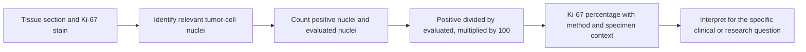

# Ki-67 proliferation index

## In one sentence

Ki-67 is a protein associated with the active cell cycle; its proliferation index is the percentage of evaluated tumor-cell nuclei that stain positive under a specified method.

## The intuition

Think of Ki-67 as a snapshot of cells engaged in the cell cycle. The cell cycle includes preparing to divide, copying genetic material and division itself. A snapshot can describe the fraction of cells carrying a marker at that moment; it cannot tell you how fast the whole tumor will double in size.

It helps to say the denominator aloud: “positive tumor-cell nuclei out of the tumor-cell nuclei evaluated.” That makes the number more concrete than simply calling it a “growth score.”

## How it works

Ki-67 is a nuclear protein associated with active cell-cycle phases. It is generally absent from resting cells in **G0**, the quiescent state outside the active cycle. Because several phases precede visible division, Ki-67 staining is not the same as counting mitotic figures. [The International Ki67 in Breast Cancer Working Group](https://academic.oup.com/jnci/article/113/7/808/6053794) explains this biology and the limits of its clinical use.

The usual tissue test is [immunohistochemistry (IHC)](/wiki/education/concepts/measurement/pathology-readouts/immunohistochemistry), an antibody stain. A pathologist identifies the relevant tumor-cell nuclei, assesses which stain positive, and reports their proportion as a percentage. **MIB-1** is a commonly used antibody for the test, not a separate biological growth process.

The fraction depends on where and how cells are evaluated. A **hotspot** is an area with particularly high staining. A broader scoring method samples regions across the tumor. These methods can give different numbers without an arithmetic mistake. Tissue preservation, staining and scorer calibration also matter.

## Why it matters in cancer

Ki-67 adds information about proliferation-related activity. It can be studied as a prognostic marker or as a change after treatment under a defined protocol. It does not by itself demonstrate that a drug killed cells or improved outcomes.

Clinical interpretation is population-specific. The working group's validated-use discussion concerns selected, anatomically favorable ER-positive, HER2-negative early breast cancers under standardized scoring. **Estrogen receptor (ER)** and **human epidermal growth factor receptor 2 (HER2)** are separate [clinical receptor measurements](/wiki/education/concepts/breast-cancer/receptors-and-subtypes/estrogen-receptor). Those conclusions are not a universal treatment-selection rule for [TNBC](/wiki/education/concepts/breast-cancer/receptors-and-subtypes/tnbc). The [current CAP protocol](https://www.cap.org/wp-content/uploads/2026/09/Breast.Bmk_1.6.2.0.REL_CAPCP.pdf?download=true) treats Ki-67 as an optional reporting element, not a replacement for the core receptor profile.

## Worked example

In a deliberately simplified fictional field, 30 of 100 evaluated tumor-cell nuclei stain positive. The Ki-67 index for that field is 30%. It does not mean that 30% of the cells are visibly dividing right now, that the tumor grows by 30% per day, or that recurrence risk is 30%.

Now imagine the sample also has a quieter region. A hotspot-only count and a broader count could differ. Before interpreting that difference as a biological change, compare the specimen, sampling and scoring method. A real report requires the laboratory's validated approach; this small count is only an arithmetic teaching example.

## Common confusions

- Ki-67 is not tumor stage or the complete [histologic grade](/wiki/education/concepts/breast-cancer/grade-and-stage/histologic-grade).
- A proliferation fraction is not a tumor doubling time or a measured rate of cell killing.
- “High” depends on the method and intended use; there is no single threshold that answers every breast-cancer question.
- [RNA (ribonucleic acid) expression](/wiki/education/concepts/measurement/transcriptomics/bulk-rna-seq) of proliferation genes and a Ki-67 IHC percentage are different measurements.
- A decrease after treatment can be informative in a study without proving long-term clinical benefit.

## How it is measured

Preserve the specimen and time point, antibody and scoring approach, sampled regions, relevant denominator and reported percentage or range. A pre-treatment biopsy and a treated surgical specimen need their own context. Comparing two bare percentages can hide changes in sampling or technique.

## Explain it back

What does 30% mean in the fictional field? Thirty out of the hundred evaluated tumor-cell nuclei stained for Ki-67 under that method. Everything beyond that fraction needs additional evidence.

## Related concepts

- [Histologic grade](/wiki/education/concepts/breast-cancer/grade-and-stage/histologic-grade)
- [Immunohistochemistry](/wiki/education/concepts/measurement/pathology-readouts/immunohistochemistry)
- [Intrinsic subtype](/wiki/education/concepts/breast-cancer/receptors-and-subtypes/intrinsic-subtype)

## Sources and scope

General education; fictional arithmetic example. Source-checked October 9, 2026. Expert and learner review remain pending. This page does not supply a clinical decision threshold.

- [Nielsen et al., International Ki67 Working Group updated recommendations (2021)](https://academic.oup.com/jnci/article/113/7/808/6053794): cell-cycle biology, analytical standardization and limited, population-specific clinical utility; doi: 10.1093/jnci/djaa201.
- [CAP, breast biomarker reporting protocol, version 1.6.2.0 (September 2026)](https://www.cap.org/wp-content/uploads/2026/09/Breast.Bmk_1.6.2.0.REL_CAPCP.pdf?download=true): Ki-67 reporting, antibody methods and optional status.

<!-- BEGIN GENERATED USED IN -->
## Used in

- [Place the specimen in time](/wiki/education/guides/reading-pathology-and-surgery-results/01-place-the-specimen-in-time)
- [Read pathology and surgery results](/wiki/education/guides/reading-pathology-and-surgery-results/index)
<!-- END GENERATED USED IN -->
