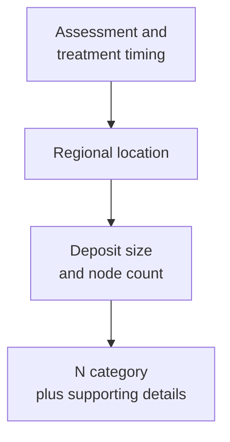
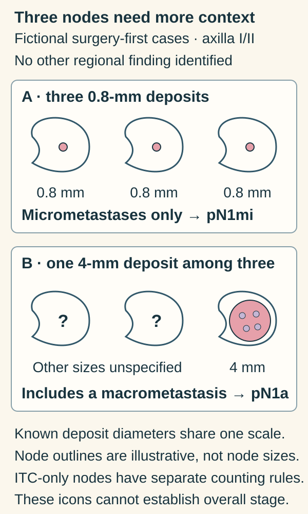

# N categories and nodal burden: location, size, count, and timing

## In one sentence

Breast-cancer N categories describe regional lymph-node involvement using clinical or pathological rules, while nodal burden includes deposit size, node count, location, and how the nodes were assessed.

## The intuition

“Two involved nodes” is like saying “two stops on a route”: useful, but incomplete without knowing where the stops are and what was found there. A small deposit in sampled axillary nodes and involvement of a different regional basin can produce different categories.

The analogy ends at geography. Sampling is incomplete, and clinical assessment and microscopic examination provide different evidence.

## How it works

In [tumor, node, metastasis (TNM) staging](/wiki/education/concepts/breast-cancer/grade-and-stage/tnm-staging), **N** concerns regional lymph nodes. **cN** uses clinical assessment, imaging, and available biopsy information. **pN** uses the applicable pathological assessment. After neoadjuvant therapy, **ypN** describes residual nodal disease; it does not replace pretreatment cN.

The following summaries use [American Joint Committee on Cancer (AJCC) eighth-edition breast rules](/wiki/education/concepts/breast-cancer/grade-and-stage/ajcc-prognostic-staging). “Ipsilateral” means on the same side as the breast cancer. Clinical involvement is an interpreted finding, not every enlarged or vaguely suspicious node.

| Clinical category | Main regional pattern |
|---|---|
| cN0 | No regional metastases identified clinically or by imaging |
| cN1 | Involved movable level I/II axillary nodes |
| cN2a / cN2b | Fixed or matted level I/II axillary nodes / internal mammary involvement without axillary involvement |
| cN3a | Infraclavicular, or level III axillary, involvement |
| cN3b / cN3c | Internal mammary plus axillary involvement / supraclavicular involvement |

cNX means regional nodes cannot be assessed. A needle biopsy can confirm clinical involvement without measuring the entire deposit. The rarely used cN1mi can apply to a pre-resection sentinel-node assessment showing micrometastasis; the context and modifiers matter.

Pathology distinguishes **isolated tumor cells (ITCs)**, generally deposits no larger than 0.2 mm; **micrometastases**, larger than 0.2 mm through 2 mm; and **macrometastases**, larger than 2 mm. CAP also uses a roughly 200-cell guideline in one node profile to resolve dispersed minimal disease. Cells from different section levels are not simply added. These boundaries require pathological judgment.

| Pathological category | Main regional pattern |
|---|---|
| pN0 / pN0(i+) | No regional metastasis / ITCs only |
| pN0(mol+) | Molecular positivity without histologically detected ITCs |
| pN1mi | Micrometastatic disease only |
| pN1a / pN2a | 1–3 / 4–9 involved axillary nodes, with at least one macrometastasis |
| pN3a | At least 10 involved axillary nodes with a macrometastasis, or infraclavicular involvement |
| pN1b / pN1c | Internal mammary sentinel-node disease excluding ITCs / that finding plus pN1a |
| pN2b | Clinically detected internal mammary involvement with pathologically negative axillary nodes |
| pN3b / pN3c | Defined combined axillary/internal mammary patterns / supraclavicular involvement |

If nodes cannot be evaluated pathologically, pN is unassigned rather than assumed negative.

Specifically, pN3b includes pN1a or pN2a with clinically detected internal mammary involvement, or pN2a with internal mammary sentinel-node involvement. If only micrometastases exist, their number alone does not turn pN1mi into pN2a. When a macrometastasis exists, nodes with micrometastases enter the involved-node count; ITC-only nodes do not.

## Why it matters in cancer

[Internal mammary nodes](/wiki/education/concepts/breast-cancer/anatomy-and-histology/internal-mammary-nodes) are regional. Intramammary nodes within the breast are counted with axillary nodes. Regional N3 involvement is not, by itself, distant metastasis.

[Extranodal extension](/wiki/education/concepts/breast-cancer/surgery-and-pathology-results/extranodal-extension) means growth beyond a node's capsule. It is useful additional information, but does not automatically make disease N3 or M1. N alone also does not determine the overall [prognostic stage](/wiki/education/concepts/breast-cancer/grade-and-stage/ajcc-prognostic-staging) or a treatment choice.

## How it is measured

Read the sampled basin, number examined, number involved, deposit dimensions in millimeters, assessment method, and treatment timing together. “Two of five” means two involved among five examined, not 40% of all regional nodes. [Sentinel sampling and axillary dissection](/wiki/education/concepts/breast-cancer/surgery-and-pathology-results/sentinel-node-and-axillary-dissection) have different coverage and limitations.

After therapy, viable residual deposits are assessed separately from surrounding treatment-related fibrosis. Missing nodes or an unsampled basin do not become proven negative findings.

## Common confusions

- **cN3 versus ten nodes:** clinical N3 can be defined by location; ten-node criteria concern pN3a.
- **Tiny deposit versus negative node:** ITCs and micrometastases are recorded differently.
- **Node count versus deposit size:** both matter, with context-dependent counting rules.
- **ypN0 versus originally node-negative:** response does not erase baseline involvement.

## Try it

In two fictional surgery-first cases, three level I/II axillary nodes are involved. All deposits in case A are 0.8 mm; case B has one 4 mm deposit. No other regional involvement is identified. Are the pN categories identical?

**Answer:** No: A has pN1mi, while B has pN1a. Count alone misses the deposit-size distinction. This does not assign either patient's overall stage or treatment.

*Three involved nodes can carry different deposit-size information.*

Try reading the size labels before the node count. The known deposit diameters use one graphical scale; the node outlines do not represent measured node sizes. Case B’s question marks leave the other deposit sizes unspecified, as in the exercise. Both cases assume surgery first, same-side level I/II axillary involvement and no other identified regional finding. Isolated-tumor-cell-only nodes have their own counting rules. Neither the icons nor this comparison survey unsampled nodes or establish an overall stage. [Pathological N definitions](https://www.cancer.gov/types/breast/hp/breast-treatment-pdq).

## Explain it back

What is missing from “three positive nodes”?

One answer: location, deposit size, sampling coverage, assessment method, and timing.

## Takeaway

**Read the N label with the evidence behind it.**

## Related concepts

- [Lymphatic drainage and axilla](/wiki/education/concepts/breast-cancer/anatomy-and-histology/lymphatic-drainage-and-axilla).
- [Extranodal extension](/wiki/education/concepts/breast-cancer/surgery-and-pathology-results/extranodal-extension).

## Sources and scope

Source check: October 10, 2026. Category literacy, not a complete staging algorithm. Examples are fictional; expert and learner review pending.

- [NCI professional PDQ: clinical and pathological N tables](https://www.cancer.gov/types/breast/hp/breast-treatment-pdq) — regional patterns, prefixes, and clinical biopsy context.
- [CAP invasive breast resection protocol 4.11.0.0](https://www.cap.org/wp-content/uploads/2026/06/Breast.Invasive.Res_4.11.0.0.REL_CAPCP.pdf?download=true) — category definitions, minimal-deposit counting guidance, and post-treatment measurement notes.
- [AJCC current staging-system table, 2026](https://www.facs.org/media/c5ik5tkr/ajcc-current-staging-system-2026.pdf) — edition context.

<!-- BEGIN GENERATED USED IN -->
## Used in

- [Place the specimen in time](/wiki/education/guides/reading-pathology-and-surgery-results/01-place-the-specimen-in-time)
- [Read pathology and surgery results](/wiki/education/guides/reading-pathology-and-surgery-results/index)
<!-- END GENERATED USED IN -->
