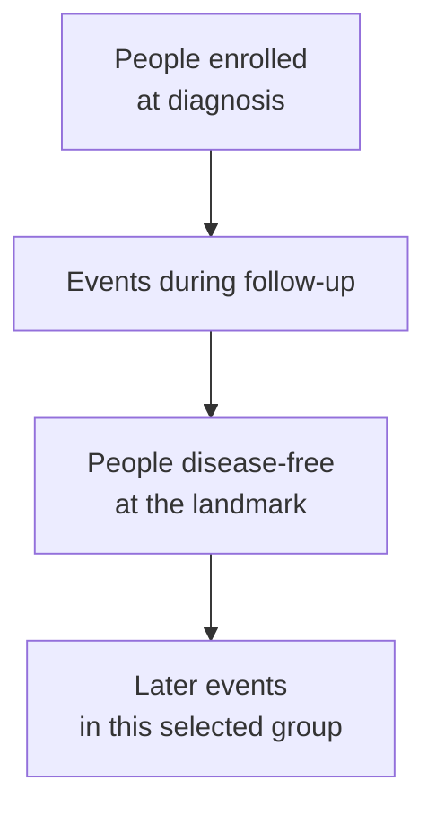

# TNBC recurrence: timing and sites

## In one sentence

Recurrence patterns describe when and where triple-negative breast cancer returns in a defined group after treatment.

## The intuition

Picture a map with a clock attached. The map tells you where events were found; the clock tells you when they became detectable. Neither tells you what will happen to one person. First ask who was included and how they were treated.

[Triple-negative breast cancer (TNBC)](/wiki/education/concepts/breast-cancer/receptors-and-subtypes/tnbc) is a receptor-defined category. Published groups differ in stage, treatment and response.

## How it works

**A recurrence is cancer returning after treatment.** Cells that persisted can later grow enough to become detectable. Local recurrence involves the original breast area or chest wall; regional recurrence involves nearby lymph nodes; distant recurrence involves other organs. A separate new breast cancer is a second primary, which needs to be distinguished from recurrence. [1]

**Timing describes a group, with a specified starting point.** In Dent's historical Toronto cohort, 180 of 1,601 patients diagnosed in 1987–1997 had TNBC. Distant-recurrence risk in that subgroup peaked at approximately three years from diagnosis and then declined. This historical pattern supplies neither a modern treatment-specific percentage nor a deadline for possible recurrence. [2]

**The group can change as time passes.** Reddy's study selected 873 stage I–III patients who had already remained disease-free for five years from diagnosis. Its later-event estimates answer a question about those survivors, rather than everyone at diagnosis. Historical receptor criteria also included some low hormone-receptor positivity. “What happens from diagnosis?” and “What happens after five disease-free years?” have different starting populations. [4]

*Reaching a disease-free landmark changes who is included in the later estimate. It does not erase the need to specify the endpoint and treatment context.*

**Sites describe another part of the pattern.** Breast cancer can recur in bone, lung, liver or brain, among other locations. These are possible sites, not a prediction that each person will develop metastases. [1] In Kennecke's early-stage cohort diagnosed in 1986–1992, basal-like and triple-negative nonbasal groups had distinctive distant-site patterns, including more brain and lung involvement than the luminal A comparison group. Those historical subtype categories and relative patterns do not establish a universal site ranking or today's absolute risks. [3]

## Why it matters in cancer

- Timing helps readers interpret a study's follow-up and [survival endpoint](/wiki/education/concepts/evidence-and-statistics/endpoints/survival-endpoints). Diagnosis, randomization and surgery are different clocks.
- Stage, treatment, response and the survival landmark affect whether a published group resembles the group you are asking about.
- A site's share among recurrences answers “where did the recorded events occur?” To estimate risk among patients, you need that patient denominator and the time/event definition. See the [denominator exercise](/wiki/education/concepts/evidence-and-statistics/endpoints/survival-endpoints).

## Common confusions

- **An early peak is not an individual forecast.** A peak identifies when a group's event rate was highest, without supplying one person's next-year probability. [2]
- **Later risk is not zero risk.** A disease-free survivor study estimates subsequent events among its selected participants; it cannot guarantee an individual's future. [4]
- **A prominent site does not establish a screening schedule.** Describing brain involvement is different from showing that routine brain imaging improves outcomes. NCI's treatment review describes older randomized follow-up trials in which intensive testing of asymptomatic survivors did not improve survival or quality of life. Those findings should not be presented as a test of every newer blood assay or imaging strategy. [5]
- **Detection and benefit are different outcomes.** Finding an event earlier does not by itself establish that the earlier detection changes survival. [5]

## How it is measured

Studies record confirmed recurrence location/date, a starting date, deaths and loss to follow-up. Ask whether they count first or later sites; one person can have several. The [endpoint definition](/wiki/education/concepts/evidence-and-statistics/endpoints/survival-endpoints) distinguishes raw fractions from estimates accounting for follow-up and competing events. [3, 4]

## Try it

A fictional reader finds a study that enrolled only people disease-free five years after diagnosis. Can its later-event estimate be used directly for a newly diagnosed person?

**Answer:** No. The study has already selected people who reached that landmark without disease. Start by finding evidence with the relevant population, treatment and clock; keep any remaining mismatch visible.

**Explain it back:** “A recurrence pattern describes ___ in ___, starting from ___; it does not by itself give ___.” One answer: “events / a defined group / a specified date or landmark / an individual's prognosis or a proven screening plan.”

## Related concepts

- [TNBC](/wiki/education/concepts/breast-cancer/receptors-and-subtypes/tnbc)
- [Residual cancer burden](/wiki/education/concepts/breast-cancer/surgery-and-pathology-results/residual-cancer-burden)
- [Survival endpoints](/wiki/education/concepts/evidence-and-statistics/endpoints/survival-endpoints)
- [Check applicability and uncertainty](/wiki/education/guides/reading-cancer-evidence/03-check-applicability-and-uncertainty)

## Sources

Source check: October 9, 2026. Historical observational patterns teach how to read timing and location; they are not a calibrated prognosis for a current individual. Expert and learner review remain pending.

1. [NCI: breast cancer recurrence](https://www.cancer.gov/types/breast/breast-cancer-survivorship/recurrence), patient definitions and possible sites.
2. [Dent et al., 2007 (PMID 17671126)](https://pubmed.ncbi.nlm.nih.gov/17671126/), historical TNBC timing cohort; diagnosis years and population above.
3. [Kennecke et al., 2010 (PMID 20498394)](https://pubmed.ncbi.nlm.nih.gov/20498394/), historical early-stage subtype/site study; basal-like and triple-negative nonbasal are distinct study groups.
4. [Reddy et al., 2018](https://www.nature.com/articles/bjc2017379.pdf), selected five-year disease-free survivors, with historical receptor definitions.
5. [NCI treatment review: posttherapy surveillance](https://www.cancer.gov/types/breast/hp/breast-treatment-pdq), scope and evidence limits of routine follow-up testing.

<!-- BEGIN GENERATED USED IN -->
## Used in

Browse the [concept index](/wiki/education/concepts/index) for related learning paths.
<!-- END GENERATED USED IN -->
