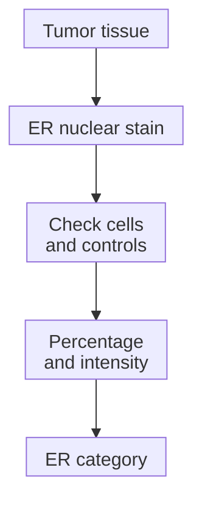

# Estrogen receptor (ER)

## In one sentence

The estrogen receptor (ER) is a protein inside cells that responds to estrogen; in breast cancer, ER status describes tumor-cell receptor staining under validated testing rules.

## The intuition

Think of estrogen as a message and its receptor as part of the cell's message-reading machinery. Finding that machinery tells us something useful about the cell. It does not prove that every cell is using it equally or that blocking it will produce a particular result.

An ER tissue test asks whether tumor cells contain detectable receptor protein. It does not measure estrogen circulating in the blood. Keeping those two questions separate makes the report much easier to read.

## How it works

Estrogen can bind ER inside a cell, and the receptor can influence which genes the cell uses, including growth-related programs. This differs from the cell-surface location of [HER2](/wiki/education/concepts/breast-cancer/receptors-and-subtypes/her2).

Clinical testing uses [immunohistochemistry (IHC)](/wiki/education/concepts/measurement/pathology-readouts/immunohistochemistry), an antibody stain in a tissue section. The pathologist identifies the tumor cells and assesses their **nuclei**, the compartments containing genetic material. The percentage of positive nuclei and the staining intensity are separate observations.

For invasive breast cancer, American Society of Clinical Oncology and College of American Pathologists (ASCO/CAP) recommendations classify **at least 1%** positive tumor-cell nuclei as ER positive and **less than 1%** as negative. The **1–10%** range has the specific reporting category **ER-low positive**. These percentages count stained cells; they are not percentages of estrogen or expected treatment benefit.

This is a measurement map. A stain samples receptor presence; it does not directly measure every downstream signal or predict a person's treatment outcome.

## Why it matters in cancer

ER helps identify cancers for which **endocrine therapy**, treatment that interferes with hormone production or action, may be relevant. It differs from menopausal hormone replacement.

ER-low cancers need particularly careful explanation. The guideline describes limited evidence about endocrine benefit, with possible benefit supporting treatment consideration. They remain ER positive even when other features resemble ER-negative cancers. A category supports a clinical discussion; it is not a guarantee of response.

## How it is measured

| Observation | What to keep beside the result |
| --- | --- |
| Measures and method | Receptor protein in identified tumor-cell nuclei, assessed by validated IHC |
| Input and tissue use | A tissue section from a named specimen/block; staining uses section material |
| Output and units | Percent positive tumor-cell nuclei, intensity and final interpretation |
| Rules and controls | Less than 1% negative; 1–10% ER-low positive; appropriate assay controls and low-result review |
| Failure and limits | Poor preservation, artifacts or inadequate controls can prevent interpretation; RNA, blood hormone levels and personal benefit are not measured |
| Validation context | Invasive breast-cancer receptor testing; an in situ component has its own testing context |

An uninterpretable test is not a negative test. A [bulk ribonucleic acid (RNA) result](/wiki/education/concepts/measurement/transcriptomics/bulk-rna-seq) does not substitute for validated clinical ER IHC.

## Worked example

A fictional report describes 4% ER-positive tumor-cell nuclei with adequate controls. That is ER-low positive. A [basal-like expression label](/wiki/education/concepts/breast-cancer/receptors-and-subtypes/intrinsic-subtype) would describe a different measurement and would not turn the tissue result into ER negative.

## Try it

Does “ER 4%” mean a 4% chance of benefit? Would failed controls justify calling an unstained sample negative?

**Answer:** Neither follows. Four percent counts positive tumor-cell nuclei. Benefit requires clinical evidence, and failed controls can make a test uninterpretable.

## Common confusions

- Estrogen is the hormone; ER is its receptor protein.
- ER-low positive is not ER negative or [TNBC](/wiki/education/concepts/breast-cancer/receptors-and-subtypes/tnbc).
- [Progesterone receptor (PR)](/wiki/education/concepts/breast-cancer/receptors-and-subtypes/progesterone-receptor) has a separate result.
- Stain intensity and percent positive nuclei are different features.

## Explain it back

Explain why a positive category, a staining percentage and expected treatment benefit are three different descriptions.

## Takeaway

Read ER as a controlled tissue measurement with a defined denominator, then keep the treatment question separate.

## Related concepts

- [Progesterone receptor](/wiki/education/concepts/breast-cancer/receptors-and-subtypes/progesterone-receptor)
- [Intrinsic subtype](/wiki/education/concepts/breast-cancer/receptors-and-subtypes/intrinsic-subtype)
- [Immunohistochemistry](/wiki/education/concepts/measurement/pathology-readouts/immunohistochemistry)

## Sources and scope

General education about invasive breast cancer; fictional example. Source-checked October 10, 2026. Expert and learner review remain pending.

- [ASCO/CAP, ER and PR testing recommendations (2020)](https://www.cap.org/wp-content/uploads/documents/erpgr_summaryrecommendations.pdf): nuclear-staining thresholds, ER-low reporting and assay limitations.
- [CAP, active ER/PR guideline and explanatory questions](https://www.cap.org/cap-guidelines/estrogen-and-progesterone-receptor-testing-in-breast-cancer-guideline-update/): low-result interpretation and clinical purpose.
- [NCI, hormone therapy for breast cancer](https://www.cancer.gov/types/breast/treatment/hormone-therapy): receptor biology and endocrine-treatment mechanisms.

<!-- BEGIN GENERATED USED IN -->
## Used in

- [Read each label as an answer to a question](/wiki/education/guides/start-here/01-read-the-labels)
- [Ask whether protein is present, placed and active](/wiki/education/molecular-profiling/03-protein-expression-and-activation)
<!-- END GENERATED USED IN -->
