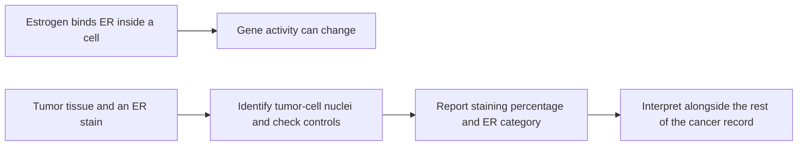

# Estrogen receptor (ER)

## In one sentence

The estrogen receptor (ER) is a protein inside cells that responds to estrogen; in breast cancer, ER status describes tumor-cell receptor staining under validated testing rules.

## The intuition

Think of estrogen as a message and its receptor as part of the cell's message-reading machinery. A cell with the receptor can respond to the hormone. The analogy has a limit: finding the machinery does not prove that every cell is using it equally or that blocking it will produce a particular result.

An ER tissue test asks whether the cancer cells contain detectable receptor protein. It does not measure how much estrogen is circulating in someone's blood.

## How it works

Estrogen can enter a cell and bind its receptor. The receptor can then affect which genes the cell uses, including programs involved in growth. This is an intracellular signaling route, unlike the surface location of [HER2](/wiki/education/concepts/breast-cancer/receptors-and-subtypes/her2). [NCI's hormone-therapy explanation](https://www.cancer.gov/types/breast/treatment/hormone-therapy) connects this mechanism to treatments that reduce estrogen production or block its effects.

The clinical measurement uses [immunohistochemistry (IHC)](/wiki/education/concepts/measurement/pathology-readouts/immunohistochemistry): an antibody stain in a tissue section. A pathologist identifies the relevant tumor cells and assesses their **nuclei**, the compartments containing genetic material. The percentage of nuclei staining positive and the stain's intensity are different observations.

For invasive breast cancer, the American Society of Clinical Oncology and College of American Pathologists (ASCO/CAP) classify **at least 1%** positive tumor-cell nuclei as ER positive and **less than 1%** as negative. The **1–10%** range has the specific reporting category **ER-low positive**. These are percentages of stained cells, not percentages of estrogen or of expected treatment benefit. [The guideline summary](https://www.cap.org/wp-content/uploads/documents/erpgr_summaryrecommendations.pdf) supplies these thresholds.

The two rows show biology and measurement. A staining result samples the receptor; it does not directly measure every downstream signal.

## Why it matters in cancer

ER testing helps identify cancers for which endocrine therapy may be relevant. **Endocrine therapy** here means cancer treatment that interferes with hormone production or action. It differs from menopausal hormone replacement.

ER-low cancers need particular care in explanation: evidence about endocrine benefit is limited, though possible benefit supports considering endocrine treatment. They remain ER positive under the testing guideline even when other biological features resemble ER-negative cancers. A category supports a treatment discussion; it is not a guarantee of response.

## Worked example

A fictional report describes 4% ER-positive tumor-cell nuclei with adequate testing controls. That is ER-low positive. It does not mean a 4% chance of benefit, and a [basal-like expression label](/wiki/education/concepts/breast-cancer/receptors-and-subtypes/intrinsic-subtype) would not change the tissue result to ER negative. Keep the test result and the expression label side by side.

## Common confusions

- ER is a receptor protein; estrogen is the hormone that can bind it.
- ER-low positive is not the same classification as ER negative or [TNBC](/wiki/education/concepts/breast-cancer/receptors-and-subtypes/tnbc).
- [Progesterone receptor (PR)](/wiki/education/concepts/breast-cancer/receptors-and-subtypes/progesterone-receptor) is a separate receptor with a separate result.
- Positive staining does not establish the contribution of that pathway to every tumor cell's growth.

## How it is measured

Read the specimen identity, tumor population, percentage, intensity, interpretation and control comments together. Tissue handling and assay performance matter, especially near a threshold. An uninterpretable or technically inadequate test is not a negative test. A [bulk RNA (ribonucleic acid) measurement](/wiki/education/concepts/measurement/transcriptomics/bulk-rna-seq) of receptor expression is another measurement and does not substitute for validated clinical ER IHC.

## Explain it back

Why can a 4% ER result be called positive without predicting a 4% treatment benefit? Because the number counts stained tumor-cell nuclei; treatment benefit is a different clinical question.

## Related concepts

- [Progesterone receptor](/wiki/education/concepts/breast-cancer/receptors-and-subtypes/progesterone-receptor)
- [Intrinsic subtype](/wiki/education/concepts/breast-cancer/receptors-and-subtypes/intrinsic-subtype)
- [Immunohistochemistry](/wiki/education/concepts/measurement/pathology-readouts/immunohistochemistry)

## Sources and scope

General education about invasive breast cancer; fictional example. Source-checked October 9, 2026. Expert and learner review remain pending.

- [ASCO/CAP, ER and PR testing guideline update (2020), summary of recommendations](https://www.cap.org/wp-content/uploads/documents/erpgr_summaryrecommendations.pdf): nuclear-staining thresholds, ER-low reporting and assay limitations.
- [CAP, active ER/PR testing guideline and explanatory questions](https://www.cap.org/cap-guidelines/estrogen-and-progesterone-receptor-testing-in-breast-cancer-guideline-update/): clinical purpose and low-result interpretation.
- [NCI, hormone therapy for breast cancer](https://www.cancer.gov/types/breast/treatment/hormone-therapy): receptor biology and endocrine-treatment mechanisms.

<!-- BEGIN GENERATED USED IN -->
## Used in

- [Read each label as an answer to a question](/wiki/education/guides/start-here/01-read-the-labels)
<!-- END GENERATED USED IN -->
