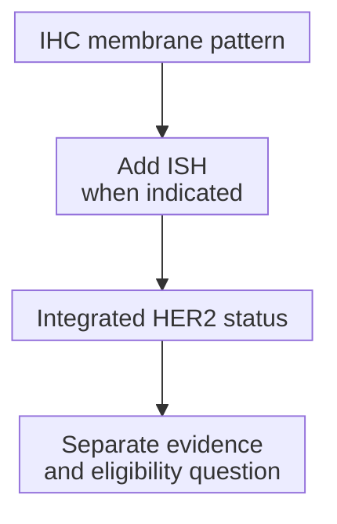

# HER2: receptor biology and test status

## In one sentence

Human epidermal growth factor receptor 2 (HER2) is a cell-surface signaling protein; clinical HER2 status describes overexpression or gene amplification under breast-cancer testing rules.

## The intuition

Picture the cell surface as a place where messages reach internal growth machinery. HER2 is part of that signaling system. Some cancers have increased copies of its gene and abundant receptor protein, making this pathway important to their growth.

The analogy cannot tell us how much a particular cancer depends on that pathway. It also leaves two questions open: “How is the cancer classified?” and “Does a particular treatment have evidence and eligibility in this setting?”

## How it works

**ERBB2** is the gene encoding HER2. **Amplification** means increased gene copies; **overexpression** means increased protein abundance. Gene copies, [ribonucleic acid (RNA) abundance](/wiki/education/concepts/measurement/transcriptomics/bulk-rna-seq) and receptor protein are different measurements.

[Immunohistochemistry (IHC)](/wiki/education/concepts/measurement/pathology-readouts/immunohistochemistry) assesses protein staining at invasive tumor-cell membranes. **In situ hybridization (ISH)** uses nucleic-acid probes in tissue to assess gene copies. Clinical interpretation integrates the applicable testing rules; an equivocal IHC result needs further workup, usually ISH.

This simplified map uses the September 2026 College of American Pathologists (CAP) reporting template. Uncommon patterns, artifacts and heterogeneous areas need the full rules.

| IHC score | Basic overexpression interpretation |
| --- | --- |
| 0 | Negative; absent membrane staining |
| 0+ | Negative; faint, incomplete membrane staining in at most 10% of tumor cells |
| 1+ | Negative; faint, incomplete membrane staining in more than 10% |
| 2+ | Equivocal; commonly weak to moderate complete membrane staining in more than 10%; requires workup |
| 3+ | Positive; intense, complete membrane staining in more than 10% of a homogeneous, contiguous invasive tumor-cell population |

**HER2-low** describes IHC 1+ or IHC 2+/ISH-negative staining. **HER2-ultralow** describes the limited faint membrane-staining pattern historically within IHC 0. The 2026 template separates that pattern as **0+** from absent staining as **0**. Both remain negative for overexpression/amplification. Intense complete staining limited to at most 10%, and some incomplete patterns, also fall into the equivocal workup group.

This is a report-reading route. The last arrow does not promise a treatment benefit.

## Why it matters in cancer

HER2 can be a growth-related receptor and an address for an [antibody–drug conjugate](/wiki/education/concepts/therapeutics/antibody-based/antibody-drug-conjugate) payload. Those are different biological jobs. Some HER2-negative cancers have treatment options in defined settings, but the exact score, disease context and treatment-specific evidence matter. A test label alone cannot establish eligibility.

## How it is measured

| Observation | What to retain |
| --- | --- |
| Measures and method | IHC membrane protein pattern; ISH gene signals in evaluated invasive tumor cells |
| Input and tissue use | Named specimen/block and tissue sections used for each assay |
| Output and units | IHC category; mean HER2 and CEP17 signals/cell, their ratio and cells counted for dual-probe ISH |
| Rules and quality | Integrated guideline interpretation, controls, preservation, artifacts and distinct populations |
| Cannot infer | Protein activity, an IHC score from [bulk RNA](/wiki/education/concepts/measurement/transcriptomics/bulk-rna-seq), or benefit from a specific medicine |
| Validation context | Clinical breast-cancer tissue testing; assay and population matter |

**CEP17** is a probe for a centromeric region of chromosome 17. A HER2/CEP17 ratio compares signals; it is different from the average HER2 signals per cell. Some uncommon ISH groups require concurrent IHC review and recounting. A ratio alone cannot supply the final category.

## Try it

A fictional, adequately assessed report has IHC 2+, a HER2/CEP17 ratio of 1.8, mean HER2 signals of 3.5 per invasive tumor cell, and a final ISH-negative interpretation, with no omitted distinct population. What do those numbers mean?

**Answer:** 1.8 is a dimensionless ratio; 3.5 is an average number of signals per cell, not a percentage. The completed result is HER2 negative and within the HER2-low staining range. It does not establish drug eligibility or benefit. This is a simple teaching report, not a complete classification algorithm.

## Common confusions

- IHC 2+ is equivocal, not “half positive.”
- IHC 0 does not prove every cell has zero HER2 molecules.
- An ERBB2 mutation or RNA signal does not replace clinical IHC/ISH.
- [HER2-enriched intrinsic subtype](/wiki/education/concepts/breast-cancer/receptors-and-subtypes/intrinsic-subtype) is an RNA label; HER2-low can coexist with [TNBC](/wiki/education/concepts/breast-cancer/receptors-and-subtypes/tnbc).

## Explain it back

Explain how “HER2 negative” and “HER2-low” can describe the same completed report.

## Takeaway

Keep protein pattern, gene-signal units, integrated status and treatment eligibility as distinct questions.

## Related concepts

- [Immunohistochemistry](/wiki/education/concepts/measurement/pathology-readouts/immunohistochemistry)
- [Intrinsic subtype](/wiki/education/concepts/breast-cancer/receptors-and-subtypes/intrinsic-subtype)

## Sources and scope

General education; fictional example. Source-checked October 10, 2026. Expert and learner review remain pending.

- [CAP, breast biomarker template v1.6.2.0 (September 2026)](https://www.cap.org/wp-content/uploads/2026/09/Breast.Bmk_1.6.2.0.REL_CAPCP.pdf?download=true): 0/0+, other IHC patterns and ISH units.
- [ASCO/CAP, HER2 recommendations (2023)](https://www.cap.org/wp-content/uploads/documents/her2_breast_update_sor_2023.pdf?download=true): integrated interpretation and uncommon ISH groups.
- [NCI, breast-cancer biomarker tests](https://www.cancer.gov/types/breast/diagnosis/breast-cancer-biomarker-tests): HER2 biology and tissue testing.

<!-- BEGIN GENERATED USED IN -->
## Used in

- [Read each label as an answer to a question](/wiki/education/guides/start-here/01-read-the-labels)
- [Ask whether protein is present, placed and active](/wiki/education/molecular-profiling/03-protein-expression-and-activation)
<!-- END GENERATED USED IN -->
