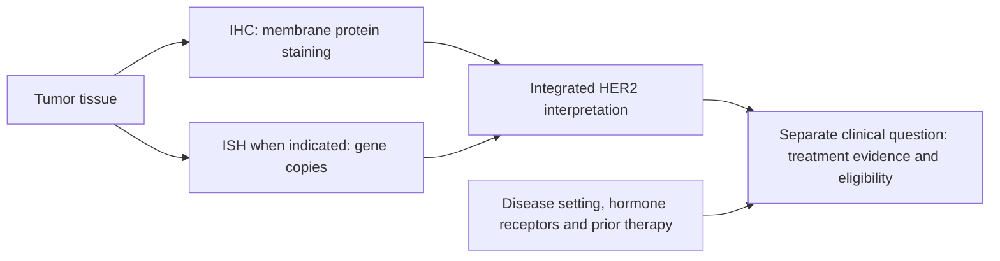

# HER2: receptor biology and test status

## In one sentence

Human epidermal growth factor receptor 2 (HER2) is a cell-surface signaling protein; clinical HER2 status describes overexpression or gene amplification under breast-cancer testing rules.

## The intuition

Picture a cell's surface as a place where messages reach its internal growth machinery. HER2 is part of that signaling system. Some cancers have many more copies of the HER2 gene and abundant receptor protein. This can make the pathway important to their growth.

Two questions follow: “How is the cancer classified?” and “Does this particular treatment have evidence and eligibility for this setting?” They are related, but a test category cannot answer the second question by itself.

## How it works

The gene called **ERBB2** encodes HER2. **Amplification** means increased gene copies; **overexpression** means increased protein abundance. [NCI's biomarker overview](https://www.cancer.gov/types/breast/diagnosis/breast-cancer-biomarker-tests) explains the growth-related role of excess HER2. Gene copies, RNA (ribonucleic acid) abundance and receptor protein are different measurements.

**Immunohistochemistry (IHC)** is [protein staining in tissue](/wiki/education/concepts/measurement/pathology-readouts/immunohistochemistry). For HER2, the pattern is assessed at tumor-cell membranes. **In situ hybridization (ISH)** uses nucleic-acid probes in tissue to assess gene copies. The clinical interpretation follows integrated testing rules, including confirmatory work for equivocal IHC patterns. It is not assigned from one isolated copy-number cutoff.

The simplified IHC map below follows [ASCO/CAP guidance](https://www.cap.org/cap-guidelines/her2-testing-in-breast-cancer-2023-guideline-update/) and the [current CAP biomarker protocol](https://www.cap.org/wp-content/uploads/2026/09/Breast.Bmk_1.6.2.0.REL_CAPCP.pdf?download=true). Unusual patterns and heterogeneous areas need the full rules.

| IHC score | Basic interpretation for overexpression |
| --- | --- |
| 0 | Negative; no membrane staining detected |
| 0+ | Negative; faint, incomplete membrane staining in at most 10% of tumor cells |
| 1+ | Negative; faint, incomplete membrane staining in more than 10% |
| 2+ | Equivocal; commonly weak to moderate complete membrane staining in more than 10%; requires further assessment, usually ISH |
| 3+ | Positive; intense, complete membrane staining in more than 10% |

**HER2-low** generally describes IHC 1+ or IHC 2+/ISH-negative cancers. **HER2-ultralow** describes faint, limited membrane staining, historically included within IHC 0. CAP's 2026 reporting template separates absent staining as **0** from that limited-staining pattern as **0+**. Neither low nor ultralow means HER2-positive overexpression/amplification.

## Why it matters in cancer

HER2 testing informs treatment pathways. A receptor can also serve as an address for an [antibody–drug conjugate](https://www.cancer.gov/publications/dictionaries/cancer-terms/def/antibody-drug-conjugate), which delivers a payload. Receptor overexpression driving growth and receptor availability for payload delivery are different biological questions. Accordingly, some HER2-negative cancers can be considered for particular HER2-directed treatments in defined settings. Retain the exact result and check the treatment-specific evidence; “negative” alone is too coarse for every question.

## Worked example

A fictional tumor is IHC 2+ and ISH negative. Its completed classification is HER2 negative, with a HER2-low expression category. The initial 2+ result was equivocal, not “half positive.” Neither result alone establishes eligibility or predicts benefit from a medicine.

## Common confusions

- IHC 0 is an assay category, not proof that every cell contains zero HER2 molecules.
- An ERBB2 RNA signal or a gene mutation does not substitute for the clinical IHC/ISH interpretation.
- [HER2-enriched intrinsic subtype](/wiki/education/concepts/breast-cancer/receptors-and-subtypes/intrinsic-subtype) is an RNA classification, not a synonym for HER2-positive pathology.
- HER2-low can coexist with [TNBC](/wiki/education/concepts/breast-cancer/receptors-and-subtypes/tnbc).

## How it is measured

Keep the specimen, assay, IHC score and pattern, ISH findings when performed, final interpretation and relevant comments together. Small differences at low staining levels, tissue handling and heterogeneity can affect classification. Do not infer an IHC score from [bulk RNA](/wiki/education/concepts/measurement/transcriptomics/bulk-rna-seq) or bulk protein abundance.

## Explain it back

How can a tumor be both HER2 negative and HER2 low? “Negative” refers to the overexpression/amplification classification; “low” describes a staining range within that negative group.

## Related concepts

- [Immunohistochemistry](/wiki/education/concepts/measurement/pathology-readouts/immunohistochemistry)
- [Intrinsic subtype](/wiki/education/concepts/breast-cancer/receptors-and-subtypes/intrinsic-subtype)
- [Estrogen receptor](/wiki/education/concepts/breast-cancer/receptors-and-subtypes/estrogen-receptor)

## Sources and scope

General education about invasive breast cancer; fictional example. Source-checked October 9, 2026. Expert and learner review remain pending. Treatment indications need their own current clinical assessment.

- [ASCO/CAP, HER2 testing guideline update (2023)](https://www.cap.org/cap-guidelines/her2-testing-in-breast-cancer-2023-guideline-update/): integrated interpretation and limitations of low-level scoring.
- [CAP, breast biomarker reporting protocol, version 1.6.2.0 (September 2026)](https://www.cap.org/wp-content/uploads/2026/09/Breast.Bmk_1.6.2.0.REL_CAPCP.pdf?download=true): IHC categories, low/ultralow descriptions and 0/0+ reporting.
- [NCI, breast-cancer biomarker tests](https://www.cancer.gov/types/breast/diagnosis/breast-cancer-biomarker-tests): HER2 biology and the role of tissue testing.

<!-- BEGIN GENERATED USED IN -->
## Used in

- [Read each label as an answer to a question](/wiki/education/guides/start-here/01-read-the-labels)
<!-- END GENERATED USED IN -->
