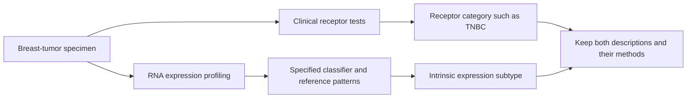

# Intrinsic breast-cancer subtype

## In one sentence

An intrinsic breast-cancer subtype is a category assigned by comparing a tumor sample's gene-expression pattern with reference patterns.

## The intuition

One description of a song names its instruments; another describes its musical style. Both can be informative, but they answer different questions. Clinical receptor tests describe selected proteins and gene amplification. An intrinsic subtype summarizes a broader pattern of gene activity in the sample.

The analogy stops there: a tumor is a changing mixture of cells, and a classifier's label depends on its measurements and rules. “Intrinsic” in this name does not mean inherited from a parent or impossible to change.

## How it works

**Gene expression** is the production of RNA (ribonucleic acid) from genes. Expression profiling asks which transcripts are relatively abundant. The original intrinsic-subtype research identified recurring breast-tumor patterns, rather than defining groups solely by [estrogen receptor (ER)](/wiki/education/concepts/breast-cancer/receptors-and-subtypes/estrogen-receptor), [progesterone receptor (PR)](/wiki/education/concepts/breast-cancer/receptors-and-subtypes/progesterone-receptor) and [human epidermal growth factor receptor 2 (HER2)](/wiki/education/concepts/breast-cancer/receptors-and-subtypes/her2) test results. [Perou and colleagues' original study](https://www.nature.com/articles/35021093) established this expression-based approach.

**PAM50** is a classifier built around a 50-gene expression panel. It compares a sample's pattern with reference patterns; one high gene does not determine the label. In the classic research framework, the groups include the following. These are relative expression patterns, not treatment guarantees.

| Expression label | The pattern it summarizes |
| --- | --- |
| Luminal A | Luminal and hormone-related expression, usually with less proliferation-related expression than luminal B |
| Luminal B | Luminal expression with more proliferation-related expression than luminal A |
| HER2-enriched | A reference pattern involving HER2-related and other growth-related expression |
| Basal-like | Expression resembling aspects of basal breast epithelial programs |
| Normal-like | Similarity to a normal-breast reference pattern; sample composition is an important concern |

[The PAM50 development study](https://pmc.ncbi.nlm.nih.gov/articles/PMC2667820/) and [a direct clinical-marker comparison](https://pubmed.ncbi.nlm.nih.gov/23035882/) support this distinction between expression classes and receptor categories.

Clinical assays and research implementations differ in preprocessing, permitted outputs and intended use. A particular assay need not report every research category; check its permitted outputs and intended use. A subtype label is also different from a **risk-of-recurrence score**, which may combine expression features and clinical inputs under a separate validated model.

## Why it matters in cancer

Intrinsic subtypes help researchers organize biologically different tumors that share a clinical receptor category. They can support defined prognostic applications when the assay, population and intended use have been validated. A research label alone does not establish treatment eligibility or benefit.

The names can mislead. HER2-enriched does not automatically mean HER2-positive pathology; basal-like does not automatically mean [TNBC](/wiki/education/concepts/breast-cancer/receptors-and-subtypes/tnbc). “Luminal” describes an expression program rather than proving a tumor's exact cell of origin. A normal-like label does not mean the tissue is benign: normal cells in a bulk specimen can influence the measured pattern, a concern raised by the PAM50 investigators.

## Worked example

A fictional tumor is ER negative, PR negative and HER2 negative on validated tissue tests. A separate, quality-controlled RNA analysis classifies it as HER2-enriched. These results can coexist. The RNA label does not create HER2 amplification or replace the tissue tests. The next interpretation depends on the classifier, specimen composition and clinical question.

## Common confusions

- A receptor-based “luminal-like” surrogate is not the same measurement as a PAM50 intrinsic subtype.
- “Molecular subtype” is a broad phrase; it can describe other frameworks besides intrinsic subtyping.
- A subtype is a pattern across genes, not necessarily a single actionable mutation or pathway dependency.
- Basal-like does not prove that the cancer began in a mature basal cell.

## How it is measured

Record the tissue sample, tumor content, platform, classifier version, preprocessing and allowed output labels. [Bulk RNA measurements](/wiki/education/concepts/measurement/transcriptomics/bulk-rna-seq) mix transcripts from malignant cells and their neighbors. A label from one platform should not be treated as interchangeable with every expression label produced elsewhere.

## Explain it back

Why should a receptor category and an intrinsic subtype stay as two descriptions? They measure different features with different methods, and their overlap is substantial but incomplete.

## Related concepts

- [TNBC](/wiki/education/concepts/breast-cancer/receptors-and-subtypes/tnbc)
- [HER2](/wiki/education/concepts/breast-cancer/receptors-and-subtypes/her2)
- [Bulk RNA sequencing](/wiki/education/concepts/measurement/transcriptomics/bulk-rna-seq)

## Sources and scope

General education; fictional example. Source-checked October 9, 2026. Expert and learner review remain pending. The subtype list describes the classic research framework, not every clinical assay's output or indication.

- [Perou et al., Molecular portraits of human breast tumours (2000)](https://www.nature.com/articles/35021093): original expression-based subtype framework.
- [Parker et al., Supervised risk predictor of breast cancer based on intrinsic subtypes (2009)](https://pmc.ncbi.nlm.nih.gov/articles/PMC2667820/): PAM50 development, subtype versus risk models and normal-like sample-composition concerns.
- [Bastien et al., PAM50 subtyping and concordance with standard clinical molecular markers (2012)](https://pubmed.ncbi.nlm.nih.gov/23035882/): luminal proliferation patterns and incomplete correspondence with receptor results.

<!-- BEGIN GENERATED USED IN -->
## Used in

- [Read each label as an answer to a question](/wiki/education/guides/start-here/01-read-the-labels)
- [Use RNA to test the message and its source](/wiki/education/molecular-profiling/02-rna-the-activity-layer)
- [Separate cell identity from cell state](/wiki/education/multi-omics-foundations/02-cell-identity-and-state)
<!-- END GENERATED USED IN -->
