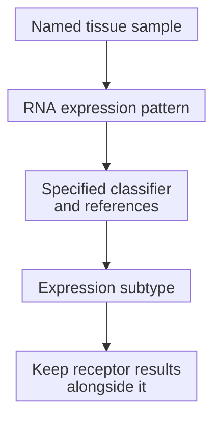

# Intrinsic breast-cancer subtype

## In one sentence

An intrinsic breast-cancer subtype is a category assigned by comparing a tumor sample's gene-expression pattern with reference patterns.

## The intuition

One description of a song names its instruments; another describes its musical style. Clinical receptor tests describe selected proteins and gene amplification. An intrinsic subtype summarizes a broader pattern of gene activity in the sample. Both descriptions can be informative without being interchangeable.

The analogy stops there: a tumor is a changing mixture of cells, and a classifier's label depends on its measurements and rules. “Intrinsic” does not mean inherited from a parent or impossible to change.

## How it works

**Gene expression** includes the production of [ribonucleic acid (RNA)](/wiki/education/concepts/measurement/transcriptomics/bulk-rna-seq) from genes. Expression profiling measures transcripts and compares their pattern with reference patterns. The original intrinsic-subtype research identified recurring breast-tumor expression patterns, rather than defining groups solely by [estrogen receptor (ER)](/wiki/education/concepts/breast-cancer/receptors-and-subtypes/estrogen-receptor), [progesterone receptor (PR)](/wiki/education/concepts/breast-cancer/receptors-and-subtypes/progesterone-receptor) and [human epidermal growth factor receptor 2 (HER2)](/wiki/education/concepts/breast-cancer/receptors-and-subtypes/her2) tissue-test results.

**PAM50** is a classifier built around a 50-gene expression panel. It compares a pattern across genes with reference patterns; one highly expressed gene does not determine the label. The classic research framework includes these labels:

| Expression label | What the pattern describes |
| --- | --- |
| Luminal A | Luminal and hormone-related expression, generally with less proliferation-related expression than luminal B |
| Luminal B | Luminal expression with more proliferation-related expression than luminal A |
| HER2-enriched | Similarity to a HER2-related and broader growth-related reference pattern |
| Basal-like | Similarity to aspects of basal breast epithelial expression programs |
| Normal-like | Similarity to a normal-breast reference pattern; sample composition needs particular attention |

These are relative expression patterns, not treatment guarantees. A particular clinical assay need not report every research category. Its preprocessing, allowed outputs and intended use belong to the assay, rather than to the label alone.

The map follows classification. It does not convert RNA into a protein test, establish a cell's ancestry or show a treatment effect.

## Why it matters in cancer

Expression subtypes help researchers distinguish tumors that share a clinical receptor category. Defined assays can support prognostic applications in validated populations. A research subtype alone does not establish treatment eligibility or benefit.

HER2-enriched does not automatically mean HER2-positive pathology, and basal-like does not automatically mean [TNBC](/wiki/education/concepts/breast-cancer/receptors-and-subtypes/tnbc). “Luminal” describes an expression program rather than proving the tumor's exact cell of origin. A normal-like label does not establish benign tissue. Experiments using paired tumor and adjacent normal tissue showed that changing the normal-tissue contribution could alter expression classifications; this is a sample-composition concern, not proof that every normal-like result has the same cause.

A subtype is also different from a **risk-of-recurrence score**. A risk model may combine expression features and clinical inputs under its own validated rules. Its population, endpoint and time horizon must travel with the score.

## How it is measured

| Observation | What to retain |
| --- | --- |
| Measures and method | An RNA expression pattern compared with a specified classifier's references |
| Input and tissue use | Named tissue, tumor content and RNA extraction; testing consumes sample material |
| Output and units | A category and any assay-defined scores; a subtype is not a percentage of tumor cells |
| Quality and limits | RNA quality, mixture of cells, platform and preprocessing can affect assignment; failed qualification is not a subtype |
| Validation context | Classifier/version, permitted labels and intended population; research and clinical implementations differ |

[Bulk RNA](/wiki/education/concepts/measurement/transcriptomics/bulk-rna-seq) mixes transcripts from malignant cells and their neighbors. Preserve specimen identity rather than assuming that every transcript came from cancer cells.

## Worked example

A fictional tumor is ER negative, PR negative and HER2 negative on validated tissue tests. A separate, quality-controlled RNA analysis calls it HER2-enriched. These descriptions can coexist: the RNA label does not create gene amplification or replace the tissue tests.

## Try it

Does the RNA label establish HER2-directed treatment eligibility? Does “normal-like” prove a sample is benign?

**Answer:** No to both. Eligibility needs treatment-specific clinical evidence and testing. A normal-like pattern requires attention to the classifier and sample composition; it is not a diagnosis of benign tissue.

## Common confusions

- A receptor-based “luminal-like” surrogate is not a PAM50 measurement.
- [Lehmann TNBCtype-4](/wiki/education/concepts/breast-cancer/receptors-and-subtypes/tnbc-molecular-subtypes) is a different expression framework.
- A subtype is not a single actionable mutation or proof of pathway dependence.
- Basal-like does not prove origin in a mature basal cell.

## Explain it back

Explain why a receptor category, an intrinsic subtype and a recurrence score should retain separate names and methods.

## Takeaway

Read the expression pattern through its specified classifier, and keep its scope beside the clinical receptor results.

## Related concepts

- [TNBC](/wiki/education/concepts/breast-cancer/receptors-and-subtypes/tnbc)
- [HER2](/wiki/education/concepts/breast-cancer/receptors-and-subtypes/her2)

## Sources and scope

General education; fictional example. Source-checked October 10, 2026. Expert and learner review remain pending. No universal assay preprocessing or treatment indication is supplied here.

- [Perou et al. (2000)](https://pubmed.ncbi.nlm.nih.gov/10963602/): original expression-pattern framework.
- [Parker et al. (2009)](https://pubmed.ncbi.nlm.nih.gov/19204204/): 50-gene development and separate subtype/risk models.
- [Bastien et al. (2012)](https://pubmed.ncbi.nlm.nih.gov/23035882/): expression patterns and incomplete receptor concordance.
- [Elloumi et al. (2011)](https://pubmed.ncbi.nlm.nih.gov/21718502/): paired-tissue contamination experiments and classification bias.
- [FDA, K130010 decision summary (2013)](https://www.accessdata.fda.gov/cdrh_docs/reviews/K130010.pdf): a dated example of implementation-specific outputs and intended use.

<!-- BEGIN GENERATED USED IN -->
## Used in

- [Read each label as an answer to a question](/wiki/education/guides/start-here/01-read-the-labels)
- [Use RNA to test the message and its source](/wiki/education/molecular-profiling/02-rna-the-activity-layer)
- [Separate cell identity from cell state](/wiki/education/multi-omics-foundations/02-cell-identity-and-state)
<!-- END GENERATED USED IN -->
