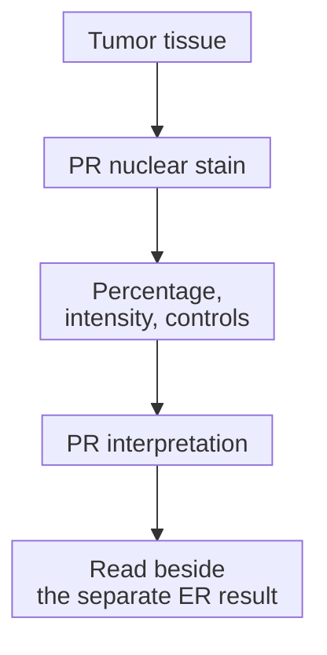

# Progesterone receptor (PR)

## In one sentence

The progesterone receptor (PR) is a protein inside cells that responds to progesterone; breast-cancer PR status reports receptor staining in tumor-cell nuclei.

## The intuition

The two hormone-receptor results on a breast-cancer report are like separate entries in a description of the cell's signaling machinery. They often appear together, but one entry cannot stand in for the other. Progesterone is the hormone; PR is the protein that can receive its signal.

The analogy has a limit: a receptor entry does not show every interaction within the cell. A PR stain also examines tissue, rather than measuring progesterone in the blood.

## How it works

Progesterone can bind its receptor inside a cell and influence gene activity. In breast cancer, PR is interpreted alongside [estrogen receptor (ER)](/wiki/education/concepts/breast-cancer/receptors-and-subtypes/estrogen-receptor). ER has a central role in identifying potential benefit from **endocrine therapy**, cancer treatment that interferes with hormone production or action.

PR and ER have different clinical jobs. The American Society of Clinical Oncology and College of American Pathologists (ASCO/CAP) describe PR testing as used **primarily for prognosis in ER-positive invasive breast cancer**. Prognosis concerns disease outcomes; prediction of treatment benefit asks whether a treatment changes those outcomes. A PR percentage is not a direct forecast of either.

The laboratory uses [immunohistochemistry (IHC)](/wiki/education/concepts/measurement/pathology-readouts/immunohistochemistry), an antibody stain that retains tissue location. The pathologist identifies the tumor-cell nuclei, the compartments holding genetic material, and assesses their staining. **At least 1%** positive tumor-cell nuclei is PR positive; **less than 1%** is negative. The **ER-low positive** reporting category is specific to ER, rather than a shared category for both receptors.

The arrows follow a tissue result through interpretation. They do not measure hormone levels or show that a PR result controls the ER result.

## Why it matters in cancer

PR adds context to the hormone-receptor profile. **Hormone receptor positive** generally means ER positive, PR positive or both, but preserving the individual results tells the reader what was actually found.

An ER-positive cancer can be PR negative. That combination does not automatically make the cancer hormone receptor negative or [triple negative](/wiki/education/concepts/breast-cancer/receptors-and-subtypes/tnbc). Unusual combinations, such as ER-negative/PR-positive findings, need attention to test quality and overall pathology rather than an invented treatment rule.

## How it is measured

| Observation | What to keep beside the result |
| --- | --- |
| Measures and method | Receptor protein in tumor-cell nuclei, assessed by validated IHC |
| Input and tissue use | A section from an identified specimen/block; staining uses section material |
| Output and units | Percent positive tumor-cell nuclei, intensity and final PR interpretation |
| Rules and controls | At least 1% positive; less than 1% negative; assay controls and concordance with morphology |
| Failure and limits | Poor preservation or inadequate controls can prevent interpretation; the stain is not a hormone level or personal risk estimate |
| Validation context | Interpret invasive cancer and any separately tested in situ component in their own contexts |

A percentage, an intensity description and a composite IHC score should retain their names and units. They are not interchangeable numbers.

## Worked example

A fictional report has ER positive in 80% of tumor-cell nuclei and PR below 1%, with adequate controls. A learner says, “One hormone receptor is negative, so endocrine therapy cannot be relevant.” That loses the positive ER finding. This is an ER-positive, PR-negative profile; the report alone does not choose a treatment or quantify benefit.

## Try it

What should a short summary preserve from that report? Does PR negativity cancel ER positivity?

**Answer:** Preserve both results: “ER positive, PR negative.” They describe different proteins. A negative PR result does not cancel a positive ER result.

## Common confusions

- PR protein staining is not a blood progesterone measurement.
- PR positivity is not a prescription for giving progesterone.
- ER-low reporting does not automatically create a “PR-low” category.
- Percent staining is not a percent chance of recurrence or treatment benefit.

## Explain it back

Explain why combining “ER positive, PR negative” into “hormone negative” changes the meaning of the report.

## Takeaway

Keep ER and PR as separate observations before interpreting their shared hormone-receptor profile.

## Related concepts

- [Estrogen receptor](/wiki/education/concepts/breast-cancer/receptors-and-subtypes/estrogen-receptor)
- [TNBC](/wiki/education/concepts/breast-cancer/receptors-and-subtypes/tnbc)
- [Intrinsic subtype](/wiki/education/concepts/breast-cancer/receptors-and-subtypes/intrinsic-subtype)

## Sources and scope

General education about invasive breast cancer; fictional example. Source-checked October 10, 2026. Expert and learner review remain pending.

- [ASCO/CAP, ER and PR testing recommendations (2020)](https://www.cap.org/wp-content/uploads/documents/erpgr_summaryrecommendations.pdf): separate nuclear-staining results and ER-specific low-positive reporting.
- [CAP, active ER/PR guideline and explanatory questions](https://www.cap.org/cap-guidelines/estrogen-and-progesterone-receptor-testing-in-breast-cancer-guideline-update/): PR's primarily prognostic role in ER-positive invasive cancer.
- [NCI, hormone therapy for breast cancer](https://www.cancer.gov/types/breast/treatment/hormone-therapy): hormone receptors and endocrine-treatment mechanisms.

<!-- BEGIN GENERATED USED IN -->
## Used in

- [Read each label as an answer to a question](/wiki/education/guides/start-here/01-read-the-labels)
- [Ask whether protein is present, placed and active](/wiki/education/molecular-profiling/03-protein-expression-and-activation)
<!-- END GENERATED USED IN -->
