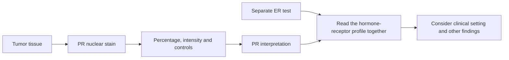

# Progesterone receptor (PR)

## In one sentence

The progesterone receptor (PR) is a protein inside cells that responds to progesterone; breast-cancer PR status reports receptor staining in tumor-cell nuclei.

## The intuition

The two hormone-receptor results on a breast-cancer report are like two separate entries in a description of the cell's signaling machinery. They often appear together, but one entry cannot stand in for the other. Progesterone is the hormone; its receptor is the protein that can receive that signal.

A PR stain examines tissue. It is not a blood progesterone test, and “PR positive” does not mean the laboratory has measured a hormone level.

## How it works

Progesterone can bind its receptor inside a cell and influence gene activity. In breast cancer, PR is interpreted alongside [estrogen receptor (ER)](/wiki/education/concepts/breast-cancer/receptors-and-subtypes/estrogen-receptor), which has a central role in identifying potential benefit from endocrine therapy. Endocrine therapy means cancer treatment that interferes with hormone production or action. [NCI describes the receptor mechanism](https://www.cancer.gov/types/breast/treatment/hormone-therapy).

PR and ER have different clinical jobs. The American Society of Clinical Oncology and College of American Pathologists (ASCO/CAP) describe PR testing as used **primarily for prognosis in ER-positive invasive breast cancer**. Prognosis concerns likely disease outcomes; prediction of treatment benefit asks whether a particular treatment changes those outcomes. A PR percentage is not a direct forecast of either one. [The testing guideline](https://www.cap.org/cap-guidelines/estrogen-and-progesterone-receptor-testing-in-breast-cancer-guideline-update/) makes this distinction.

The laboratory uses [immunohistochemistry (IHC)](/wiki/education/concepts/measurement/pathology-readouts/immunohistochemistry), an antibody stain that preserves tissue location. The pathologist identifies tumor cells and assesses staining in their nuclei, the compartments holding genetic material. Under ASCO/CAP recommendations, **at least 1%** positive tumor-cell nuclei is PR positive; **less than 1%** is negative. The **ER-low positive** reporting category is specific to ER, not a shared category for both receptors. [The recommendation summary](https://www.cap.org/wp-content/uploads/documents/erpgr_summaryrecommendations.pdf) gives these rules.

The arrows combine information, not hormone levels. Each assay keeps its own identity.

## Why it matters in cancer

PR adds context to the hormone-receptor profile. **Hormone receptor positive** generally means ER positive, PR positive or both, but preserving the individual results helps a reader understand what was actually found.

An ER-positive cancer can be PR negative. That combination does not automatically make the cancer hormone receptor negative or [triple negative](/wiki/education/concepts/breast-cancer/receptors-and-subtypes/tnbc). Unusual combinations, such as an ER-negative/PR-positive report, deserve careful assessment of test quality and the overall pathology rather than a treatment rule invented from one label.

## Worked example

In a fictional report, ER is positive in 80% of tumor-cell nuclei and PR is below 1%. A learner says, “One hormone receptor is negative, so hormone therapy cannot be relevant.” The missing step is the ER result: this is an ER-positive, PR-negative profile. The two measurements can coexist. The report does not tell us by itself which treatment to choose or how much benefit to expect.

## Common confusions

- A PR stain measures receptor protein, not progesterone in the blood.
- A negative PR result does not cancel a positive ER result.
- A positive PR result is not a prescription for giving progesterone.
- The percent staining and staining intensity are different features; neither is a percent chance of recurrence.

## How it is measured

Read the specimen, percentage of positive tumor-cell nuclei, intensity, final interpretation and control comments. An inadequate sample or failed controls can prevent a reliable interpretation. Keep invasive cancer and any in situ component distinct if their results are separately reported.

## Explain it back

Why should “ER positive, PR negative” stay as two results? Because they describe different proteins and carry different information. Collapsing them into “hormone negative” loses the positive ER finding.

## Related concepts

- [Estrogen receptor](/wiki/education/concepts/breast-cancer/receptors-and-subtypes/estrogen-receptor)
- [TNBC](/wiki/education/concepts/breast-cancer/receptors-and-subtypes/tnbc)
- [Intrinsic subtype](/wiki/education/concepts/breast-cancer/receptors-and-subtypes/intrinsic-subtype)

## Sources and scope

General education about invasive breast cancer; fictional example. Source-checked October 9, 2026. Expert and learner review remain pending.

- [ASCO/CAP, ER and PR testing guideline update (2020), summary of recommendations](https://www.cap.org/wp-content/uploads/documents/erpgr_summaryrecommendations.pdf): separate receptor results, nuclear-staining thresholds and ER-specific low-positive reporting.
- [CAP, active ER/PR testing guideline and explanatory questions](https://www.cap.org/cap-guidelines/estrogen-and-progesterone-receptor-testing-in-breast-cancer-guideline-update/): PR's primarily prognostic role in ER-positive invasive cancer and interpretation of unusual results.
- [NCI, hormone therapy for breast cancer](https://www.cancer.gov/types/breast/treatment/hormone-therapy): hormone receptors and endocrine-treatment mechanisms.

<!-- BEGIN GENERATED USED IN -->
## Used in

- [Read each label as an answer to a question](/wiki/education/guides/start-here/01-read-the-labels)
<!-- END GENERATED USED IN -->
