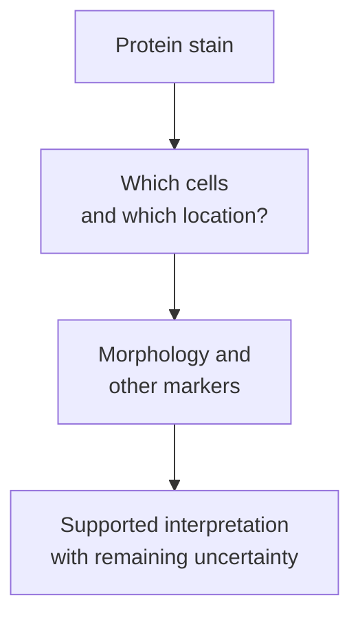

# SOX10 and basal markers: tissue clues with limits

## In one sentence

SOX10 and basal markers are tissue protein stains that can support a diagnostic interpretation, but cannot alone establish breast origin, a gene-expression subtype, or treatment benefit.

## The intuition

A familiar accent can suggest where someone comes from, but accents overlap and change. A stain is a similarly useful clue when combined with the rest of the picture.

The analogy has limits: protein staining is a laboratory measurement, not an inference from a person's identity. The pathologist needs to see which cells stain, where the signal sits, and how it fits the tissue's appearance.

## How it works

**SRY-box transcription factor 10 (SOX10)** is a protein that helps regulate gene expression. [Immunohistochemistry (IHC)](/wiki/education/concepts/measurement/pathology-readouts/immunohistochemistry) detects it as nuclear staining. Finding the protein does not directly measure its transcriptional activity or show that the cancer depends on it.

SOX10 is expressed in normal breast [myoepithelial cells](/wiki/education/concepts/breast-cancer/anatomy-and-histology/myoepithelial-cells-and-basement-membrane) and in a subset of breast carcinomas, particularly within triple-negative and metaplastic groups in the cited study. It also occurs in other tumors, including melanoma and nerve-sheath tumors. Thus, a positive result can support breast origin in an appropriate diagnostic panel, but it cannot confirm that origin alone. A negative result does not exclude breast carcinoma.

**Basal markers** include cytokeratins 5 and 6, often reported together as **CK5/6**. Cytokeratins are epithelial structural proteins. Research panels have also used epidermal growth factor receptor (EGFR, historically HER1) alongside estrogen-receptor and HER2 testing. The particular panel and its definition matter.

Nielsen and colleagues compared a basal-marker panel with expression-defined basal-like cancers and then examined a larger historical tissue cohort. That supports a scoped protein surrogate, not the claim that any one positive marker establishes the [intrinsic RNA subtype](/wiki/education/concepts/breast-cancer/receptors-and-subtypes/intrinsic-subtype). Ribonucleic acid (RNA) classifiers and protein stains measure different layers.

## Why it matters in cancer

Markers help pathologists interpret a difficult specimen and consider competing diagnoses. The tissue context is essential: SOX10-positive benign myoepithelial nuclei beside a lesion are different from SOX10-positive malignant nuclei within it.

“Basal-like” expression, a basal-marker-positive phenotype, and [triple-negative receptor status](/wiki/education/concepts/breast-cancer/receptors-and-subtypes/tnbc) overlap without being identical. SOX10 positivity does not assign [Lehmann BL1](/wiki/education/concepts/breast-cancer/receptors-and-subtypes/tnbc-molecular-subtypes), prove a precise developmental origin, or predict vaccine benefit. A cohort association with outcome is also different from a treatment-benefit biomarker.

## How it is measured

| Item | Interpretation question |
|---|---|
| Input | Which tissue, lesion, and cells were sampled? Fixation and processing matter |
| Method | Named antibody, staining protocol, localization, and scoring criteria |
| Output | Presence, intensity, and/or percentage of stained cells; retain the stated denominator |
| Controls | Appropriate positive and negative controls, including interpretable internal tissue controls |
| Failure modes | Poor preservation, scant tumor, background staining, and mistaking neighboring cells for tumor |
| Limit | A stain is not an expression classifier, lineage tracing, or a drug-response assay |

The research studies used specified antibodies and scoring schemes. Their positivity rates are not a universal prevalence or sensitivity for every laboratory, breast-cancer population, or biopsy. A percentage of stained tumor cells is not a probability that a treatment will work.

## Common confusions

- **SOX10 positive versus breast-specific:** other normal tissues and tumors can express it.
- **Basal marker versus basal-like RNA:** related patterns need not agree sample by sample.
- **Marker versus cell of origin:** shared differentiation features do not establish ancestry.
- **Diagnostic clue versus treatment target:** protein detection does not prove dependence or eligibility.

## Try it

A fictional axillary mass stains for SOX10. Someone concludes, “This confirms a breast primary and therefore BL1.” What two jumps have been made?

**Answer:** The stain alone has been used to establish origin, then to assign an RNA research subtype. Neither follows. Morphology, other markers, and clinical context inform origin; a named expression analysis addresses the subtype question.

## Explain it back

Explain why “which cells stained?” can matter as much as “was the stain positive?”

One answer: normal supporting cells can stain too, so the signal must be attributed to the intended cells.

## Takeaway

**Use stains as contextual tissue evidence, and keep subtype and treatment claims separate.**

## Related concepts

- [TNBC molecular subtypes](/wiki/education/concepts/breast-cancer/receptors-and-subtypes/tnbc-molecular-subtypes).
- [Cell lineage and differentiation](/wiki/education/concepts/biology-basics/cells/cell-lineage-and-differentiation).

## Sources and scope

Source check: October 10, 2026. Diagnostic-marker education, not a diagnostic rule or individual prognosis. The example is fictional; expert and learner review pending.

- [Cimino-Mathews et al., 2013: SOX10 in breast neoplasms](https://pubmed.ncbi.nlm.nih.gov/23260325/) — a defined tissue series with normal-cell staining and diagnostic pitfalls; rates depend on its sampling and methods.
- [Nielsen et al., 2004: basal-marker panel](https://pubmed.ncbi.nlm.nih.gov/15328174/) — comparison with expression-defined tumors and a historical tissue cohort, not validation of SOX10 as a TNBCtype classifier.

<!-- BEGIN GENERATED USED IN -->
## Used in

- [Read pathology and surgery results](/wiki/education/guides/reading-pathology-and-surgery-results/index)
<!-- END GENERATED USED IN -->
