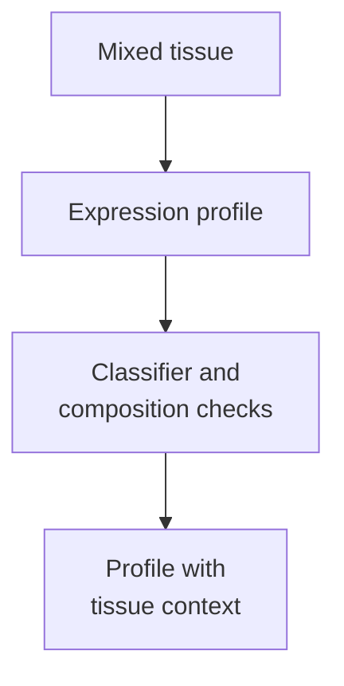
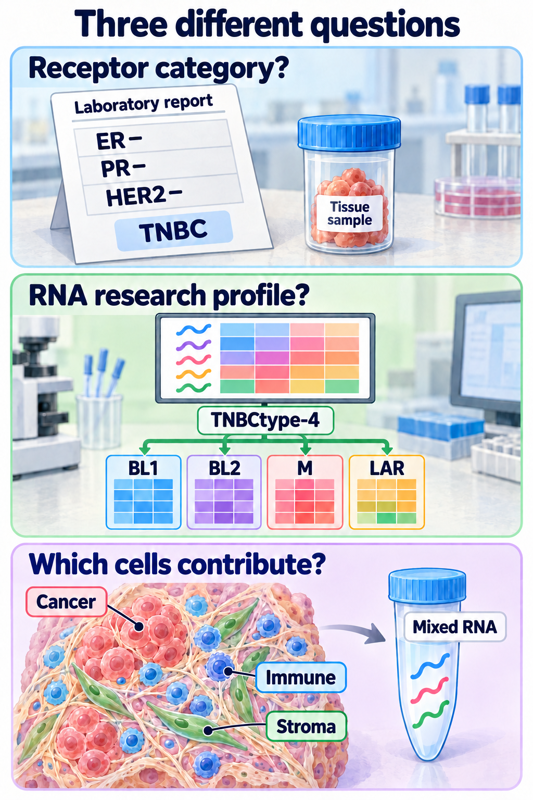

# TNBC molecular subtypes: four research profiles, with tissue context

## In one sentence

TNBC molecular subtypes are research categories assigned from gene-expression patterns under a specified classifier, including the four Lehmann TNBCtype-4 groups.

## The intuition

Imagine recording a conversation in a crowded room. You can recognize patterns in the recording, but some voices belong to neighbors rather than the person you meant to study. A tissue expression profile has the same attribution problem: malignant cells, immune cells, and supporting cells contribute messages.

The analogy stops there. These categories come from mathematical comparisons of many genes, not from listening to one distinctive gene. They are useful research descriptions, not four sealed boxes that every tumor must fit perfectly.

## How it works

*Receptor category, an RNA research profile and tissue mixture answer different questions. The four labels describe expression patterns, not cell shapes or a treatment choice. Shapes and proportions are schematic.*

[Triple-negative breast cancer (TNBC)](/wiki/education/concepts/breast-cancer/receptors-and-subtypes/tnbc) is a receptor-defined clinical category. Researchers can subdivide it using ribonucleic acid (RNA) expression. That is a different question from receptor testing or the broader [intrinsic breast-cancer subtypes](/wiki/education/concepts/breast-cancer/receptors-and-subtypes/intrinsic-subtype).

Lehmann and colleagues' 2011 **TNBCtype** classification described six groups: basal-like 1 and 2, immunomodulatory, mesenchymal, mesenchymal stem-like, and luminal androgen receptor. The original sixth group was mesenchymal stem-like; an unclassified result is not its replacement.

In 2016, histological assessment and paired laser-capture analyses of malignant epithelium and adjacent stroma helped clarify the mixed-tissue signal. **Immunomodulatory (IM)** expression tracked infiltrating lymphocytes, while **mesenchymal stem-like (MSL)** expression reflected substantial stromal contributions. The refined **TNBCtype-4** retained four tumor-focused profiles. IM and MSL samples were reassigned using their next-best tumor-profile correlation. The immune and stromal biology remained important; it was separated from the four tumor-profile labels.

| Profile | Full name | Associated expression programs |
|---|---|---|
| BL1 | Basal-like 1 | Cell cycle and [deoxyribonucleic acid (DNA)](/wiki/education/concepts/biology-basics/genetics/central-dogma) damage responses |
| BL2 | Basal-like 2 | Growth-factor signaling and myoepithelial-associated genes |
| M | Mesenchymal | Motility, differentiation, and mesenchymal-associated programs |
| LAR | Luminal androgen receptor | Luminal and androgen-related transcription |

These are associations within the classifier, not proof of a single cause or dependency. “Tumor-focused” also does not make every bulk sample free of neighboring cells. LAR does not mean estrogen-receptor positivity, and it is not interchangeable with [androgen receptor protein staining](/wiki/education/concepts/cancer-biology/signaling-pathways/androgen-receptor-signaling).

## Why it matters in cancer

The classification makes TNBC heterogeneity easier to study and helps frame hypotheses for trials. The original studies included cell models and retrospective chemotherapy-response analyses. They did not establish an automatic treatment assignment or a validated vaccine-benefit prediction for an individual.

Different classifiers can organize the same sample differently. A [PAM50 basal-like call](/wiki/education/concepts/breast-cancer/receptors-and-subtypes/intrinsic-subtype) does not establish Lehmann BL1, and [SOX10 or basal-marker staining](/wiki/education/concepts/breast-cancer/receptors-and-subtypes/sox10-and-basal-markers) cannot substitute for either expression analysis.

## How it is measured

| Item | What to record |
|---|---|
| Input | Tissue identity, collection relative to treatment, tumor content, and RNA quality |
| Method | [Bulk RNA profiling](/wiki/education/concepts/measurement/transcriptomics/bulk-rna-seq), classifier version, gene coverage, normalization, and reference data |
| Output | Profile label and correlation or similarity scores; these are not automatically probabilities |
| Checks | Missing genes, batch effects, competing correlations, and immune/stromal composition |
| Limit | A reproducible research label does not by itself establish clinical utility |

There is no universal RNA-quality number that validates every platform. Suitability must be shown for the actual specimen preparation and classifier pipeline. Comparing two timepoints also requires separating treatment effects from sampling and preprocessing differences.

## Common confusions

- **Six versus four:** specify TNBCtype or TNBCtype-4, rather than mixing their labels.
- **IM removed versus immunity absent:** the refinement changes attribution, not the importance of immunity.
- **Subtype versus lineage:** a program does not establish a tumor's exact cell of origin.
- **Response association versus prediction:** an older cohort association does not assign modern treatment benefit.

## Try it

A fictional whole-tissue profile has a strong IM signal. A malignant-cell-enriched preparation from the same specimen is classified BL1. Does this prove the cancer changed subtype between collections?

**Answer:** No. The preparations contain different cell mixtures, and the original IM signal can reflect lymphocytes. Compare preparation, classifier, and scores before proposing a biological change. Neither label alone demonstrates vaccine responsiveness.

## Explain it back

Why can the immune signal remain useful even when IM is not one of the four tumor-profile labels?

One answer: it describes neighboring immune contributions that should be analyzed alongside the malignant-cell programs.

## Takeaway

**Read the profile together with its classifier, tissue mixture, and evidence boundary.**

## Related concepts

- [Tumor microenvironment](/wiki/education/concepts/cancer-biology/tumor-microenvironment/tumor-microenvironment).
- [Intrinsic subtype](/wiki/education/concepts/breast-cancer/receptors-and-subtypes/intrinsic-subtype).

## Sources and scope

Source check: October 10, 2026. Classification and tissue-attribution education; the practice example is fictional. Expert and learner review pending.

- [Lehmann et al., 2011: original six-subtype study](https://www.jci.org/articles/view/45014) — expression-defined groups and scoped preclinical experiments.
- [Lehmann et al., 2016: TNBCtype-4 refinement](https://journals.plos.org/plosone/article?id=10.1371/journal.pone.0157368) — histology, microdissection, and retrospective response analyses; not a prospective treatment-selection validation.

<!-- BEGIN GENERATED USED IN -->
## Used in

Browse the [concept index](/wiki/education/concepts/index) for related learning paths.
<!-- END GENERATED USED IN -->
