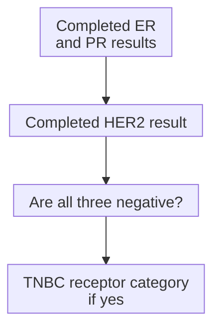

# Triple-negative breast cancer (TNBC)

## In one sentence

Triple-negative breast cancer (TNBC) is breast cancer classified as negative for estrogen receptor, progesterone receptor and human epidermal growth factor receptor 2 (HER2) by validated tissue tests.

## The intuition

TNBC is a name built from three clinical test results. Imagine three entries on a report, each interpreted under its own rules. When all three are negative, they define the category. They do not provide a complete description of the tumor's biology.

“Negative” can sound like “nothing there” or “nothing to treat.” Neither follows. The name concerns three selected biomarkers, not every pathway, immune interaction or potential treatment target. The report-entry analogy also cannot show how the tumor changes across sites or time.

## How it works

The hormone-receptor tests are [estrogen receptor (ER)](/wiki/education/concepts/breast-cancer/receptors-and-subtypes/estrogen-receptor) and [progesterone receptor (PR)](/wiki/education/concepts/breast-cancer/receptors-and-subtypes/progesterone-receptor). For invasive breast cancer, American Society of Clinical Oncology and College of American Pathologists (ASCO/CAP) recommendations call **less than 1%** positive tumor-cell nuclei negative for each. **ER-low positive**, the 1–10% ER range, is still positive. The category is not defined by rounding every result to zero.

The third result is the completed [HER2 interpretation](/wiki/education/concepts/breast-cancer/receptors-and-subtypes/her2), negative for overexpression/amplification under the testing rules. **Immunohistochemistry (IHC)** stains protein in tissue; **in situ hybridization (ISH)** assesses gene copies. HER2 IHC 0, 0+ and 1+ are negative; IHC 2+ is equivocal and needs further workup, usually ISH, before it can supply a completed result.

The map gathers independent tests; it does not imply that one receptor causes another. Unknown, pending and uninterpretable results remain distinct from negative results.

## Why it matters in cancer

The classification organizes treatment pathways and research cohorts, separating cancers without the usual positive hormone-receptor or HER2-overexpression findings from cancers that have them. It is useful because it answers a limited question clearly.

Within TNBC, tumors differ in gene-expression programs and other features. **Basal-like** is an [intrinsic expression subtype](/wiki/education/concepts/breast-cancer/receptors-and-subtypes/intrinsic-subtype), not the definition of TNBC. Direct comparisons show that expression labels and receptor categories do not map one to one.

[TNBC molecular subtypes](/wiki/education/concepts/breast-cancer/receptors-and-subtypes/tnbc-molecular-subtypes) ask a separate ribonucleic acid (RNA) research question. [SOX10 and basal markers](/wiki/education/concepts/breast-cancer/receptors-and-subtypes/sox10-and-basal-markers) provide protein clues rather than assigning those profiles. The TNBC name also does not specify stage, [histologic grade](/wiki/education/concepts/breast-cancer/grade-and-stage/histologic-grade), immune activity or response.

## How it is measured

| Observation | What to retain |
| --- | --- |
| Measures and method | Three validated tissue-test interpretations, with the HER2 workup completed when required |
| Input and tissue use | Specimen/block, site and collection date; individual assays use section material |
| Output and units | ER/PR nuclear-staining percentages and categories; HER2 score/ISH findings and final status |
| Quality and limits | Control comments, adequate invasive tumor and any unresolved result; a general RNA classifier cannot replace these tests |
| Validation context | Standard pathology classification; trial enrollment thresholds may differ |

If specimens disagree, retain their dates and sites. Combining selected results from different specimens into a synthetic three-negative profile loses the evidence of where each result came from.

## Worked example

A fictional invasive tumor has ER below 1%, PR below 1% and HER2 IHC 1+, with adequate controls. It meets the TNBC receptor classification. The same HER2 result also falls in the HER2-low staining range: low expression is within the HER2-negative overexpression/amplification group.

## Try it

Change only ER to 4%. Does the report still meet the standard TNBC classification? Would a basal-like RNA label change the answer?

**Answer:** No. ER 4% is ER-low positive, so the three results are no longer all negative. A basal-like RNA label measures a different feature and does not overwrite the ER tissue result.

## Common confusions

- Triple negative does not require three literal zeroes.
- HER2-low and TNBC can coexist.
- A trial's enrollment threshold does not silently redefine standard pathology terminology.
- TNBC is neither a stage nor a prediction that everyone in the category responds alike.

## Explain it back

Explain why TNBC, basal-like and HER2-low can answer different questions about the same specimen.

## Takeaway

Use the three completed receptor results to read the category, then ask separate questions about biology, extent and evidence.

## Related concepts

- [Estrogen receptor](/wiki/education/concepts/breast-cancer/receptors-and-subtypes/estrogen-receptor)
- [Progesterone receptor](/wiki/education/concepts/breast-cancer/receptors-and-subtypes/progesterone-receptor)
- [HER2](/wiki/education/concepts/breast-cancer/receptors-and-subtypes/her2)

## Sources and scope

General education about invasive breast cancer; fictional examples. Source-checked October 10, 2026. Expert and learner review remain pending.

- [NCI, definition of TNBC](https://www.cancer.gov/publications/dictionaries/cancer-terms/def/triple-negative-breast-cancer): the receptor category.
- [ASCO/CAP, ER and PR recommendations (2020)](https://www.cap.org/wp-content/uploads/documents/erpgr_summaryrecommendations.pdf): negative and ER-low thresholds.
- [CAP, breast biomarker template v1.6.2.0 (September 2026)](https://www.cap.org/wp-content/uploads/2026/09/Breast.Bmk_1.6.2.0.REL_CAPCP.pdf?download=true): HER2 scoring and workup context.
- [Bastien et al., PAM50 and clinical markers (2012)](https://pubmed.ncbi.nlm.nih.gov/23035882/): incomplete correspondence between the classifications.

<!-- BEGIN GENERATED USED IN -->
## Used in

- [The journey through a solid tumor](/wiki/education/cellular-therapies/08-solid-tumor-barriers)
- [Read each label as an answer to a question](/wiki/education/guides/start-here/01-read-the-labels)
- [Start here: read the biology, then the evidence](/wiki/education/guides/start-here/index)
- [Read the jobs in the treatment plan](/wiki/education/guides/treating-early-tnbc/01-read-the-jobs-in-the-plan)
- [Read timing around surgery](/wiki/education/guides/treating-early-tnbc/02-read-timing-around-surgery)
- [Understand how treatment is sequenced](/wiki/education/guides/treating-early-tnbc/index)
- [Use RNA to test the message and its source](/wiki/education/molecular-profiling/02-rna-the-activity-layer)
- [Ask whether protein is present, placed and active](/wiki/education/molecular-profiling/03-protein-expression-and-activation)
- [Separate cell identity from cell state](/wiki/education/multi-omics-foundations/02-cell-identity-and-state)
<!-- END GENERATED USED IN -->
