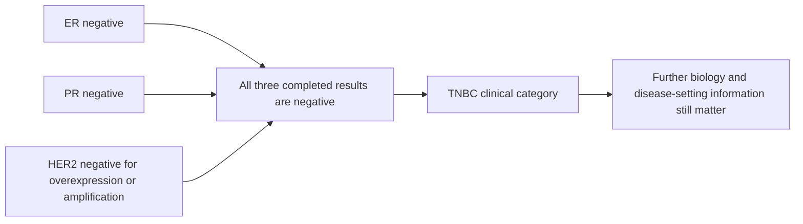

# Triple-negative breast cancer (TNBC)

## In one sentence

Triple-negative breast cancer (TNBC) is breast cancer classified as negative for estrogen receptor, progesterone receptor and human epidermal growth factor receptor 2 (HER2) by validated tissue tests.

## The intuition

TNBC is a name built from three clinical test results. Imagine three entries on a report, each interpreted under its own rules. When all three are negative, they define the category. They do not provide a complete description of the tumor's biology.

That distinction matters because “negative” can sound like “nothing there” or “nothing to treat.” Neither follows. The category describes three selected biomarkers, not every pathway, immune interaction or potential treatment target.

## How it works

The hormone-receptor tests are [estrogen receptor (ER)](/wiki/education/concepts/breast-cancer/receptors-and-subtypes/estrogen-receptor) and [progesterone receptor (PR)](/wiki/education/concepts/breast-cancer/receptors-and-subtypes/progesterone-receptor). In invasive breast cancer, American Society of Clinical Oncology and College of American Pathologists (ASCO/CAP) testing recommendations call **less than 1%** positive tumor-cell nuclei negative for each. **ER-low positive**, the 1–10% ER range, is still positive under that guideline. The category is not defined by rounding every result to zero. [The hormone-receptor guideline](https://www.cap.org/wp-content/uploads/documents/erpgr_summaryrecommendations.pdf) provides the thresholds.

The third result is the completed [HER2 interpretation](/wiki/education/concepts/breast-cancer/receptors-and-subtypes/her2). It is negative for overexpression/amplification under the applicable testing rules. IHC 0 and 1+ are negative; IHC 2+ requires further assessment, usually ISH, before the final result can be used. **Immunohistochemistry (IHC)** stains protein in tissue; **in situ hybridization (ISH)** assesses gene copies. [ASCO/CAP HER2 guidance](https://www.cap.org/cap-guidelines/her2-testing-in-breast-cancer-2023-guideline-update/) explains why an equivocal starting result is not a completed negative result.

An unknown, pending or uninterpretable result belongs in its own category. Absence of a reported positive result is not evidence that all three tests are negative.

## Why it matters in cancer

The classification helps organize treatment pathways and research cohorts. It separates cancers without the usual positive hormone-receptor or HER2-overexpression findings from cancers that have them. [NCI defines TNBC through these three receptors](https://www.cancer.gov/publications/dictionaries/cancer-terms/def/triple-negative-breast-cancer).

Within TNBC, tumors differ in gene-expression programs and other biological features. **Basal-like** is a common [intrinsic expression subtype](/wiki/education/concepts/breast-cancer/receptors-and-subtypes/intrinsic-subtype), but it is not the definition of TNBC. Research directly comparing expression subtypes with clinical markers found that the systems do not map one to one. Preserve which assay supplied each label.

[TNBC molecular subtypes](/wiki/education/concepts/breast-cancer/receptors-and-subtypes/tnbc-molecular-subtypes) ask a separate RNA research question. [SOX10 and basal markers](/wiki/education/concepts/breast-cancer/receptors-and-subtypes/sox10-and-basal-markers) provide contextual protein clues rather than assigning those expression profiles.

The name also does not specify stage, [histologic grade](/wiki/education/concepts/breast-cancer/grade-and-stage/histologic-grade), immune activity or treatment response. Those require their own measurements. A receptor classification is useful precisely because it answers a limited question clearly.

## Worked example

A fictional invasive tumor has ER below 1%, PR below 1% and HER2 IHC 1+. It meets the TNBC receptor classification. The same IHC 1+ result also falls in the HER2-low staining range. Both labels can be true because HER2-low is within the HER2-negative overexpression/amplification group.

Now change only ER to 4%, with adequate controls. That report is ER-low positive and no longer meets this three-negative classification. A basal-like [RNA (ribonucleic acid) expression result](/wiki/education/concepts/breast-cancer/receptors-and-subtypes/intrinsic-subtype) would describe a different measurement; it would not overwrite the ER result.

## Common confusions

- “Triple negative” does not mean that the reported numbers must all be zero.
- TNBC and basal-like overlap, but are not interchangeable labels.
- A clinical trial may use its own enrollment threshold; that threshold should not silently redefine the standard pathology category.
- TNBC is not a stage or a prediction that all people in the category will respond alike.

## How it is measured

Read the three completed tissue-test interpretations, the relevant percentages or scores, specimen identity and control comments. A general RNA classifier cannot supply missing clinical receptor tests. If separate specimens have different results, retain their dates and sites rather than combining selected results into a new synthetic profile.

## Explain it back

Why can TNBC and HER2-low appear on the same report? Because TNBC requires a negative HER2 overexpression/amplification classification, and HER2-low is a staining category within that group.

## Related concepts

- [Estrogen receptor](/wiki/education/concepts/breast-cancer/receptors-and-subtypes/estrogen-receptor)
- [Progesterone receptor](/wiki/education/concepts/breast-cancer/receptors-and-subtypes/progesterone-receptor)
- [HER2](/wiki/education/concepts/breast-cancer/receptors-and-subtypes/her2)
- [Intrinsic subtype](/wiki/education/concepts/breast-cancer/receptors-and-subtypes/intrinsic-subtype)

## Sources and scope

General education about invasive breast cancer; fictional examples. Source-checked October 9, 2026. Expert and learner review remain pending.

- [NCI, definition of triple-negative breast cancer](https://www.cancer.gov/publications/dictionaries/cancer-terms/def/triple-negative-breast-cancer): the clinical receptor category.
- [ASCO/CAP, ER and PR testing recommendation summary (2020)](https://www.cap.org/wp-content/uploads/documents/erpgr_summaryrecommendations.pdf): negative and ER-low-positive thresholds.
- [ASCO/CAP, HER2 testing guideline update (2023)](https://www.cap.org/cap-guidelines/her2-testing-in-breast-cancer-2023-guideline-update/): completed HER2 classification.
- [Bastien et al., PAM50 subtyping and concordance with clinical markers (2012)](https://pubmed.ncbi.nlm.nih.gov/23035882/): expression subtypes and receptor categories are distinct.

<!-- BEGIN GENERATED USED IN -->
## Used in

- [The journey through a solid tumor](/wiki/education/cellular-therapies/08-solid-tumor-barriers)
- [Read each label as an answer to a question](/wiki/education/guides/start-here/01-read-the-labels)
- [Start here: read the biology, then the evidence](/wiki/education/guides/start-here/index)
- [Read the jobs in the treatment plan](/wiki/education/guides/treating-early-tnbc/01-read-the-jobs-in-the-plan)
- [Read timing around surgery](/wiki/education/guides/treating-early-tnbc/02-read-timing-around-surgery)
- [Understand how treatment is sequenced](/wiki/education/guides/treating-early-tnbc/index)
- [Use RNA to test the message and its source](/wiki/education/molecular-profiling/02-rna-the-activity-layer)
- [Ask whether protein is present, placed and active](/wiki/education/molecular-profiling/03-protein-expression-and-activation)
- [Separate cell identity from cell state](/wiki/education/multi-omics-foundations/02-cell-identity-and-state)
<!-- END GENERATED USED IN -->
