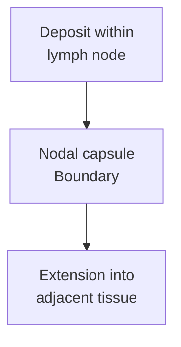

# Extranodal extension: beyond a lymph-node capsule

## In one sentence

Extranodal extension means a cancer deposit in a lymph node extends through its capsule into adjacent tissue; it does not by itself establish distant metastasis.

## The intuition

Picture a local boundary around a lymph node. Tumor can lie within that node or extend beyond its outer capsule. The image explains a tissue relationship. Crossing this boundary is not the same as proving that tumor has reached a distant organ, and a pathology section is not a film showing when spread occurred.

## How it works

A [lymph node](/wiki/education/concepts/immunology/the-immune-system/lymph-nodes-and-lymphatics) has a capsule of connective tissue. When a nodal tumor deposit extends through the capsule into the nearby soft tissue, the report may call this **extranodal extension (ENE)** or **extracapsular extension**. In an axillary specimen, that nearby tissue may include fat.

Several findings describe different aspects of the same specimen:

| Finding | Question it answers |
|---|---|
| Nodal tumor deposit | Is cancer present in this node, and how is the deposit classified? |
| ENE | Does the nodal deposit extend beyond the capsule into adjacent tissue? |
| Lymphovascular invasion | Are tumor cells present within lymphatic or blood-vessel spaces? |
| Surgical margin | What is present at the specimen's relevant cut boundary? |

These observations may coexist. They are not interchangeable labels. In particular, a lymph-node capsule is not a surgical margin, and tumor within a nearby vessel is not automatically the same as direct extension through a capsule.

*This illustrates the location defining ENE. It is not a timeline or a diagram of distant spread.*

## Why it matters in cancer

ENE adds anatomical information to the report. Cohort studies have examined associations between ENE, nodal burden and subsequent outcomes. For example, a retrospective Fudan cohort included patients with node-positive invasive breast cancer who underwent axillary dissection. Its findings do not supply an individual forecast or establish that one particular treatment benefits every person with ENE.

[Prognostic association and prediction of treatment benefit](/wiki/education/concepts/evidence-and-statistics/biomarkers/prognostic-vs-predictive) are different questions. Using ENE in care requires the complete disease and treatment context, rather than treating the word as an automatic surgery or radiation rule.

A regional [axillary](/wiki/education/concepts/breast-cancer/anatomy-and-histology/lymphatic-drainage-and-axilla) deposit remains a regional finding when it has ENE. [TNM staging](/wiki/education/concepts/breast-cancer/grade-and-stage/tnm-staging) distinguishes regional nodal disease from distant metastasis. ENE alone does not establish M1 or stage IV disease.

## How it is measured

Pathologists examine the deposit, remaining capsule and adjacent tissue. If extent is measured, the unit is usually **millimeters**, not a percentage of all body disease. The measurement method and whether it is feasible matter. Current College of American Pathologists (CAP) guidance permits description and optional size reporting; it does not establish one proven superior measuring direction.

Evaluation can be difficult when the capsule is disrupted, the node is substantially replaced, tumor involves vessel spaces or the tissue has changed after treatment. An international pathologist survey documented variation in ENE measurement and these interpretive problems. Morphology, deeper sections and selected stains may help resolve the tissue relationships.

Do not interchange ENE extent with the size of the whole nodal deposit. Post-treatment [staging measurements and residual cancer burden](/wiki/education/concepts/breast-cancer/surgery-and-pathology-results/residual-cancer-burden) can also follow different rules. Retain the reported parameter and method instead of moving one number between fields.

## Common confusions

- ENE means beyond a node's capsule, not necessarily beyond the regional area.
- ENE is not synonymous with lymphovascular invasion or a positive margin.
- A measured ENE extent is not the diameter of every nodal metastasis combined.
- An outcome association does not prove that a specified treatment improves that outcome.

## Try it

A fictional axillary specimen contains a positive node with ENE. A learner changes the summary to “distant metastasis proven.” What has been added without evidence?

**Answer:** A distant-disease claim. ENE describes extension from that regional nodal deposit into neighboring tissue. Evidence of disease at a distant site would be a separate finding.

## Explain it back

“ENE describes ___; distant metastasis requires ___.”

**One possible answer:** A nodal deposit crossing its capsule into nearby tissue; evidence of disease at a distant site under the relevant staging rules.

## Takeaway

**Read ENE as a specific tissue-boundary finding, with its location and measurement context preserved.**

## Related concepts

- [Sentinel-node biopsy and axillary dissection](/wiki/education/concepts/breast-cancer/surgery-and-pathology-results/sentinel-node-and-axillary-dissection)
- [Surgical margins](/wiki/education/concepts/breast-cancer/surgery-and-pathology-results/surgical-margins)

## Sources and scope

Source check: October 10, 2026. Pathological definition and evidence limits; the exercise is fictional. No individual forecast or treatment recommendation. Expert and learner review remain pending.

- [CAP breast resection protocol, version 4.11.0.0, June 2026](https://www.cap.org/wp-content/uploads/2026/06/Breast.Invasive.Res_4.11.0.0.REL_CAPCP.pdf?download=true) — ENE fields, optional extent measurement and regional-node context.
- [Tang et al., 2022](https://pubmed.ncbi.nlm.nih.gov/36030639/) — international survey of ENE evaluation and measurement; practice variation, rather than a diagnostic-accuracy trial.
- [Prognostic value of ENE in axillary node-positive breast cancer, 2021](https://pubmed.ncbi.nlm.nih.gov/33953240/) — retrospective Fudan dissection cohort; observational associations, not randomized treatment-benefit evidence.

<!-- BEGIN GENERATED USED IN -->
## Used in

- [Read residual disease and margins](/wiki/education/guides/reading-pathology-and-surgery-results/02-read-residual-disease-and-margins)
<!-- END GENERATED USED IN -->
