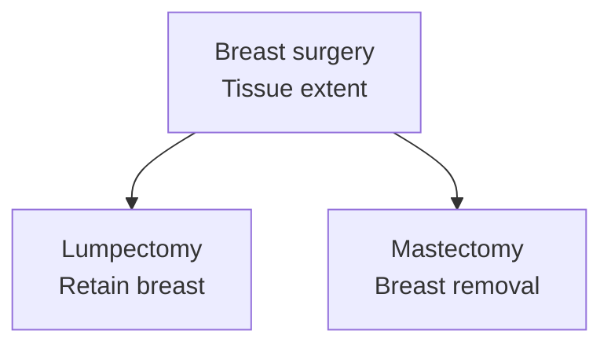
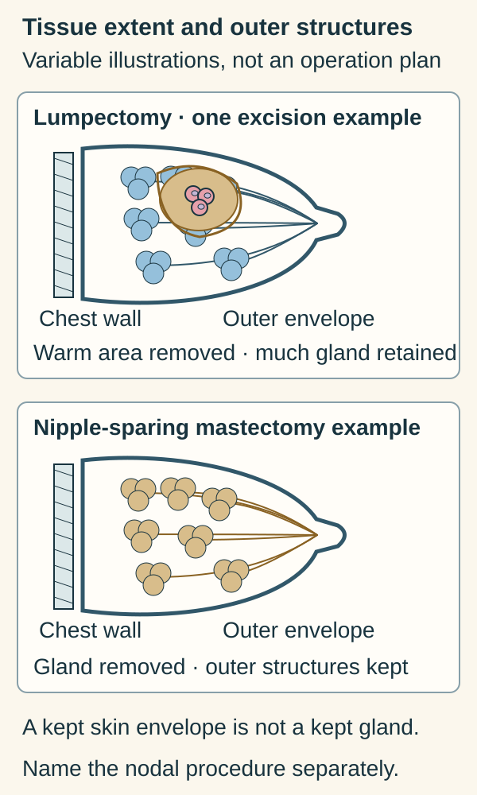

# Lumpectomy versus mastectomy: the extent of breast surgery

## In one sentence

Lumpectomy removes a breast lesion and surrounding tissue while retaining the rest of the breast; mastectomy removes breast tissue more extensively, with different options for preserving skin or the nipple.

## The intuition

The first question is simply, “How much breast tissue does this operation remove?” That makes the two names easier to understand. It is only one part of a treatment plan: tissue extent does not, by itself, answer questions about lymph nodes, radiation, medicines or future risk.

## How it works

**Lumpectomy**, also called **breast-conserving surgery**, removes the lesion with surrounding tissue while keeping much of the breast. “Partial mastectomy” or “segmental mastectomy” can describe a breast-conserving excision. The amount removed and any reshaping depend on the lesion and operation; the name does not promise an unchanged breast shape.

**Mastectomy** removes the breast tissue more extensively. A total or simple mastectomy removes the breast including the nipple and skin as specified by the operation. Skin-sparing and nipple-sparing approaches preserve selected outer structures while removing underlying breast tissue. Preserving the skin envelope is different from retaining the breast's glandular tissue.

Both operations produce a [surgical specimen](/wiki/education/concepts/measurement/specimens/surgical-resection-specimen) for pathological examination. The [margins](/wiki/education/concepts/breast-cancer/surgery-and-pathology-results/surgical-margins) are its cut boundaries. A report may include the main specimen and additional separately submitted margins; the final assessment needs their orientation and relationship.

*The comparison concerns breast tissue. Nodal procedures, reconstruction and other treatment are separate parts of the plan.*

*A retained outer envelope and retained glandular tissue are different things.*

Imagine tracing the warm tissue marked for removal. In the upper sketch it is a local piece around the lesion; much of the gland remains. In the lower sketch it marks the underlying gland in one nipple-sparing mastectomy example. The outer profile represents selected retained structures, not a promise of postoperative shape or reconstruction. These extents are illustrative and variable. No nodal operation is drawn into either breast excision; that procedure needs its own name. Radiation and other treatment remain separate questions. [Lumpectomy terminology](https://www.cancer.gov/types/breast/treatment/surgery/lumpectomy), [Mastectomy variants](https://www.cancer.gov/types/breast/treatment/surgery/mastectomy).

**Trace the tissues:** Does keeping skin and a nipple mean keeping the whole gland? **Answer:** No. The retained outer structures and the removed underlying breast tissue are different parts of the sketch.

## Why it matters in cancer

**Breast-conserving treatment** commonly combines surgery with [radiation](/wiki/education/concepts/therapeutics/local-therapies/radiation-therapy-basics). It should not be reduced to “lumpectomy alone.” Selected settings may permit omission or different radiation approaches, while others require broader treatment. The operation name does not establish that everyone receives the same radiation field, dose or schedule.

Mastectomy can also be followed by radiation. Removing the breast does not, by itself, remove the need to consider the chest wall, regional nodes or disease outside the surgical field. Medicines and local treatments have different jobs.

Disease extent relative to breast size, lesion distribution, margins, prior treatment, radiation feasibility, inherited risk and preferences can all enter the choice. The right comparison is between appropriate complete treatment plans in the relevant population, rather than a ranking based only on how much tissue is removed. This definition does not recommend an operation.

[Lymph-node surgery](/wiki/education/concepts/breast-cancer/surgery-and-pathology-results/sentinel-node-and-axillary-dissection) must be named separately. A mastectomy with sentinel-node biopsy is not automatically an axillary dissection. Reconstruction restores or reshapes the breast area; it is another decision and does not replace cancer-directed treatment.

## How it is assessed

The operative report describes what was done. Pathology identifies what was present in the submitted material and at its final margins. Imaging and the pretreatment diagnosis add context that the specimen alone may not supply, especially after [neoadjuvant treatment](/wiki/education/concepts/breast-cancer/treatment-setting/neoadjuvant-vs-adjuvant).

“Negative margins” is a local boundary finding. It does not prove that every cell anywhere in the body is cancer-free. Conversely, a larger operation does not guarantee a better outcome in every eligible disease setting.

## Common confusions

- Lumpectomy and partial mastectomy can both describe breast-conserving surgery.
- Skin- or nipple-sparing mastectomy preserves selected outer structures, rather than the whole gland.
- Mastectomy does not automatically mean axillary dissection or no radiation.
- Breast conservation describes retained anatomy, rather than an intention to leave known tumor behind.

## Try it

A fictional plan lists “mastectomy with sentinel-node biopsy.” A learner summarizes it as “all armpit nodes removed; radiation cannot be needed.” Is that an accurate translation?

**Answer:** No. The nodal procedure samples identified sentinel nodes, and radiation need remains a separate clinical question. The breast operation alone cannot answer either claim.

## Explain it back

“These names distinguish ___, while the full plan also specifies ___.”

**One possible answer:** The extent of breast tissue removal; nodal assessment, margin interpretation, radiation, medicines and reconstruction when relevant.

## Takeaway

**Read the breast operation as one component of a complete local and systemic treatment plan.**

## Related concepts

- [Surgical margins](/wiki/education/concepts/breast-cancer/surgery-and-pathology-results/surgical-margins)
- [Sentinel-node biopsy and axillary dissection](/wiki/education/concepts/breast-cancer/surgery-and-pathology-results/sentinel-node-and-axillary-dissection)

## Sources and scope

Source check: October 10, 2026. General surgical terminology; the exercise is fictional. No individual surgical or radiation recommendation. Expert and learner review remain pending.

- [NCI: lumpectomy](https://www.cancer.gov/types/breast/treatment/surgery/lumpectomy) — breast-conserving excision, margins and other treatment.
- [NCI: mastectomy](https://www.cancer.gov/types/breast/treatment/surgery/mastectomy) — extent and different operation names.
- [NCI: choosing between lumpectomy and mastectomy](https://www.cancer.gov/types/breast/treatment/surgery/choosing-lumpectomy-mastectomy) — clinical context and the possibility of radiation after either approach.
- [NCI: radiation for breast cancer](https://www.cancer.gov/types/breast/treatment/radiation) — different local targets and treatment approaches; no schedule is prescribed here.
- [CAP breast resection protocol, version 4.11.0.0, June 2026](https://www.cap.org/wp-content/uploads/2026/06/Breast.Invasive.Res_4.11.0.0.REL_CAPCP.pdf?download=true) — procedure terminology and final-margin reporting.

<!-- BEGIN GENERATED USED IN -->
## Used in

- [Read the jobs in the treatment plan](/wiki/education/guides/treating-early-tnbc/01-read-the-jobs-in-the-plan)
<!-- END GENERATED USED IN -->
