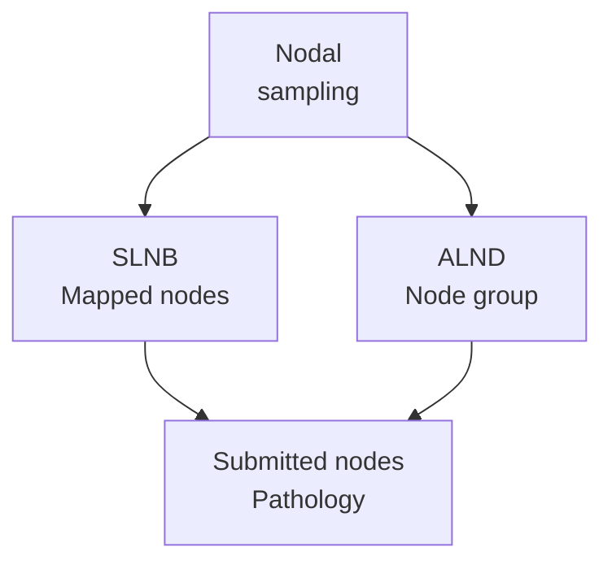

# Sentinel-node biopsy and axillary dissection: what was sampled?

## In one sentence

Sentinel-node biopsy removes selected nodes identified by lymphatic mapping, while axillary lymph-node dissection removes a broader group of nodes and surrounding tissue from the armpit region.

## The intuition

Imagine using a tracer to find particular collection points versus examining a broader area. This captures the difference in sampling strategy. Neither strategy examines every lymph node in the body, and the tracer route is not a perfect replay of cancer's earlier movements.

## How it works

A **sentinel node** is a node identified as an early draining node from the relevant territory. There can be more than one. In **sentinel lymph-node biopsy (SLNB)**, the surgeon uses a mapping agent, such as a radiotracer or dye, to locate nodes for removal. A pathologist examines the submitted tissue for cancer.

**Axillary lymph-node dissection (ALND)** removes a broader packet of tissue containing nodes from specified [axillary levels](/wiki/education/concepts/breast-cancer/anatomy-and-histology/lymphatic-drainage-and-axilla). It is not defined by a universal number of retrieved nodes, and it does not remove every regional nodal group. The operative and pathology reports describe its extent and yield.

**Targeted axillary dissection** combines sentinel sampling with localization and removal of a previously marked node. In the studied post-neoadjuvant setting, that node had biopsy-confirmed involvement before treatment. A marked node and a tracer-identified sentinel node may overlap, but they are not necessarily the same node. Retrieval of the marker needs its own documentation.

*The diagram compares tissue acquisition. It does not choose a procedure or show that either surveys every drainage route.*

## Why it matters in cancer

Nodal procedures can provide staging information and contribute to regional treatment. Their interpretation depends on the pretreatment nodal findings, whether surgery occurs before or after systemic treatment, mapping method and the complete local-treatment plan. Finding a positive sentinel node does not establish one universal next operation.

The American College of Surgeons Oncology Group (ACOSOG) Z1071 study tested sentinel sampling followed by dissection after chemotherapy in patients initially presenting with node-positive breast cancer. It documented missed residual disease under that study's conditions. Caudle and colleagues subsequently studied adding retrieval of a clipped node. These studies show why population and technique belong beside a test result; their accuracy estimates are not universal values for every nodal procedure today.

Nodal surgery also has costs. Disrupted lymph flow can contribute to **lymphedema**, persistent swelling, and other surgical effects. Sampling fewer nodes generally reduces some risks, but SLNB is not risk-free and dissection does not guarantee complications.

## How it is measured

Keep the procedure, location, side, treatment timing, total examined nodes, nodes with reported deposits, deposit measurements and [extranodal extension](/wiki/education/concepts/breast-cancer/surgery-and-pathology-results/extranodal-extension). A pathology laboratory evaluates sampled sections; neither surgical yield nor microscopic detection is unlimited.

“Zero of three nodes positive” means no qualifying involvement was found in those examined nodes under the reporting method. Three is the examined denominator, rather than the total number of nodes in the armpit. [Isolated tumor cells, micrometastases and larger deposits](/wiki/education/concepts/breast-cancer/grade-and-stage/tnm-staging) also have different reporting rules.

A **false negative** occurs when the sampled result misses involvement present in the comparison reference. Its frequency requires a defined population, procedure and reference standard. A negative SLNB is useful evidence, rather than proof that all regional nodes and distant organs contain no cancer.

## Common confusions

- Sentinel means identified by drainage mapping; it does not mean a fixed count of nodes.
- A clipped node is not automatically a sentinel node.
- ALND concerns the axilla, rather than the internal mammary chain or all body nodes.
- “Nodes examined” and “nodes that exist” are different denominators.

## Try it

A fictional post-treatment report says three sentinel nodes were negative, but does not state whether a previously marked node was recovered. Can a summary assert that the originally positive node was confirmed negative?

**Answer:** No. The sentinel findings are documented, but the marked node's identity and retrieval remain unresolved. Confirming that relationship is a different evidentiary step.

## Explain it back

“A nodal result is interpretable when I retain ___.”

**One possible answer:** The sampled region, procedure, timing, identities and pathological findings, including the examined denominator.

## Takeaway

**A nodal result answers a question about a defined sampling procedure; retain that procedure's reach and limits.**

## Related concepts

- [Breast lymphatic drainage](/wiki/education/concepts/breast-cancer/anatomy-and-histology/lymphatic-drainage-and-axilla)
- [Internal mammary nodes](/wiki/education/concepts/breast-cancer/anatomy-and-histology/internal-mammary-nodes)

## Sources and scope

Source check: October 10, 2026. Procedures and measurement limits; the exercise is fictional. No recommendation for an individual's nodal surgery. Expert and learner review remain pending.

- [NCI: sentinel lymph node biopsy](https://www.cancer.gov/about-cancer/diagnosis-staging/staging/sentinel-node-biopsy-fact-sheet) — mapping, risks and false-negative results.
- [CAP breast resection protocol, version 4.11.0.0, June 2026](https://www.cap.org/wp-content/uploads/2026/06/Breast.Invasive.Res_4.11.0.0.REL_CAPCP.pdf?download=true) — node identification, sampling and reporting, Note M.
- [Boughey et al., 2013: ACOSOG Z1071](https://pubmed.ncbi.nlm.nih.gov/24101169/) — sentinel sampling after chemotherapy in an initially node-positive population.
- [Caudle et al., 2016](https://pubmed.ncbi.nlm.nih.gov/26811528/) — prospective study of clipped-node evaluation and targeted axillary dissection after neoadjuvant therapy.

<!-- BEGIN GENERATED USED IN -->
## Used in

- [Read the jobs in the treatment plan](/wiki/education/guides/treating-early-tnbc/01-read-the-jobs-in-the-plan)
<!-- END GENERATED USED IN -->
