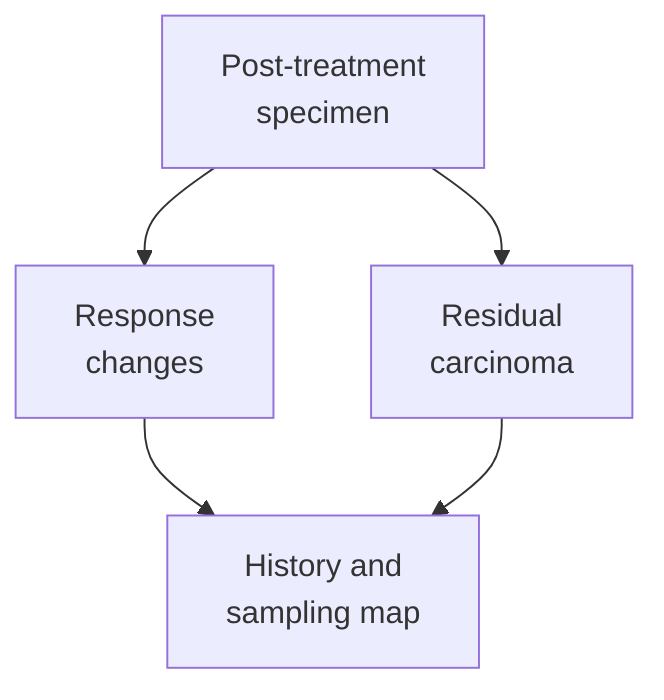
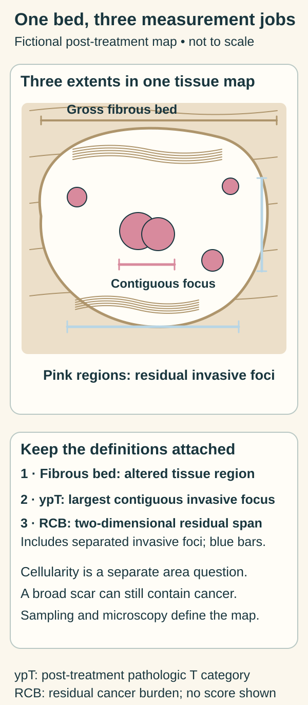

# Treatment effect in pathology: response changes and residual disease

## In one sentence

Treatment effect in pathology describes tissue changes consistent with prior therapy, assessed separately from whether residual viable cancer is identified and how much remains in the examined specimen.

## The intuition

Think of a site after renovation: altered surroundings and what remains there answer different questions. A treated tumor bed can show repair or injury while still containing cancer cells. The analogy stops at the tissue appearance; a scar does not count all cells or tell you what will happen in the future.

## How it works

After [neoadjuvant therapy](/wiki/education/concepts/breast-cancer/treatment-setting/neoadjuvant-vs-adjuvant), given before surgery as part of the treatment plan, a pathologist assesses the breast and any submitted nodes. Changes may include **fibrosis**, collagen-rich scarring; **necrosis**, dead tissue; inflammatory cells; and **histiocytes**, tissue macrophages involved in clearing material. Their presence and pattern must be interpreted with the treatment and specimen history.

**Residual viable carcinoma** means cancer judged to remain viable by pathological assessment. That judgment uses cell and tissue appearance, with supporting studies when needed. It is not a direct culture experiment measuring each cell's ability to grow. Treatment-altered cells can require careful interpretation.

Treatment effect and residual cancer can coexist. A report may find residual carcinoma with signs of response, no definite response in residual carcinoma, or no residual invasive carcinoma identified after treatment. Those categories should not be collapsed into “scarring means no cancer.” Previous biopsy or other tissue injury can also cause repair changes; no single scar proves a drug-specific effect.

*The two branches are assessed together. Neither a response change nor a grossly visible scar substitutes for examination of residual disease.*

## Why it matters in cancer

<!-- BEGIN next-gap-278 VISUAL -->

*The same invented tissue map contains a broad fibrous region and several residual invasive foci. A largest contiguous-focus measurement for ypT and the two-dimensional residual span for RCB serve different jobs. Bar lengths are schematic, with no numerical score or individual staging assignment. Cellularity has its own area denominator.*

The [tumor-bed area example](/wiki/education/concepts/breast-cancer/surgery-and-pathology-results/tumor-bed-cellularity) supplies the separate cellularity denominators. Here, [CAP’s measurement guidance](https://www.cap.org/wp-content/uploads/2026/06/Breast.Invasive.Res_4.11.0.0.REL_CAPCP.pdf?download=true) supports the distinction between residual span and a contiguous focus.

[Open the light diagram](./images/treatment-bed-three-extents-v1-light.svg) · [Open the dark diagram](./images/treatment-bed-three-extents-v1-dark.svg)
<!-- END next-gap-278 VISUAL -->

Keep three measurements distinct:

| Measurement | What it describes |
|---|---|
| Fibrous or gross tumor-bed area | The altered region recognized during specimen examination |
| Residual invasive focus for post-treatment T staging | The relevant remaining invasive focus under staging rules |
| Residual cancer burden inputs | Residual-invasive span and [cancer cellularity](/about/Terminology#tumor-cellularity), plus specified nodal findings, under that assessment protocol |

[Residual cancer burden (RCB)](/wiki/education/concepts/breast-cancer/surgery-and-pathology-results/residual-cancer-burden) uses defined measurements. A gross fibrous bed need not equal the microscopic span containing residual invasion. **Cellularity** describes the proportion occupied by cancer within a specified assessment area; its denominator must stay attached. Current College of American Pathologists (CAP) guidance cautions that RCB was not designed or validated for neoadjuvant endocrine treatment. It is not a universal response score for every treatment setting.

[Pathologic complete response (pCR)](/wiki/education/concepts/breast-cancer/surgery-and-pathology-results/pcr) also needs a definition and adequate evaluation of breast and nodes. The commonly used absence-of-invasive-cancer definition can allow residual [ductal carcinoma in situ (DCIS)](/wiki/education/concepts/breast-cancer/anatomy-and-histology/dcis). “No invasive cancer in the breast” alone cannot establish the combined breast-and-node endpoint. None of these findings proves that every site in the body is free of cancer.

## How it is measured

The assessment connects pretreatment location and findings, imaging or marker information, gross examination, a mapped sampling plan and microscopy. Remaining tumor can be sparse or scattered. Looking at an arbitrary section without locating the relevant bed can miss the question the specimen was meant to answer.

Breast and nodal response are reported separately. Scarring or histiocytic aggregates in a node without residual carcinoma can be consistent with treated prior involvement. They should not independently be upgraded to biopsy-proven pretreatment nodal disease when that evidence is absent.

For post-neoadjuvant T and N staging, adjacent therapy-related fibrosis is excluded from the relevant residual-focus dimensions. RCB has its own bed and nodal measurement rules. A single unlabelled “size” cannot safely replace all those fields.

## Common confusions

- Treatment effect is not synonymous with no residual cancer.
- A fibrous bed's dimensions are not automatically residual invasive tumor dimensions.
- Cancer cellularity is not the same as bulk molecular-assay tumor purity.
- A histological response describes the assessed specimen and setting; it does not erase the pretreatment record or prove cure.

## Try it

In a fictional specimen, a broad fibrous bed contains scattered residual invasive carcinoma. Can it be summarized as either “the whole bed is solid cancer” or “the scar proves no cancer remains”?

**Answer:** Neither. Both altered tissue and residual disease are present. The report needs the relevant residual dimensions, cellularity, nodal findings and assessment method, rather than one interpretation of the scar's size.

## Explain it back

“Treatment effect tells me ___; residual-disease assessment tells me ___.”

**One possible answer:** What response-related tissue changes were seen; whether and how much cancer remains in the material evaluated under specified rules.

## Takeaway

**Read response changes, residual viable disease and the sampling method together, while keeping each measurement's definition.**

## Related concepts

- [pCR](/wiki/education/concepts/breast-cancer/surgery-and-pathology-results/pcr)
- [Residual cancer burden](/wiki/education/concepts/breast-cancer/surgery-and-pathology-results/residual-cancer-burden)

## Sources and scope

Source check: October 10, 2026. Breast and nodal assessment after neoadjuvant therapy; the exercise is fictional. No individual response forecast or treatment recommendation. Expert and learner review remain pending.

- [CAP breast resection protocol, version 4.11.0.0, June 2026](https://www.cap.org/wp-content/uploads/2026/06/Breast.Invasive.Res_4.11.0.0.REL_CAPCP.pdf?download=true) — treatment-effect fields, Note K, different RCB/staging dimensions and the endocrine-treatment limitation.
- [Provenzano et al., 2015](https://www.nature.com/articles/modpathol201574) — international working-group recommendations for mapped sampling and post-neoadjuvant breast and nodal assessment; a reporting consensus, not a trial of treatment benefit.
- [Diagnostic pitfalls in breast cancer pathology, 2023](https://meridian.allenpress.com/aplm/article/147/9/1025/495517/Diagnostic-Pitfalls-in-Breast-Cancer-Pathology) — biopsy-site repair changes and the need for morphological context; a pathology review, not a treatment-response trial.

<!-- BEGIN GENERATED USED IN -->
## Used in

- [Read residual disease and margins](/wiki/education/guides/reading-pathology-and-surgery-results/02-read-residual-disease-and-margins)
<!-- END GENERATED USED IN -->
