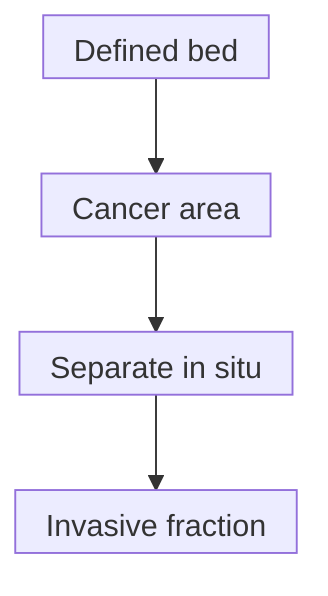
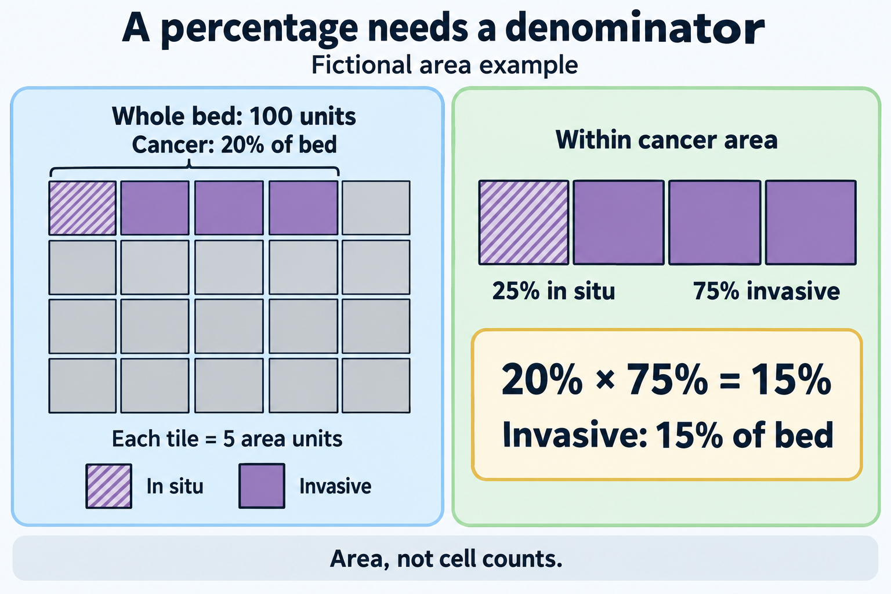

# Tumor-bed cellularity

## In one sentence

Tumor-bed cellularity estimates the proportion of a defined residual breast tumor-bed area occupied by cancer, with the in situ share assessed separately when calculating invasive cellularity.

## The intuition

Imagine outlining a garden and estimating the area occupied by plants. The outline and the density inside it are different measurements. A large treated tumor bed can contain sparse cancer; a smaller one can be densely occupied.

This is an area analogy, not a cell census. Pathologic cellularity in this method is not the percentage of all counted cells that are malignant, nor the fraction of sequenced DNA contributed by cancer.

## How it works

After [neoadjuvant treatment](/wiki/education/concepts/breast-cancer/treatment-setting/neoadjuvant-vs-adjuvant), a pathologist defines the residual bed using gross findings and microscopic review. The [residual cancer burden (RCB)](/wiki/education/concepts/breast-cancer/surgery-and-pathology-results/residual-cancer-burden) method assesses cancer-occupied area across that defined bed, including sparse regions rather than selecting only the densest focus.

Two percentages have different denominators:

| Measurement | Numerator | Denominator |
|---|---|---|
| Overall cancer cellularity | Area occupied by invasive plus in situ cancer | Defined tumor-bed area |
| In situ percentage | In situ cancer component | Cancer component, not the entire bed |

[In situ disease](/wiki/education/concepts/breast-cancer/anatomy-and-histology/dcis) remains within ducts; invasive disease has crossed into surrounding tissue. For the RCB input calculation, the invasive fraction of bed area is overall cellularity multiplied by the fraction of cancer that is invasive.

*An interpretation sequence with explicit denominators, not a biological conversion of in situ cancer into invasive cancer. The calculation is explained below.*

## Measurement card

- **Measures:** Cancer-occupied area within the defined bed and the in situ share of that cancer.
- **How:** Gross mapping and review of representative microscopic sections, estimating an overall bed average.
- **Input and tissue cost:** A treated breast resection and histologic sections; additional sampling consumes finite tissue.
- **Output and units:** Percent bed occupied by cancer, and percent of cancer that is in situ. They need separate labels.
- **Thresholds:** There is no universal low/high cutoff that alone selects a treatment. The RCB method specifies its estimation conventions.
- **Failure modes:** Misdefined bed, incomplete representation, variable distribution or sampling only dense cancer regions.
- **Cannot tell:** Node burden, final margins, distant disease, sequencing purity or an RCB score by itself.
- **Validation context:** A pathology component of a defined response method. The College of American Pathologists (CAP) distinguishes reporting residual measurements from assigning an RCB score after neoadjuvant endocrine therapy, for which the score was not designed or validated.

## Why it matters in cancer

Bed dimensions and cellularity describe different aspects of remaining disease. Under current CAP guidance, the residual span used for RCB can include separated invasive foci; the largest contiguous residual invasive focus used for ypT is a different measurement. Scarring alone is not an interchangeable tumor dimension.

Neither cellularity percentage can replace [sequencing cell purity](/wiki/education/concepts/measurement/sequencing-basics/variant-allele-fraction-and-cancer-cell-fraction). Area, counted-cell fractions and DNA contributions have different denominators. An assay-specific sample assessment may also concern a selected block rather than the whole residual bed.

## Worked example

*Fictional area tiles, not cells: 20 cancer units within a 100-unit bed include five in situ and 15 invasive units. The grid teaches denominators, not pixel-counting instructions, sequencing purity or an RCB score.*

**Fictional, simplified arithmetic:** Set the defined bed area to 100 area units. Cancer occupies 20 units: overall cellularity is 20%. Of that cancer component, 25% is in situ.

- In situ occupies 20 × 0.25 = **5 bed-area units**.
- Invasive cancer occupies 20 × 0.75 = **15 bed-area units**.
- Thus invasive cellularity is **15% of the bed**: 0.20 × (1 − 0.25) = 0.15.

The 75% is the invasive share **of the cancer component**, not 75% of the bed. These idealized numbers explain denominators; they do not imply that visual estimates have this precision. They also cannot yield an RCB score without the other required breast and node inputs.

## Common confusions

- A large bed is not automatically a densely occupied invasive mass.
- In situ percentage here uses the cancer component as denominator.
- Twenty percent area does not mean twenty percent of counted cells or DNA.
- Low cellularity alone does not establish [pathologic complete response (pCR)](/wiki/education/concepts/breast-cancer/surgery-and-pathology-results/pcr).

## Try it

In the fictional example, a reader reports “25% of the whole bed is in situ,” and enters 20% as sequencing purity. Are either of those substitutions supported?

**Answer:** No. The in situ component is 25% of the 20% cancer-occupied area, or 5% of the bed. Sequencing purity needs its own sample and method; the area estimate cannot supply it.

## Explain it back

Name both percentage denominators before explaining the 15% invasive result.

**One possible answer:** Twenty percent refers to bed area; twenty-five percent refers to the cancer within that area. Removing the in situ share leaves fifteen percent of the bed occupied by invasive cancer.

## Takeaway

**A percentage becomes useful when you know its region, numerator and denominator.**

## Related concepts

- [Residual cancer burden](/wiki/education/concepts/breast-cancer/surgery-and-pathology-results/residual-cancer-burden)
- [Surgical margins](/wiki/education/concepts/breast-cancer/surgery-and-pathology-results/surgical-margins)

## Sources and scope

Source-checked October 10, 2026; expert and learner review pending. This teaches a pathology measurement and fictional arithmetic, not a personal score or treatment recommendation.

- [MD Anderson: Detailed pathology methods for RCB](https://www.mdanderson.org/content/dam/mdanderson/documents/for-physicians/clinical-calculators/PLM_protocol_RCB_calculators_BRO.pdf), pages 1–4, for area denominators and whole-bed assessment.
- [CAP invasive breast resection protocol, June 2026, version 4.11](https://www.cap.org/wp-content/uploads/2026/06/Breast.Invasive.Res_4.11.0.0.REL_CAPCP.pdf?download=true), Note K, for residual-span, cellularity and endocrine-treatment boundaries.
- [Symmans and colleagues, 2007](https://pubmed.ncbi.nlm.nih.gov/17785706/), primary abstract, for the original combined RCB measure after neoadjuvant chemotherapy.

<!-- BEGIN GENERATED USED IN -->
## Used in

- [Read residual disease and margins](/wiki/education/guides/reading-pathology-and-surgery-results/02-read-residual-disease-and-margins)
- [Build the next question](/wiki/education/guides/reading-pathology-and-surgery-results/03-build-the-next-question)
- [Read pathology and surgery results](/wiki/education/guides/reading-pathology-and-surgery-results/index)
- [Read single-cell data after treatment](/wiki/education/molecular-profiling/08-profile-residual-tumor)
<!-- END GENERATED USED IN -->
