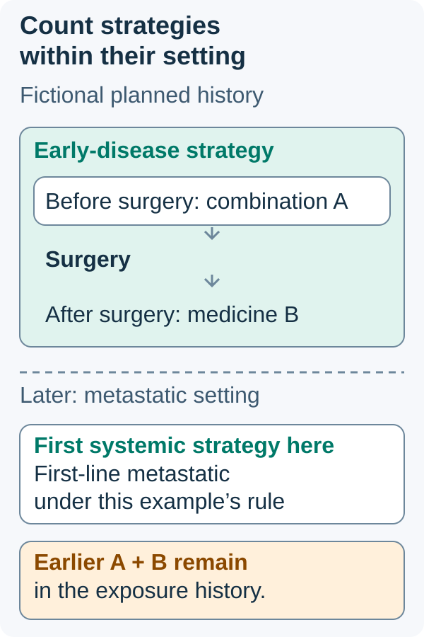

# Line of therapy

## In one sentence

A line of therapy is a distinct treatment strategy in a defined disease setting, counted using the clinical record or a study’s stated rules.

## The intuition

A line is like a chapter in a treatment story. Several medicines, visits and planned stages can belong to one chapter. Turning a page because the strategy changes is different from counting every medicine as a new chapter.

The analogy has a limit: clinical records and trial protocols may draw chapter boundaries differently. The number becomes useful only when its setting and counting rule are clear.

## How it works

**First-line therapy** is the initial treatment strategy for a specified disease setting. **Second-line therapy** generally follows when the first strategy does not work or stops working. Intolerable toxicity can also lead to a new strategy. The [National Cancer Institute's first-line](https://www.cancer.gov/publications/dictionaries/cancer-terms/def/first-line-therapy) and [second-line definitions](https://www.cancer.gov/publications/dictionaries/cancer-terms/def/second-line-therapy) establish the basic sequence.

A **regimen** is a planned combination or sequence of treatments. A **cycle** is a repeating treatment-and-recovery interval. A planned block can use different medicines from the preceding block without automatically becoming another line. [Neoadjuvant and adjuvant](/wiki/education/concepts/breast-cancer/treatment-setting/neoadjuvant-vs-adjuvant) describe timing around the main treatment; they do not mean first and second line.

In advanced breast-cancer studies, “first line” often refers specifically to the first systemic strategy for advanced disease. Earlier treatment given with [curative intent](/wiki/education/concepts/breast-cancer/treatment-setting/curative-intent) is recorded separately and can still affect eligibility. It is not safe to translate “first-line metastatic” into “never received an anticancer medicine.”

For example, the **KEYNOTE-355** primary report studied previously untreated locally recurrent inoperable or metastatic triple-negative breast cancer. Its randomization also accounted for previous chemotherapy in the neoadjuvant or adjuvant setting. Those are compatible statements: prior early-disease exposure and prior advanced-disease treatment are different fields. This example explains a trial's terminology, not current access or a prescribing choice. [Primary report](https://pubmed.ncbi.nlm.nih.gov/33278935/).

## Why it matters in cancer

A study in a first-line population may not transfer to people whose cancer progressed through several strategies. Previous exposure can affect [drug resistance](/wiki/education/concepts/therapeutics/how-drugs-work/drug-resistance), tolerability and the comparison being tested. The same drug name in two studies therefore does not make their populations equivalent.

A “later line” is not a forecast of remaining life or a guarantee that options are exhausted. It is a history label. Disease biology, available evidence and the person's circumstances remain separate questions.

## How it is recorded

| Record field | What it clarifies |
|---|---|
| Disease setting | Early, recurrent operable, unresectable or metastatic disease |
| Strategy and dates | Medicines, planned sequence, start and stop dates |
| Reason for change | Progression, toxicity, planned completion or another documented reason |
| Counting convention | How the clinical record, label or protocol handles switches and maintenance |

When a study labels continued treatment as **maintenance**, check whether its counting convention includes that phase with the initial line or counts it separately. A dose reduction, pause or removal of one component also does not automatically create a new line. Preserve what happened before assigning a number.

## Common confusions

- Three drugs can form one regimen; three infusions are not three lines.
- A switch built into the original plan differs from changing strategy after progression.
- Early/adjuvant exposure may matter to trial eligibility even when it is not counted as a prior metastatic line.
- A database's algorithmic line count may differ from the clinician's account. Check its rules before comparing groups.

## Try it

A fictional plan gives combination A before surgery and medicine B afterward as its planned adjuvant phase. Years later, metastatic disease receives its first systemic regimen. Does the earlier plan automatically make this third-line metastatic treatment?

*Planned phases can belong to one strategy; earlier exposure does not automatically become a prior metastatic line.*

The outline around A, surgery and B groups a fictional planned early-disease strategy. The dashed setting boundary changes the question being counted. In the later metastatic setting, the first systemic strategy is first-line metastatic under this example’s stated convention. Keep A and B in the exposure history even though they are not prior metastatic lines.

*Visual scope: Fictional history and illustrative counting convention: no earlier systemic metastatic strategy. Time separation is schematic; no universal switch or maintenance algorithm.*

**Answer:** No. The earlier treatments must remain in the history, but they were given in another setting. Count advanced-disease lines using the relevant clinical or protocol rule; do not count calendar phases as metastatic lines.

## Explain it back

“Before interpreting ‘second line,’ I need ___.”

**One possible answer:** “The disease setting, the earlier strategy and the counting rule.”

## Takeaway

**A line describes a strategy in context, not a drug count or an infusion count.**

## Related concepts

- [The KEYNOTE-522 regimen](/wiki/education/concepts/breast-cancer/treatment-setting/the-keynote-522-regimen)
- [Cross-trial comparison](/wiki/education/concepts/evidence-and-statistics/reasoning-tools/cross-trial-comparison)
- [Finding a trial](/wiki/education/concepts/access-and-regulation/trials-and-access/finding-a-trial)

## Sources and scope

Visual addition source check: October 13, 2026. Expert and learner review pending. Original teaching source bounds are retained below.

Source-checked October 10, 2026. General education; the treatment story is fictional. Expert and learner review remain pending. No universal algorithm for counting every switch is asserted.

- [NCI: First-line therapy](https://www.cancer.gov/publications/dictionaries/cancer-terms/def/first-line-therapy) — initial treatment and a possible set of treatments.
- [NCI: Second-line therapy](https://www.cancer.gov/publications/dictionaries/cancer-terms/def/second-line-therapy) — treatment after the initial treatment does not work or stops working.
- [NCI: Chemotherapy](https://www.cancer.gov/about-cancer/treatment/types/chemotherapy) — cycles, differing roles and schedule changes.
- [Cortes and colleagues, 2020: KEYNOTE-355](https://pubmed.ncbi.nlm.nih.gov/33278935/) — primary abstract; an advanced-disease population with previous neoadjuvant/adjuvant exposure recorded separately.

<!-- BEGIN GENERATED USED IN -->
## Used in

- [Read timing around surgery](/wiki/education/guides/treating-early-tnbc/02-read-timing-around-surgery)
- [Understand how treatment is sequenced](/wiki/education/guides/treating-early-tnbc/index)
<!-- END GENERATED USED IN -->
