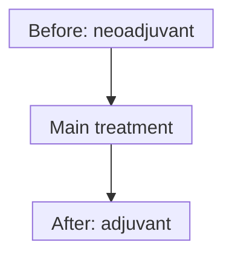

# Neoadjuvant versus adjuvant therapy

## In one sentence

Neoadjuvant and adjuvant describe treatment's timing around the main treatment, usually surgery: neoadjuvant comes before it, and adjuvant comes after it to lower recurrence risk.

## The intuition

Put a bookmark at the main treatment in a cancer plan. Treatment before the bookmark can be neoadjuvant; additional treatment after it can be adjuvant. These words name roles in a plan, rather than naming a particular medicine.

The bookmark also needs a purpose. A drug happening before any procedure is not automatically neoadjuvant. Dates alone cannot tell us whether the procedure is the main treatment or an intervention to relieve a symptom.

## How it works

**Neoadjuvant therapy** precedes the main treatment. It can reduce disease before surgery and provides an opportunity to assess response while the tumor is present. **Adjuvant therapy** follows the main treatment to reduce recurrence risk, including risk from disease too small to see. The [National Cancer Institute (NCI) timing definitions](https://www.cancer.gov/publications/dictionaries/cancer-terms/def/neoadjuvant-therapy) describe these roles.

The same treatment class can appear at different times. Chemotherapy, endocrine therapy, radiation and other treatments may have preoperative or postoperative roles in appropriate settings. **Systemic** means acting throughout the body rather than only at a treated local site. Neither timing word means chemotherapy only.

| Timing term | Position and role | What it does not establish |
|---|---|---|
| Neoadjuvant | Before the main treatment, often to reduce disease and assess response | That every pre-procedure drug has this role or will shrink the tumor |
| Adjuvant | After the main treatment, to lower recurrence risk | That visible cancer must remain or that recurrence is impossible |

*Possible positions around a main treatment. A plan may use either, both or neither surrounding phase; the arrows do not prescribe a sequence.*

## Why it matters in cancer

Timing changes what can be observed. With neoadjuvant treatment, examination, imaging and later surgical pathology can describe response. In an adjuvant setting there may be no measurable tumor to watch. The aim can be recurrence-risk reduction rather than shrinkage of a visible mass.

Keep timing separate from [curative intent](/wiki/education/concepts/breast-cancer/treatment-setting/curative-intent), which describes the plan's goal. Neither a preoperative drug nor a postoperative drug establishes intent from its calendar position alone.

Also distinguish palliative treatment intent from **palliative care**, supportive care for symptoms, distress and quality of life. Palliative care can accompany curative care; it does not necessarily mean cancer treatment has stopped.

## Worked example

In a fictional curative-intent plan, systemic therapy precedes definitive breast surgery, followed by additional treatment to reduce recurrence risk. The first systemic phase is neoadjuvant; the later phase is adjuvant. Related medicines can appear in both phases without changing those roles.

In another fictional plan, systemic therapy controls advanced cancer and a later procedure relieves a symptom. The sequence is also “drug, then procedure,” but that alone does not establish a neoadjuvant role. We need the documented goal and the procedure's purpose.

Now attach three dates: specimen collection, treatment delivery and report issue. A result issued after surgery may test a biopsy collected before treatment. It does not become a post-treatment measurement because it was reported late. [TNM prefixes](/wiki/education/concepts/breast-cancer/grade-and-stage/tnm-staging) retain that assessment context.

## Common confusions

- Adjuvant treatment can be given when no cancer is visible.
- Neoadjuvant is not a synonym for curative; adjuvant is not a guarantee of cure.
- **Neoadjuvant chemotherapy (NAC)** is one type of neoadjuvant treatment, not the entire category.
- A vaccine **adjuvant** is an ingredient that strengthens an immune response. That meaning differs from adjuvant cancer therapy's timing.
- Planned treatment is not proof of delivered treatment; holds and substitutions still matter.

## Try it

A fictional postoperative plan aims to reduce recurrence risk despite no visible tumor. A supportive-care visit occurs during that plan. Is the cancer treatment adjuvant? Does the supportive visit establish palliative treatment intent?

**Answer:** The cancer treatment has an adjuvant role. The supportive visit does not establish palliative intent: palliative care can accompany curative care. Read each activity's documented purpose.

## Explain it back

Name the two details that distinguish neoadjuvant treatment from a drug that merely happens before a procedure.

**One possible answer:** Its role before the main treatment and the purpose of that main treatment. Timing alone is insufficient.

## Takeaway

**Use timing words to place treatment in its documented plan, then read the goal and delivered course separately.**

## Related concepts

- [Curative intent](/wiki/education/concepts/breast-cancer/treatment-setting/curative-intent)
- [Pathologic complete response](/wiki/education/concepts/breast-cancer/surgery-and-pathology-results/pcr)

## Sources and scope

Source-checked October 10, 2026; expert and learner review pending. Plans are fictional and do not prescribe an individual's sequence.

- [NCI: Neoadjuvant therapy](https://www.cancer.gov/publications/dictionaries/cancer-terms/def/neoadjuvant-therapy), for pre-main-treatment timing and examples.
- [NCI: Adjuvant therapy](https://www.cancer.gov/publications/dictionaries/cancer-terms/def/adjuvant-therapy), for recurrence-risk reduction after primary treatment.
- [NCI: Palliative care in cancer](https://www.cancer.gov/about-cancer/advanced-cancer/care-choices/palliative-care-fact-sheet), for supportive care alongside curative care.
- [CDC: Adjuvants and vaccines](https://www.cdc.gov/vaccine-safety/about/adjuvants.html), for the separate ingredient meaning.

<!-- BEGIN GENERATED USED IN -->
## Used in

- [Place the specimen in time](/wiki/education/guides/reading-pathology-and-surgery-results/01-place-the-specimen-in-time)
- [Read pathology and surgery results](/wiki/education/guides/reading-pathology-and-surgery-results/index)
- [Read timing around surgery](/wiki/education/guides/treating-early-tnbc/02-read-timing-around-surgery)
- [Understand how treatment is sequenced](/wiki/education/guides/treating-early-tnbc/index)
- [Put the disease setting before the clock](/wiki/education/local-treatment-modalities/02-timing)
<!-- END GENERATED USED IN -->
