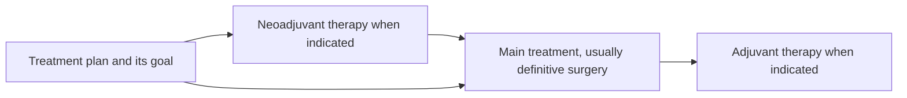

# Neoadjuvant versus adjuvant therapy

## In one sentence

Neoadjuvant and adjuvant describe treatment's timing around the main treatment, usually surgery: neoadjuvant comes before it, and adjuvant comes after it to lower recurrence risk.

## The intuition

Put a bookmark at the main treatment in a cancer plan. Treatment before the bookmark can be neoadjuvant; additional treatment after it can be adjuvant. The word tells you where the treatment fits in the plan, rather than naming a particular drug.

The bookmark also needs a purpose. A drug happening before any procedure is not automatically neoadjuvant. The terms describe a planned relationship to the main treatment, usually definitive surgery.

## How it works

**Neoadjuvant therapy** is treatment before the main treatment. It can reduce disease before surgery and lets clinicians assess response while the tumor is still present. **Adjuvant therapy** follows the main treatment to lower the chance of recurrence, including risk from cancer cells too small to see. [NCI's neoadjuvant](https://www.cancer.gov/publications/dictionaries/cancer-terms/def/neoadjuvant-therapy) and [adjuvant definitions](https://www.cancer.gov/publications/dictionaries/cancer-terms/def/adjuvant-therapy) describe these roles.

The same treatment class can be used at different times. Chemotherapy, endocrine therapy and other systemic therapies can appear in different settings. **Systemic** means acting throughout the body, rather than only at a treated local site. Radiation can also be used before or after surgery in appropriate plans. Neither timing word means “chemotherapy only.”

| Timing term | Position in the plan | What the label does not establish |
| --- | --- | --- |
| Neoadjuvant | Before the main treatment, usually surgery | That the tumor will shrink, or that every pre-procedure drug has this role |
| Adjuvant | After the main treatment, to reduce recurrence risk | That visible cancer must remain, or that recurrence has become impossible |

This is a map of possible positions, not a requirement to receive every step. Some plans begin with surgery; others begin with systemic therapy. The plan depends on the cancer, extent, treatment evidence and the person's circumstances.

## Why it matters in cancer

Timing shapes what can be learned. With neoadjuvant treatment, examination, imaging and later surgical pathology can describe response. With adjuvant treatment, there may be no measurable tumor left to watch; the aim is to reduce future recurrence risk, not to prove that a visible mass is shrinking.

Keep **timing** separate from [**curative intent**](/wiki/education/concepts/breast-cancer/treatment-setting/curative-intent): timing describes where treatment sits; intent describes the plan's goal. A treatment's position on the calendar alone cannot tell you its intent.

Also distinguish palliative treatment intent from **palliative care**, supportive care addressing symptoms, distress and quality of life. Palliative care can accompany a curative treatment plan, as [NCI explains](https://www.cancer.gov/about-cancer/advanced-cancer/care-choices/palliative-care-fact-sheet).

## Worked example

In a fictional curative-intent plan, systemic treatment is followed by definitive breast surgery, then additional treatment to reduce recurrence risk. The first systemic phase is neoadjuvant; the later phase is adjuvant. These labels describe roles in the plan, even if related medicines appear in both phases.

In a second fictional plan, systemic treatment aims to control advanced cancer and a later procedure relieves a symptom. The calendar also has “drug, then procedure,” but that sequence alone does not establish a neoadjuvant role. Read the documented goal and the procedure's purpose.

## Common confusions

- Adjuvant therapy can be given when no cancer is visible; its role is recurrence-risk reduction.
- Neoadjuvant is not a synonym for curative, and adjuvant is not a guarantee of cure.
- Palliative care can be offered alongside curative-intent treatment.
- In a vaccine, an [**adjuvant**](https://www.cdc.gov/vaccine-safety/about/adjuvants.html) is an ingredient that strengthens an immune response. That use of the word is different from adjuvant cancer therapy's timing.
- **Neoadjuvant chemotherapy (NAC)** is one kind of neoadjuvant treatment, not the whole category.

## Explain it back

Which two details tell you whether treatment before a procedure is neoadjuvant? Its documented role before the main treatment and the purpose of that main treatment. The dates alone are insufficient.

## Related concepts

- [TNM staging](/wiki/education/concepts/breast-cancer/grade-and-stage/tnm-staging)
- [Histologic grade](/wiki/education/concepts/breast-cancer/grade-and-stage/histologic-grade)
- [Read pathology and surgery results](/wiki/education/guides/reading-pathology-and-surgery-results/index)

## Sources and scope

General education; fictional treatment plans. Source-checked October 9, 2026. Expert and learner review remain pending. Timing definitions do not prescribe a sequence for an individual.

- [NCI, neoadjuvant therapy](https://www.cancer.gov/publications/dictionaries/cancer-terms/def/neoadjuvant-therapy): treatment before the main treatment.
- [NCI, adjuvant therapy](https://www.cancer.gov/publications/dictionaries/cancer-terms/def/adjuvant-therapy): treatment after the main treatment to reduce recurrence risk.
- [NCI, chemotherapy](https://www.cancer.gov/about-cancer/treatment/types/chemotherapy): treatment roles and differing goals.
- [NCI, palliative care in cancer](https://www.cancer.gov/about-cancer/advanced-cancer/care-choices/palliative-care-fact-sheet): supportive care alongside curative or other treatment.
- [CDC, adjuvants and vaccines](https://www.cdc.gov/vaccine-safety/about/adjuvants.html): the separate vaccine-ingredient meaning of adjuvant.

<!-- BEGIN GENERATED USED IN -->
## Used in

- [Place the specimen in time](/wiki/education/guides/reading-pathology-and-surgery-results/01-place-the-specimen-in-time)
- [Read pathology and surgery results](/wiki/education/guides/reading-pathology-and-surgery-results/index)
- [Read timing around surgery](/wiki/education/guides/treating-early-tnbc/02-read-timing-around-surgery)
- [Understand how treatment is sequenced](/wiki/education/guides/treating-early-tnbc/index)
- [Put the disease setting before the clock](/wiki/education/local-treatment-modalities/02-timing)
<!-- END GENERATED USED IN -->
