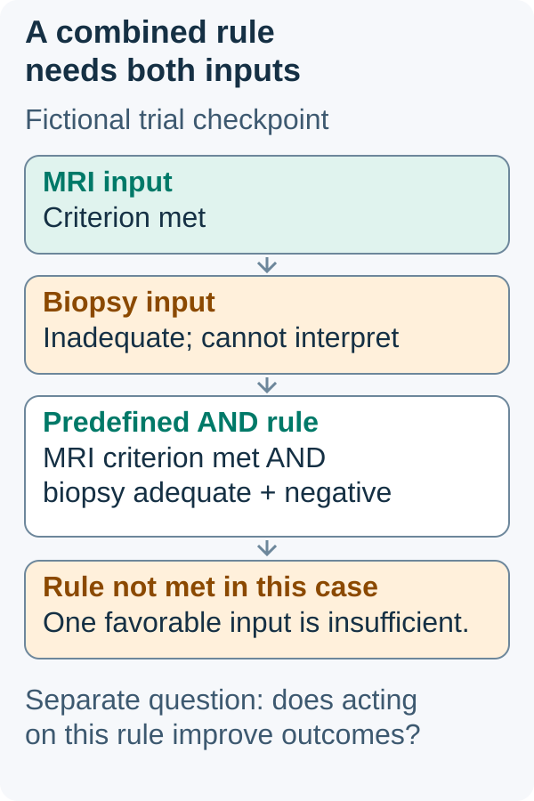

# Response-adapted therapy

## In one sentence

Response-adapted therapy uses an assessed treatment response to guide a predefined next treatment step within a specified clinical strategy.

## The intuition

Imagine a route with checkpoints and written instructions for each branch. A checkpoint gives useful information because the next step has a defined relationship to it. Seeing a promising signal and inventing a shortcut afterward is a different process.

The analogy has a limit: a treatment response is measured imperfectly. The route also needs clinical evidence that its branches preserve useful outcomes and acceptable safety.

## How it works

An adaptive strategy specifies **who**, **what is measured**, **when**, **which result triggers a branch**, and **what happens next**. A branch might continue treatment, change medicines, add treatment or omit a later component. These actions need different evidence; “response-adapted” does not mean “less treatment.”

The assessment must match the decision. [Magnetic resonance imaging (MRI)](/wiki/education/concepts/measurement/imaging/breast-mri) measures imaging signals. [Pathologic complete response (pCR)](/wiki/education/concepts/breast-cancer/surgery-and-pathology-results/pcr) is a defined tissue endpoint. A prediction of pCR is not the surgical finding itself. A negative biopsy also samples only its submitted tissue.

For a real research example, the **I-SPY2.2** phase 2 platform studied presurgical treatment blocks in high-risk stage II–III breast cancer. Its datopotamab-deruxtecan/durvalumab report used subtype-specific rules, serial MRI and a core biopsy. Participants meeting combined criteria could proceed to surgery before later blocks. This was a protocolized research strategy, not a rule allowing any favorable scan to cancel chemotherapy or surgery. The report's response findings do not by themselves establish equivalent long-term survival for every omission strategy. [Primary report](https://pubmed.ncbi.nlm.nih.gov/39277672/).

Adaptation can also use postoperative findings. **CREATE-X** randomized people with [human epidermal growth factor receptor 2 (HER2)](/wiki/education/concepts/breast-cancer/receptors-and-subtypes/her2)-negative residual invasive breast cancer after preoperative chemotherapy to postsurgical care with or without capecitabine. The response-defined population and randomized treatment comparison supplied evidence beyond “residual disease means higher risk.” It did not test adding capecitabine after a modern perioperative pembrolizumab course. [Primary report](https://pubmed.ncbi.nlm.nih.gov/28564564/).

## Why it matters in cancer

A result can be [prognostic](/wiki/education/concepts/evidence-and-statistics/biomarkers/prognostic-vs-predictive), meaning it informs risk, without proving which treatment change helps. A response-guided strategy must evaluate the decision made from that result. Test accuracy, the decision rule and clinical outcomes are separate parts of that evaluation.

Planned adaptation also differs from changing treatment because of toxicity. Safety can require an immediate clinical change even when the cancer response is favorable. That does not automatically validate the changed course as equivalent to the original one.

## How it is measured

| Readout | Details needed before it can guide a branch |
|---|---|
| Imaging change | Method, baseline, acquisition times, units and protocol threshold |
| Tissue response | Sample adequacy, sites examined and response definition |
| Strategy benefit | Comparator, recurrence or survival endpoint, follow-up and harms |

There is no universal response percentage that safely triggers treatment omission. A rule validated for one assay, subtype and treatment sequence may not transfer to another.

## Common confusions

- A baseline marker used to select a medicine is not necessarily an on-treatment response rule.
- Adaptive **randomization** changes how future trial participants are assigned; response adaptation changes a participant's later treatment. A trial can use both.
- Predicting response is different from showing that acting on the prediction improves outcomes.
- Treatment escalation can be response-adapted too; adaptation is not a synonym for de-escalation.

## Try it

In a fictional trial, early surgery requires both a specified MRI result and an adequate negative biopsy. The scan meets its criterion, but the biopsy is inadequate. Has the participant met the study's early-surgery rule?

*A favorable scan cannot replace an inadequate biopsy; reading a branch rule does not prove the branch improves outcomes.*

Apply only the stated fictional rule. The magnetic resonance imaging (MRI) input meets its criterion, but the biopsy cannot be interpreted adequately. Because the rule requires both an appropriate scan and an adequate negative biopsy, this participant has not met it. This is protocol literacy, not an instruction to omit treatment or choose surgery.

*Visual scope: Fictional trial, checkpoint and combined rule; no numerical cutoff. Response prediction is distinct from measured surgical pathologic complete response, and branch logic is distinct from long-term strategy benefit.*

**Answer:** No. One favorable result cannot replace the missing assessment. This tells us how to read the fictional protocol, not what a clinician should prescribe outside it.

## Explain it back

“A response result informs a treatment branch only when ___.”

**One possible answer:** “The assessment, timing and decision rule match the tested population and strategy, with the remaining uncertainty kept visible.”

## Takeaway

**Response adaptation needs an assessed response, a defined rule and evidence for the resulting strategy.**

## Related concepts

- [Neoadjuvant versus adjuvant therapy](/wiki/education/concepts/breast-cancer/treatment-setting/neoadjuvant-vs-adjuvant)
- [Test validity and clinical utility](/wiki/education/concepts/measurement/computational-analysis/analytical-validity-clinical-validity-and-utility)
- [Surrogate endpoints: the pCR paradox](/wiki/education/concepts/evidence-and-statistics/endpoints/surrogate-endpoints)
- [Randomization and trial phases](/wiki/education/concepts/evidence-and-statistics/study-design/trial-phases-and-randomization)

## Sources and scope

Visual addition source check: October 13, 2026. Expert and learner review pending. Original teaching source bounds are retained below.

Source-checked October 10, 2026. General education; the practice trial is fictional. Expert and learner review remain pending. The cited studies illustrate defined strategies, not individual treatment instructions.

- [Shatsky and colleagues, 2024: I-SPY2.2](https://pubmed.ncbi.nlm.nih.gov/39277672/) — primary abstract and selected full-text design, treatment-block, eligibility, serial-MRI and analysis sections; presurgical response-guided research in high-risk stage II–III breast cancer.
- [Masuda and colleagues, 2017: CREATE-X](https://pubmed.ncbi.nlm.nih.gov/28564564/) — primary abstract; randomized postsurgical treatment in HER2-negative residual invasive disease after preoperative chemotherapy.

<!-- BEGIN GENERATED USED IN -->
## Used in

- [Read timing around surgery](/wiki/education/guides/treating-early-tnbc/02-read-timing-around-surgery)
- [Use the findings in the next conversation](/wiki/education/guides/treating-early-tnbc/03-use-the-findings-in-the-next-conversation)
- [Understand how treatment is sequenced](/wiki/education/guides/treating-early-tnbc/index)
<!-- END GENERATED USED IN -->
