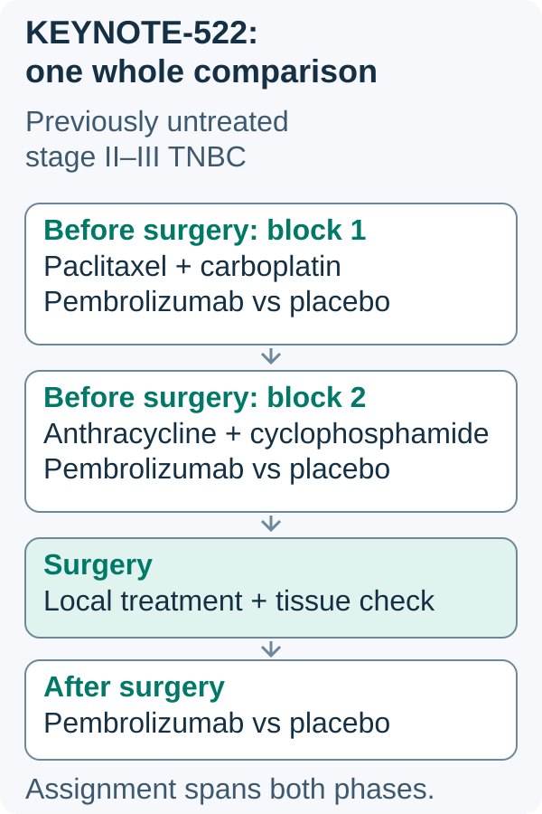

# The KEYNOTE-522 regimen

## In one sentence

The KEYNOTE-522 regimen combines pembrolizumab with two chemotherapy blocks before surgery, then pembrolizumab alone afterward, as a studied strategy for high-risk early triple-negative breast cancer.

## The intuition

Think of a regimen as a score with several movements. The medicine names identify instruments; their order describes the score. A performance record tells you what was actually played, including changes and interruptions.

The analogy stops at clinical judgment. A trial's score does not supply a person's doses, safety decisions or appointment calendar.

## How it works

*Randomization compared the whole perioperative strategy; it did not separately randomize the postoperative component.*

Read from top to bottom across the surgery boundary. Both trial arms used chemotherapy before surgery; the assigned pembrolizumab or placebo continued across the preoperative and postoperative phases. The whole mapped strategy is the randomized comparison. Its outcome cannot isolate the postoperative component’s contribution, and the planned map does not show an individual’s completed delivery.

*Visual scope: Historical trial structure for previously untreated stage II–III TNBC. No dose, interval, appointment calendar or delivery claim. Pembrolizumab arm contrasted with placebo arm, not separate postoperative randomization.*

**KEYNOTE-522** names the randomized trial as well as the treatment strategy commonly associated with it. It studied previously untreated stage II–III [triple-negative breast cancer (TNBC)](/wiki/education/concepts/breast-cancer/receptors-and-subtypes/tnbc). The combination's setting matters; it is not a universal plan for every tumor with a triple-negative receptor classification.

The original sequence had four broad parts:

| Part | Components in the studied strategy | Role |
|---|---|---|
| First preoperative block | Paclitaxel and carboplatin with pembrolizumab | Begin systemic treatment while the tumor is present |
| Second preoperative block | Doxorubicin or epirubicin, with cyclophosphamide and pembrolizumab | Continue systemic treatment with another chemotherapy combination |
| Definitive surgery | Breast and node treatment appropriate to the clinical plan | Local treatment and tissue assessment |
| Postoperative phase | Pembrolizumab alone | Continue the assigned immune treatment after surgery |

The [2020 primary report](https://pubmed.ncbi.nlm.nih.gov/32101663/) describes this sequence. **Neoadjuvant** and **adjuvant** name treatment before and after the main treatment; **perioperative** spans those periods. Radiation planning has its own local-treatment indications. It is not an extra chemotherapy block in this map.

The medicines have different mechanisms. Paclitaxel is a [taxane](/wiki/education/concepts/therapeutics/chemotherapy/taxanes) that stabilizes microtubules. Carboplatin is a [platinum agent](/wiki/education/concepts/therapeutics/chemotherapy/platinum-agents) that forms chemical attachments and cross-links in [DNA, or deoxyribonucleic acid](/wiki/education/concepts/biology-basics/molecules/dna). Doxorubicin and epirubicin are [anthracyclines](/wiki/education/concepts/therapeutics/chemotherapy/anthracyclines) with several injury mechanisms, including effects on topoisomerase II. Cyclophosphamide is a [classic alkylating agent](/wiki/education/concepts/therapeutics/chemotherapy/alkylating-agents) activated to metabolites that chemically modify DNA.

Pembrolizumab is an [immune-checkpoint inhibitor](/wiki/education/concepts/therapeutics/immunotherapy/immune-checkpoint-inhibitor). It blocks programmed death receptor 1 (PD-1) interactions, which can reduce inhibition of T-cell activity. That immune mechanism differs from directly injuring cells with chemotherapy. It also brings [immune-related adverse events](/wiki/education/concepts/therapeutics/toxicities-and-supportive-care/immune-related-adverse-event); immune activity does not guarantee cancer clearance.

## Why it matters in cancer

The randomized comparison assigned the **whole preoperative-plus-postoperative strategy** against chemotherapy with placebo before surgery and placebo afterward. The [2024 overall-survival report](https://pubmed.ncbi.nlm.nih.gov/39282906/) supports the combined strategy in its studied population. It does not isolate the benefit of the postoperative pembrolizumab component, test restarting after a particular toxicity, or settle every treatment choice after residual disease.

The [July 2026 prescribing information](https://dailymed.nlm.nih.gov/dailymed/lookup.cfm?setid=9333c79b-d487-4538-a9f0-71b91a02b287&version=228) retains the high-risk early-TNBC neoadjuvant-plus-adjuvant use. Its early-disease setting differs from its advanced-disease uses. Product labeling, trial eligibility, a clinician's plan and actual delivery are related records with different jobs.

## How the regimen is documented

A useful record keeps the original trial strategy, the planned clinical adaptation and the delivered course separate. Record agents, route, doses, intervals, holds, substitutions and their reasons. [Dose-dense scheduling](/wiki/education/concepts/therapeutics/chemotherapy/dose-dense-scheduling) changes intervals relative to a specified comparator. It should not be silently described as the original trial calendar.

[Pathologic complete response (pCR)](/wiki/education/concepts/breast-cancer/surgery-and-pathology-results/pcr) is assessed in surgical tissue. Tumor shrinkage during combination treatment cannot identify which drug produced it or prove the postoperative phase unnecessary.

## Common confusions

- Pembrolizumab is immune treatment; not every infusion is chemotherapy.
- Two planned chemotherapy blocks are not automatically two [lines of therapy](/wiki/education/concepts/breast-cancer/treatment-setting/line-of-therapy).
- A generic regimen map is not proof that every planned dose was administered.
- The trial did not randomize a new adjuvant treatment separately after each person's response became known.

## Try it

A fictional record says “KEYNOTE-522-like therapy,” but one medicine was held and a later block used different intervals. Can you copy the trial calendar as the completed treatment history?

**Answer:** No. Retain the relationship to the studied strategy, then record actual delivery and the documented changes. The label alone cannot establish completed doses or equivalent benefit.

## Explain it back

“KEYNOTE-522 teaches a whole ___; it does not separately answer ___.”

**One possible answer:** “A whole perioperative strategy; the benefit and safety of each possible postoperative change.”

## Takeaway

**Read KEYNOTE-522 as a defined sequence and comparison, then keep actual delivery and later decisions distinct.**

## Related concepts

- [Combination-therapy rationale](/wiki/education/concepts/therapeutics/how-drugs-work/combination-therapy-rationale)
- [Response-adapted therapy](/wiki/education/concepts/breast-cancer/treatment-setting/response-adapted-therapy)
- [Survival endpoints](/wiki/education/concepts/evidence-and-statistics/endpoints/survival-endpoints)

## Sources and scope

Visual addition source check: October 13, 2026. Expert and learner review pending. Original teaching source bounds are retained below.

Source-checked October 10, 2026. General regimen education; the practice record is fictional. Expert and learner review remain pending. Current clinical eligibility, numerical outcome estimates and treatment decisions require their own evidence and assessment.

- [Schmid and colleagues, 2020: KEYNOTE-522](https://pubmed.ncbi.nlm.nih.gov/32101663/) — complete primary abstract; original components, sequence and randomized comparison.
- [Schmid and colleagues, 2024: overall survival](https://pubmed.ncbi.nlm.nih.gov/39282906/) — complete primary abstract; benefit of the assigned perioperative strategy, not an isolated postoperative randomization.
- [KEYTRUDA prescribing information, July 2026, version 228](https://dailymed.nlm.nih.gov/dailymed/lookup.cfm?setid=9333c79b-d487-4538-a9f0-71b91a02b287&version=228) — selected indication, mechanism and early-TNBC study sections; personal dosing instructions are not reproduced here.

<!-- BEGIN GENERATED USED IN -->
## Used in

- [Read timing around surgery](/wiki/education/guides/treating-early-tnbc/02-read-timing-around-surgery)
- [Understand how treatment is sequenced](/wiki/education/guides/treating-early-tnbc/index)
<!-- END GENERATED USED IN -->
