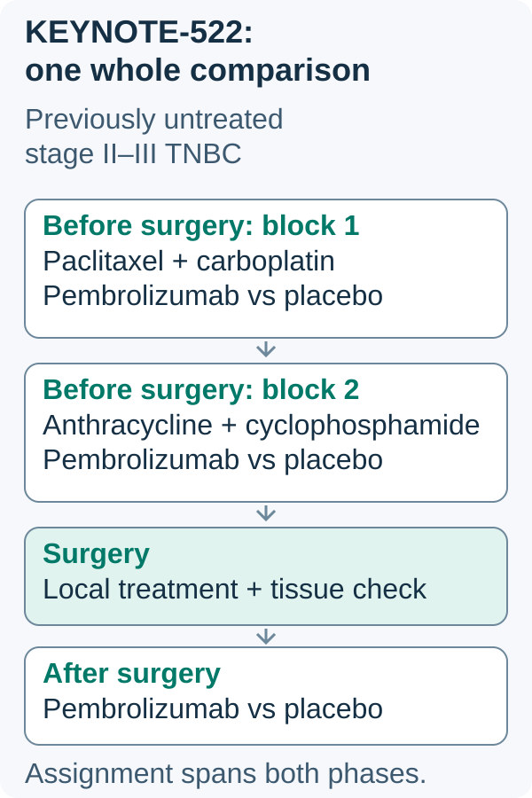

# The KEYNOTE-522 regimen

## In one sentence

The KEYNOTE-522 regimen gives pembrolizumab with two three-month chemotherapy blocks before surgery, then pembrolizumab alone for up to nine cycles afterward, for high-risk early triple-negative breast cancer.

## The intuition

Think of a regimen as a score with several movements. The drug names are the instruments; their order is the score. A treatment record says what was actually played, including pauses and substitutions. The analogy stops at clinical judgment: a trial's score does not supply one person's doses or safety decisions.

## How it works

**KEYNOTE-522** names a randomized phase 3 trial and the strategy it tested in previously untreated stage II–III [triple-negative breast cancer (TNBC)](/wiki/education/concepts/breast-cancer/receptors-and-subtypes/tnbc). It randomized 1,174 people 2:1 to pembrolizumab or placebo, each added to the same chemotherapy. Cycles were every 3 weeks [1].

| Phase | What the trial gave | Cycles and approximate span |
|---|---|---|
| Preoperative block 1 | Paclitaxel and carboplatin, with pembrolizumab or placebo | 4 cycles, about 12 weeks |
| Preoperative block 2 | Doxorubicin or epirubicin plus cyclophosphamide, with pembrolizumab or placebo | 4 cycles, about 12 weeks |
| Definitive surgery | Breast and node surgery; radiation is planned by its own local indications | — |
| Postoperative phase | Pembrolizumab or placebo alone | Up to 9 cycles, about 27 weeks |

Pembrolizumab therefore spans about a year: up to 17 three-weekly doses across both sides of surgery. In the trial the postoperative phase followed surgery in both arms; it was not limited to people with residual cancer.

*Randomization compared the whole perioperative strategy; it did not separately randomize the postoperative component.*

The drugs work differently. Paclitaxel is a [taxane](/wiki/education/concepts/therapeutics/chemotherapy/taxanes) that stabilizes microtubules. Carboplatin is a [platinum agent](/wiki/education/concepts/therapeutics/chemotherapy/platinum-agents) that cross-links [DNA (deoxyribonucleic acid)](/wiki/education/concepts/biology-basics/molecules/dna). Doxorubicin and epirubicin are [anthracyclines](/wiki/education/concepts/therapeutics/chemotherapy/anthracyclines). Cyclophosphamide is an [alkylating agent](/wiki/education/concepts/therapeutics/chemotherapy/alkylating-agents) that chemically modifies DNA.

Pembrolizumab is an [immune-checkpoint inhibitor](/wiki/education/concepts/therapeutics/immunotherapy/immune-checkpoint-inhibitor). It is an antibody that blocks programmed cell death protein 1 (PD-1), a brake receptor on T cells, so that tumor signals engaging that brake inhibit T-cell activity less. It can also cause [immune-related adverse events](/wiki/education/concepts/therapeutics/toxicities-and-supportive-care/immune-related-adverse-event).

## What the trial showed

| Endpoint | Pembrolizumab arm | Placebo arm | Report |
|---|---|---|---|
| [Pathologic complete response (pCR)](/wiki/education/concepts/breast-cancer/surgery-and-pathology-results/pcr), ypT0/Tis ypN0, first 602 randomized | 64.8% | 51.2% | Difference 13.6 points (95% CI 5.4–21.8) [1] |
| [Event-free survival (EFS)](/wiki/education/concepts/evidence-and-statistics/endpoints/survival-endpoints) at 36 months, all 1,174 | 84.5% | 76.8% | [Hazard ratio](/wiki/education/concepts/evidence-and-statistics/effect-measures/hazard-ratio) 0.63 (95% CI 0.48–0.82) [2] |
| Overall survival at 60 months | 86.6% | 81.7% | P = 0.002; median follow-up 75.1 months [3] |

In absolute terms, about 8 more people per 100 were alive without an event at 3 years, and about 5 more per 100 were alive at 5 years. pCR and EFS were the two primary endpoints; overall survival was secondary. Each was reported at a different planned analysis. Grade 3 or higher treatment-related adverse events occurred in 78.0% versus 73.0% across all phases [1].

## Why it matters in cancer

- It is the approved strategy for high-risk early TNBC; the [prescribing information](https://dailymed.nlm.nih.gov/dailymed/lookup.cfm?setid=9333c79b-d487-4538-a9f0-71b91a02b287&version=228) carries this neoadjuvant-plus-adjuvant use.
- It showed, in a randomized trial, that adding a checkpoint inhibitor to chemotherapy improved overall survival in early TNBC.
- The comparison was the **whole** preoperative-plus-postoperative strategy. It cannot say how much the postoperative phase adds, or whether it helps more after pCR or after residual disease.
- What to add after residual disease is a separate question; see [post-neoadjuvant escalation](/wiki/education/concepts/breast-cancer/treatment-setting/post-neoadjuvant-escalation).

## Common confusions

- Pembrolizumab is immune treatment; not every infusion is chemotherapy.
- The two chemotherapy blocks are one planned course, not two [lines of therapy](/wiki/education/concepts/breast-cancer/treatment-setting/line-of-therapy).
- A pCR gain of 13.6 points is not the same number as the survival gain; pCR is a different endpoint.
- The trial calendar is not a record of what any one person received. Holds, substitutions and [dose-dense scheduling](/wiki/education/concepts/therapeutics/chemotherapy/dose-dense-scheduling) belong in the delivered record.

## Try it

A friend reads "pCR 64.8% versus 51.2%" and says pembrolizumab raises the chance of being alive at 5 years by about 14 points. Is that right?

**Answer:** No. The 13.6-point difference is in pCR, a tissue endpoint at surgery. The 5-year overall-survival difference was 86.6% versus 81.7%, about 5 points. Endpoints answer different questions.

## Explain it back

"KEYNOTE-522 tested a whole ___; it improved ___, but it does not separately answer ___."

**One possible answer:** "A whole perioperative strategy of about a year of pembrolizumab with chemotherapy; pCR, event-free survival and overall survival; how much the postoperative phase adds on its own."

## Takeaway

**KEYNOTE-522 is four plus four three-weekly cycles before surgery and up to nine after, and it improved pCR, event-free survival and overall survival as a whole strategy.**

## Related concepts

- [Neoadjuvant versus adjuvant therapy](/wiki/education/concepts/breast-cancer/treatment-setting/neoadjuvant-vs-adjuvant)
- [Post-neoadjuvant escalation](/wiki/education/concepts/breast-cancer/treatment-setting/post-neoadjuvant-escalation)
- [Response-adapted therapy](/wiki/education/concepts/breast-cancer/treatment-setting/response-adapted-therapy)
- [Surrogate endpoints](/wiki/education/concepts/evidence-and-statistics/endpoints/surrogate-endpoints)
- [Combination-therapy rationale](/wiki/education/concepts/therapeutics/how-drugs-work/combination-therapy-rationale)

## Sources and scope

Source-checked November 7, 2026 against the three primary abstracts and the DailyMed label history. Expert and learner review pending. General education, not a dosing record.

1. [Schmid and colleagues, NEJM 2020](https://pubmed.ncbi.nlm.nih.gov/32101663/) — design, cycle structure, pCR at the first interim analysis and adverse events.
2. [Schmid and colleagues, NEJM 2022](https://pubmed.ncbi.nlm.nih.gov/35139274/) — event-free survival at the fourth planned interim analysis, median follow-up 39.1 months.
3. [Schmid and colleagues, NEJM 2024](https://pubmed.ncbi.nlm.nih.gov/39282906/) — final overall-survival analysis.
4. [KEYTRUDA prescribing information, July 2026, version 228](https://dailymed.nlm.nih.gov/dailymed/lookup.cfm?setid=9333c79b-d487-4538-a9f0-71b91a02b287&version=228) — early-TNBC indication; personal dosing is not reproduced here.

<!-- BEGIN GENERATED USED IN -->
## Used in

- [What checkpoint inhibitors change](/wiki/education/guides/how-the-immune-system-fights-cancer/07-what-checkpoint-inhibitors-change)
- [Why the immune system doesn't just kill a tumor, and what checkpoint inhibitors change](/wiki/education/guides/how-the-immune-system-fights-cancer/index)
- [Read a real trial: KEYNOTE-522](/wiki/education/guides/reading-cancer-evidence/05-read-a-real-trial)
- [Follow the route to immune recognition](/wiki/education/guides/start-here/02-follow-immune-recognition)
- [Connect treatment jobs with evidence](/wiki/education/guides/start-here/03-connect-treatment-and-evidence)
- [Start here: triple-negative breast cancer in 30 minutes](/wiki/education/guides/start-here/index)
- [Read the jobs in the treatment plan](/wiki/education/guides/treating-early-tnbc/01-read-the-jobs-in-the-plan)
- [Read timing around surgery](/wiki/education/guides/treating-early-tnbc/02-read-timing-around-surgery)
- [Use the findings in the next conversation](/wiki/education/guides/treating-early-tnbc/03-use-the-findings-in-the-next-conversation)
- [Understand how treatment is sequenced](/wiki/education/guides/treating-early-tnbc/index)
<!-- END GENERATED USED IN -->
