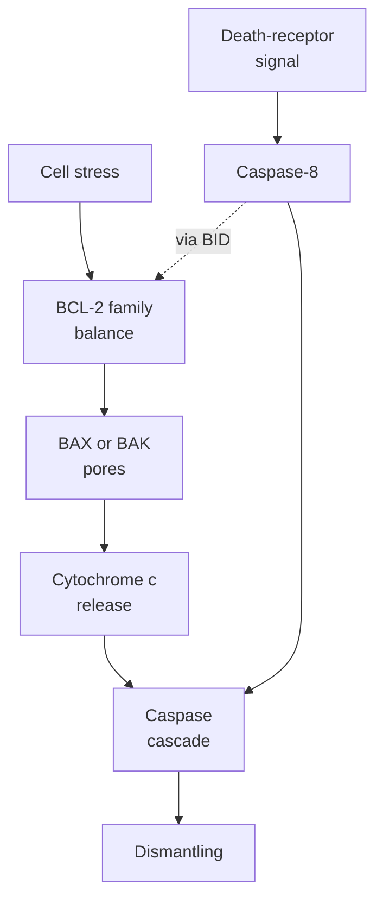

# Apoptosis and the BCL-2 family

## In one sentence

Apoptosis is regulated cell dismantling, with the BCL-2 protein family controlling the mitochondrial route into that process.

## The intuition

Think of an orderly building closure: a decision starts a coordinated dismantling process, and neighboring workers collect the pieces. The BCL-2 family helps control one important decision point. Some members restrain the process; others help open it. This analogy cannot predict the outcome from a head count. Protein interactions, cell state and the stimulus matter.

**Before you start:** [Mitochondria and other organelles](/wiki/education/concepts/biology-basics/cells/organelles-overview) are cellular compartments; [proteins](/wiki/education/concepts/biology-basics/molecules/protein-and-peptide) perform much of the machinery's work.

## How it works

**Caspases** are [enzymes](/wiki/education/concepts/biology-basics/molecules/enzymes-and-binding) that cut selected proteins. Initiator caspases help start a cascade; executioner caspases, especially caspase-3 and caspase-7, carry out much of the dismantling. Cells commonly shrink, their nuclear material condenses, and fragments become available for collection. This differs from simply bursting after severe injury. The [cell-death nomenclature consensus](https://www.nature.com/articles/s41418-017-0012-4) distinguishes pathways by mechanism, beyond appearance alone.

**Intrinsic apoptosis** responds to stresses such as damage to [deoxyribonucleic acid (DNA)](/wiki/education/concepts/biology-basics/molecules/dna) or loss of survival support. Its key mitochondrial event is **mitochondrial outer-membrane permeabilization**: the outer membrane becomes permeable to proteins normally held inside. Released **cytochrome c** helps assemble the apoptosome, a protein complex that activates caspase-9 and the downstream cascade.

The **B-cell lymphoma 2 (BCL-2) family** has opposing roles:

| Group | Examples | Main mitochondrial job |
|---|---|---|
| Survival proteins | BCL-2, BCL-XL, MCL-1 | Restrain death-promoting partners |
| BH3-only proteins | BIM, BID, PUMA | Convey stress signals through activating or relieving restraint |
| Pore-forming effectors | BAX and BAK | Assemble structures that permeabilize the outer membrane |

**BH3** means BCL-2 homology 3, a shared protein region. Family membership does not mean every protein prevents death. [Czabotar and colleagues](https://www.nature.com/articles/nrm3722) summarize these interactions. In primary mouse-cell experiments, combined loss of BAX and BAK strongly blocked mitochondrial responses to several apoptotic stimuli. This supports their role in that route, not immunity from every kind of death. [Wei 2001](https://pubmed.ncbi.nlm.nih.gov/11326099/).

**Extrinsic apoptosis** starts with an extracellular signal received by a surface death receptor, such as Fas. It can activate caspase-8 and downstream executioner caspases. In some cells it also recruits the mitochondrial route: caspase-8 cuts BID, producing a form that acts at mitochondria. The two routes therefore interact. [Li 1998](https://pubmed.ncbi.nlm.nih.gov/9727492/).

*This simplified map shows two connected routes; it does not classify every possible cell-death mechanism.*

## Why it matters in cancer

Cancer cells can evade apoptosis by changing survival and death machinery. That motivates testing vulnerabilities, but strong BCL-2-family staining is not a dependency result. BCL2 and BCL2L1 are different genes; BCL-XL is one product of BCL2L1. An inhibitor's selectivity must match the proposed mechanism.

Apoptosis is not automatically immune-silent or immunogenic. [Obeid's tumor-model experiments](https://pubmed.ncbi.nlm.nih.gov/17187072/) linked calreticulin exposure to immune protection under tested conditions. The [immunogenic-cell-death concept](/wiki/education/concepts/cancer-biology/cell-death-and-survival/immunogenic-cell-death) holds that separate claim.

## How it is measured

Cleaved-caspase measurements, membrane changes and microscopy address different stages. A single marker does not establish completed, irreversible death in every cell. [BH3 profiling](/wiki/education/concepts/measurement/functional-models/bh3-profiling) challenges mitochondrial readiness under a defined protocol. It is distinct from observed killing and clinical benefit. Keep cell identity, timing, controls and later survival or regrowth attached to an experiment.

## Common confusions

- BCL-2 is one protein; the family includes survival and death-promoting members.
- Intrinsic and extrinsic routes are connected, rather than mutually exclusive labels.
- More survival protein does not prove survival dependence.
- Apoptosis does not establish protective tumor immunity.

## Try it

A fictional culture stains strongly for BCL-XL. A researcher concludes that any BCL-2 inhibitor will kill it. What needs checking?

**Answer:** Protein abundance is the observation. Dependency needs a controlled functional test, and the compound's selectivity must include the relevant protein. Mitochondrial response, sustained killing and benefit in people remain separate outcomes.

## Explain it back

“The family includes ___, while mitochondrial apoptosis requires ___.” One answer: “both restraints and death-promoting proteins; a measured transition through the mitochondrial death machinery.”

## Takeaway

**Follow the death pathway and test dependence; a protein name or stain cannot choose a treatment.**

## Related concepts

- [Necrosis](/wiki/education/concepts/cancer-biology/cell-death-and-survival/necrosis)
- [Senescence](/wiki/education/concepts/cancer-biology/cell-death-and-survival/senescence)
- [Perturbation and controls](/wiki/education/concepts/evidence-and-statistics/study-design/perturbation-and-controls)

## Sources and scope

Source-checked October 10, 2026. General mechanism and research interpretation; fictional exercise. Expert and learner review remain pending.

- [Galluzzi et al., 2018: mechanism-based cell-death definitions](https://www.nature.com/articles/s41418-017-0012-4).
- [Czabotar et al., 2014: BCL-2-family roles and interactions](https://www.nature.com/articles/nrm3722).
- [Wei et al., 2001: BAX/BAK loss-of-function experiments](https://pubmed.ncbi.nlm.nih.gov/11326099/).
- [Li et al., 1998: BID links Fas signaling to mitochondria](https://pubmed.ncbi.nlm.nih.gov/9727492/).
- [Obeid et al., 2007: immunogenicity in defined tumor models](https://pubmed.ncbi.nlm.nih.gov/17187072/).

<!-- BEGIN GENERATED USED IN -->
## Used in

- [Test a mechanism in a living model](/wiki/education/molecular-profiling/05-functional-drug-response)
- [Oncology 101: immune foundations](/wiki/education/oncology-101/index)
<!-- END GENERATED USED IN -->
