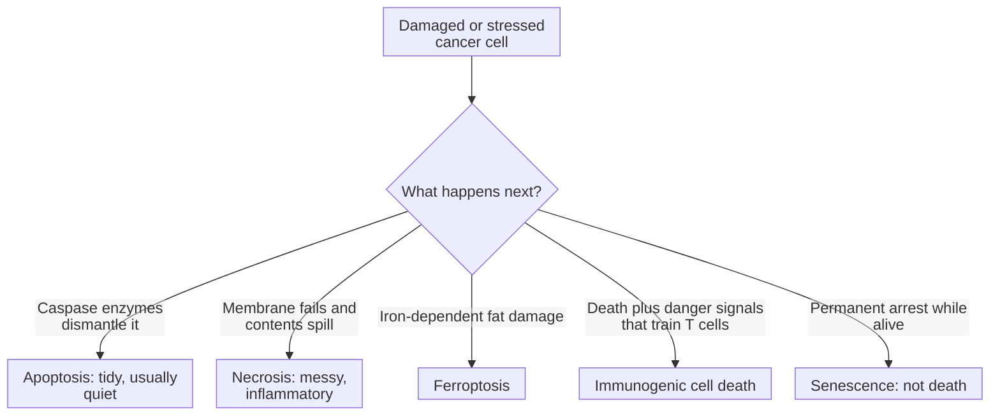

# Ways a cancer cell can die or stop: apoptosis, necrosis, ferroptosis, immunogenic death and senescence

Apoptosis, necrosis, ferroptosis and immunogenic cell death are different routes by which a cell dies, while senescence is a living, permanent stop; they differ in what triggers them, what the dying cell looks like and what the immune system sees.

## What they share

Cancer treatment works, in large part, by making tumor cells die or stop dividing. Chemotherapy, radiation and targeted drugs can each push a cell down more than one of these routes. The international Nomenclature Committee on Cell Death defines each route by its molecular mechanism rather than by appearance alone, and lists more than a dozen subtypes. [Galluzzi 2018](https://pubmed.ncbi.nlm.nih.gov/29362479/). This page compares the five a reader meets most often.

## The axis is the mechanism, and what neighbors see

The single most useful question is: **what machinery carries out the death, and does the cell burst?** A cell that dismantles itself tidily is cleared quietly. A cell whose membrane ruptures spills its contents, which can alarm the immune system.

*The routes overlap: immunogenic cell death is a property some deaths have, not a separate machine.*

## Side by side

| | Apoptosis | Necrosis | Ferroptosis | Immunogenic cell death | Senescence |
|---|---|---|---|---|---|
| Is the cell dead? | Yes | Yes | Yes | Yes | No, alive but stopped |
| Core machinery | Caspase enzymes, controlled by the BCL-2 family | Loss of membrane integrity; some forms are regulated, such as necroptosis | Iron-dependent damage to membrane fats, normally prevented by the enzyme GPX4 | Any death that releases or displays danger signals, such as surface calreticulin | Durable cell-cycle arrest, often with secreted inflammatory signals |
| Typical appearance | Shrinking, fragmented nucleus, membrane-wrapped pieces | Swelling and rupture | Distinct from apoptosis and necrosis in the defining study | Depends on the underlying death route | Enlarged, flattened living cells |
| What the immune system sees | Usually little | Inflammation | Context-dependent | A signal that can prime T cells | Secreted signals that can attract immune cells |
| Cancer example | Venetoclax triggers apoptosis by blocking BCL-2 | Central tumor necrosis in fast-growing tumors | Erastin triggers it in laboratory cells | Anthracyclines such as doxorubicin in mouse models | Many chemotherapy drugs can induce it |

Ferroptosis was named in 2012, when the compound erastin was shown to cause an iron-dependent cell death that was "morphologically, biochemically, and genetically distinct" from apoptosis and necrosis. [Dixon 2012](https://pubmed.ncbi.nlm.nih.gov/22632970/). Anthracycline-treated tumor cells moved calreticulin to their surface before dying and acted as a vaccine in mice, while some other DNA-damaging drugs did not. [Obeid 2007](https://pubmed.ncbi.nlm.nih.gov/17187072/). In the first three patients with chronic lymphocytic leukemia given the BCL-2 inhibitor venetoclax, tumor breakdown began within 24 hours. [Souers 2013](https://pubmed.ncbi.nlm.nih.gov/23291630/).

## When each idea helps

- Ask about **apoptosis** when a drug works through the BCL-2 family or a DNA-damage response.
- Ask about **necrosis** when a pathology report describes dead tumor tissue; see [necrosis](/wiki/education/concepts/cancer-biology/cell-death-and-survival/necrosis).
- Ask about **ferroptosis** when iron, fat damage or antioxidant defenses are the proposed mechanism.
- Ask about **immunogenic cell death** when a treatment is meant to help immunotherapy.
- Ask about **senescence** when cells stop growing but do not disappear.

## Common confusions

- **Dead tissue on a slide versus a death mechanism:** necrosis on pathology describes appearance, not which machinery acted.
- **Senescence versus death:** senescent cells are alive and can keep signaling.
- **Immunogenic versus a separate pathway:** it describes what a death signals to the immune system.
- **Autophagy versus death:** [autophagy](/wiki/education/concepts/cancer-biology/cell-death-and-survival/autophagy) is mainly a recycling and survival process; it causes death only in specific settings.
- **One marker versus a mode:** a single stain or protein rarely proves which route a cell took.

## Try it

A fictional drug kills cultured tumor cells. An iron-binding compound and a fat-protecting antioxidant each prevent the killing, but a caspase blocker does not. Which route best fits, and what would you check next?

Show answer

Ferroptosis fits best: the death needs iron and fat damage, not the caspases of apoptosis. Next, measure fat damage directly and test whether the drug acts through GPX4 or the cell's supply of the antioxidant glutathione. Whether the death also signals to the immune system is a separate question.

## Explain it back

Apoptosis is a ______ death carried out by ______; necrosis ends with the membrane ______; senescence is not death but a permanent ______.

**One possible answer:** tidy, self-dismantling; caspase enzymes; rupturing; stop in cell division.

## Takeaway

**Name the machinery, not just the outcome: apoptosis, necrosis and ferroptosis are different ways to die, immunogenic death describes what the immune system sees, and senescence is a living stop.**

## Related concepts

- [Apoptosis and the BCL-2 family](/wiki/education/concepts/cancer-biology/cell-death-and-survival/apoptosis-and-bcl2-family)
- [Necrosis](/wiki/education/concepts/cancer-biology/cell-death-and-survival/necrosis)
- [Ferroptosis](/wiki/education/concepts/cancer-biology/cell-death-and-survival/ferroptosis)
- [Immunogenic cell death](/wiki/education/concepts/cancer-biology/cell-death-and-survival/immunogenic-cell-death)
- [Senescence](/wiki/education/concepts/cancer-biology/cell-death-and-survival/senescence)
- [Autophagy](/wiki/education/concepts/cancer-biology/cell-death-and-survival/autophagy)

## Sources and scope

Source check: November 7, 2026. Concept comparison with fictional practice; expert and learner review pending.

- [Galluzzi et al. (2018), Nomenclature Committee on Cell Death recommendations](https://pubmed.ncbi.nlm.nih.gov/29362479/): mechanism-based definitions of regulated cell-death modes, including apoptosis, necrosis subtypes, ferroptosis and immunogenic cell death; discusses senescence as a non-lethal outcome.
- [Dixon et al. (2012)](https://pubmed.ncbi.nlm.nih.gov/22632970/): ferroptosis as an iron-dependent, nonapoptotic cell death.
- [Obeid et al. (2007)](https://pubmed.ncbi.nlm.nih.gov/17187072/): calreticulin exposure and the immunogenicity of anthracycline-induced death.
- [Souers et al. (2013)](https://pubmed.ncbi.nlm.nih.gov/23291630/): venetoclax (ABT-199), a BCL-2-selective inhibitor.

<!-- BEGIN GENERATED USED IN -->
## Used in

- [Compare related ideas](/wiki/education/comparisons/index)
- [Reading a functional experiment](/wiki/education/guides/from-variant-to-drug/07-reading-a-functional-experiment)
- [Why the immune system doesn't just kill a tumor, and what checkpoint inhibitors change](/wiki/education/guides/how-the-immune-system-fights-cancer/index)
<!-- END GENERATED USED IN -->
