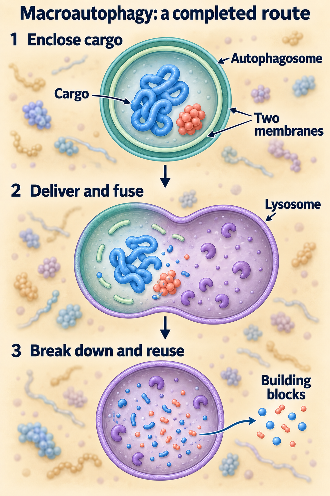
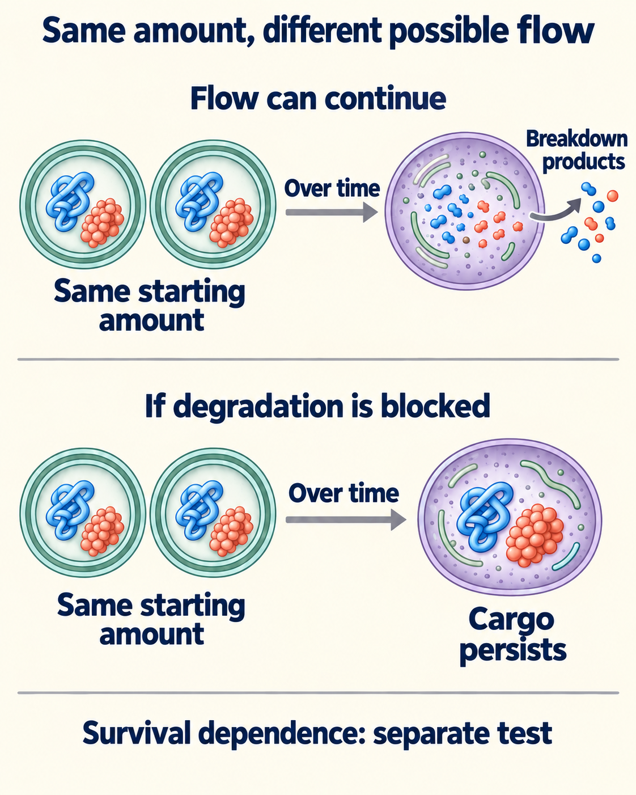

# Autophagy: recycling, flow, and dependence

## In one sentence

Autophagy delivers cellular material to lysosomes for breakdown and reuse; measuring how much material is present does not establish how fast it moves.

## The intuition

Imagine recycling bags waiting beside a collection point. A large pile could mean busy collection, slow pickup or a blocked processing center. A photograph cannot distinguish them. Autophagy needs measurements over time for the same reason.

The analogy is limited: cells can select particular cargo, and their recycling machinery also interacts with other processes. A count of “bags” does not reveal everything inside them or whether recycling keeps the cell alive.

## How it works

This page focuses on **macroautophagy**, the route that encloses material in a double-membrane compartment called an **autophagosome**. It eventually delivers cargo to a [lysosome](/wiki/education/concepts/biology-basics/cells/organelles-overview), an acidic compartment containing breakdown enzymes. The resulting building blocks can be reused. Other autophagy routes exist; not every lysosomal process uses an autophagosome.

<em>Enclosure, lysosomal delivery and breakdown are separate steps. A completed macroautophagy route returns building blocks for reuse; membranes, cargo shapes and sizes are schematic.</em>

**Autophagic flux** means movement through the process, including delivery and degradation. Formation, fusion with lysosomes and degradation are separate steps. A block late in the process can increase the amount of visible material while reducing completed recycling.

**Microtubule-associated protein 1 light chain 3 (LC3)** is a commonly studied marker. Its lipid-attached form, **LC3-II**, associates with autophagic membranes. More LC3-II can reflect increased formation or reduced removal. Its abundance alone is not a flux measurement or proof of selective cargo degradation.

A controlled, short lysosomal-block experiment compares LC3-II with and without blocked degradation. Additional accumulation can support ongoing turnover during that interval. Complementary reporters can track delivery into acidic compartments: Kimura and colleagues developed a tandem fluorescent LC3 reporter whose green and red signals respond differently to those conditions. A reporter needs controls for expression, acidity and handling; it is not an infallible cargo census.

<em>The same starting amount can have different later fates. These illustrative routes do not diagnose culture B: follow cargo over time, and test survival dependence separately. LC3-II abundance alone does not settle either question.</em>

## Why it matters in cancer

Recycling can help cells cope with nutrient shortage and damage. Its importance varies with the cell and conditions. “Autophagy is present,” “flux increased” and “survival depends on autophagy” are different claims.

Specific cargo can be selected. A general marker cannot establish that a particular protein is being cleared. Likewise, lowering [mTOR signaling](/wiki/education/concepts/cancer-biology/signaling-pathways/pi3k-akt-mtor) can change initiation without guaranteeing completed recycling or cell death.

## How it is measured

Useful readouts include normalized LC3-II band intensity, reporter-positive compartments per cell and disappearance of a specified cargo over time. Units and normalization belong beside the result; none supplies a universal treatment cutoff.

Use matched viable cultures, several times, verified lysosomal inhibition and an independent readout. Prolonged inhibition itself can disturb the system. To test survival dependence, disrupt the process in independent ways and measure death as well as growth. Restoration of the relevant function can strengthen attribution. Autophagy-related proteins may have other jobs, so changing one gene or using a broad inhibitor is not a complete specificity control.

## Common confusions

- **Abundance versus flux:** a pile-up can indicate a blockage.
- **Flux versus dependence:** active recycling need not be essential for survival.
- **General marker versus selected cargo:** LC3 does not identify every material being degraded.
- **Initiation versus completion:** making autophagosomes is only part of the route.

## Try it

Two fictional cultures have equally high LC3-II. In A, a controlled short lysosomal block produces further accumulation, and a complementary reporter supports delivery into acidic compartments. In B, little additional accumulation occurs. Which culture's survival depends on autophagy?

**Answer:** Neither dependence is established. A's measurements support ongoing flux under the tested conditions. B could have a late block, low formation or an unsuitable measurement window; additional controls are needed. Survival dependence requires a separate, specific perturbation and outcome experiment. The equal starting snapshot answered neither question.

## Explain it back

“Abundance measures ___; flux tests ___; dependence asks ___.”

One answer: “material present at a moment; movement through recycling over time; whether disrupting that process harms survival in this setting.”

## Takeaway

**Read the amount, the movement and the survival requirement as three separate pieces of evidence.**

## Related concepts

- [Ubiquitin and the proteasome](/wiki/education/concepts/cancer-biology/cell-death-and-survival/ubiquitin-and-proteasome): another route for controlled protein breakdown.
- [The flux-and-dependence lesson](/wiki/education/guides/from-variant-to-drug/05-autophagy-flux-and-dependence).

## Sources and scope

Source check: October 10, 2026. General macroautophagy methods; cultures are fictional. Expert and learner review remain pending.

- [Kimura et al. (2007)](https://pubmed.ncbi.nlm.nih.gov/17534139/): tandem fluorescent LC3 reporter for maturation and lysosomal delivery in cell experiments.
- [Ganley et al. (2009)](https://pubmed.ncbi.nlm.nih.gov/19258318/): starvation-regulated initiation machinery and mTOR signaling in cellular and reconstituted experiments.
- [Klionsky et al., fourth-edition assay guidelines (2021)](https://pubmed.ncbi.nlm.nih.gov/33634751/): complementary assays and specificity limits of individual markers or genetic perturbations.
- [Kirkin et al. (2009)](https://pubmed.ncbi.nlm.nih.gov/19250911/): selective handling of ubiquitinated cargo in experimental models.
- [Plaza-Zabala et al. (2021)](https://pmc.ncbi.nlm.nih.gov/articles/PMC7878397/): formation-versus-degradation analysis in cultured microglia; method context, not cancer-treatment validation.

<!-- BEGIN GENERATED USED IN -->
## Used in

- [PARP trapping and recycling](/wiki/education/guides/from-variant-to-drug/04-parp-trapping-and-recycling)
- [Autophagy: traffic, flow, and dependence](/wiki/education/guides/from-variant-to-drug/05-autophagy-flux-and-dependence)
- [PI3K, AKT, and mTOR: competing effects on repair and recycling](/wiki/education/guides/from-variant-to-drug/06-pi3k-akt-mtor-and-repair)
- [Autophagy and proteostasis: amount, flow, and dependence](/wiki/education/molecular-profiling/evee-pathways/01-autophagy-and-proteostasis)
- [Lipid supply and mTOR: measuring resource control](/wiki/education/molecular-profiling/evee-pathways/02-lipid-and-mtor)
- [Pathway mechanisms: a supporting lesson library](/wiki/education/molecular-profiling/evee-proposed-pathways)
<!-- END GENERATED USED IN -->
