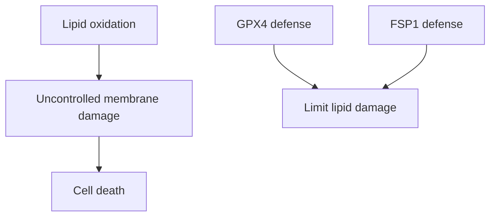

# Ferroptosis: death through uncontrolled lipid oxidation

## In one sentence

Ferroptosis is a form of cell death driven by iron-dependent damage to membrane lipids when protective systems cannot contain it.

## The intuition

Picture a fire spreading through a cell's oily membrane. Fire prevention, the material in the wall, and the source of sparks all matter. Ferroptosis describes a particular failure of membrane protection. The analogy breaks because membranes contain many different lipids, and cells have several overlapping defense systems.

## How it works

**Lipid peroxidation** is oxidative damage to lipids. Some membrane lipids are especially vulnerable because their fatty-acid chains contain several double bonds. Iron participates in chemistry that can amplify damage. If damage exceeds defenses, the membrane system fails and the cell can die.

One protective enzyme is **glutathione peroxidase 4 (GPX4)**. It reduces lipid hydroperoxides, damaged lipid products, using the antioxidant molecule glutathione. This is one important defense, not the only defense. **Ferroptosis suppressor protein 1 (FSP1)** supplies a parallel defense by regenerating reduced coenzyme Q, which can trap lipid radicals. Primary experiments showed why resistance to GPX4 disruption varies across models. [Bersuker 2019](https://pubmed.ncbi.nlm.nih.gov/31634900/). [Yang 2014](https://pubmed.ncbi.nlm.nih.gov/24439385/).

Cells can supply building blocks for glutathione through nutrient transport and metabolism. System xC− is a transporter that exchanges extracellular cystine for intracellular glutamate. Cystine can support cysteine supply for glutathione synthesis. Disrupting this route can trigger ferroptosis in susceptible experimental conditions. [Dixon 2012](https://pubmed.ncbi.nlm.nih.gov/22632970/).

[**Reactive oxygen species (ROS)**](/wiki/education/concepts/cancer-biology/metabolism-and-stress/reactive-oxygen-species) is a broad name for reactive oxygen-containing molecules. A rise in a general ROS signal does not identify membrane-lipid damage or ferroptosis. Other kinds of cell death can occur under oxidative stress.

*Several defenses can contain damage; their presence alone does not quantify their protective function.*

## Why it matters in cancer

Some cancer models depend strongly on lipid-protection systems. Other models resist ferroptosis because of their lipid composition, iron handling, or alternative defenses. A high antioxidant program may indicate protection; it may also motivate a test of dependence on that protection. Those are different claims.

Experimental compounds help researchers ask these questions. Their ability to kill cultured cells does not establish a tolerable drug exposure or benefit in patients.

## A worked example

A fictional culture dies after GPX4 perturbation. Lipid oxidation rises before death. An iron chelator and a lipid-radical-trapping compound each reduce the effect in appropriate controls. A different killing agent is not rescued in the same way.

Together, these findings support ferroptosis in this model. General cell death alone would not. The result still leaves open whether a tumor in a person has the same dependence and whether normal tissues can tolerate the intervention.

## Common confusions

- **ROS versus ferroptosis:** general oxidation is not a death-mechanism diagnosis.
- **Antioxidant expression versus sensitivity:** strong defenses can confer resistance.
- **Rescue versus complete proof:** rescue is more informative when paired with independent measurements and controls.
- **Laboratory tool versus therapy:** a chemical probe is not automatically a clinically usable medicine.

## How it is measured

Researchers combine viability, timing of lipid peroxidation, iron dependence, and rescue experiments. They may also compare genetic and pharmacologic perturbation of a proposed defense. Probe specificity, concentration, culture nutrients, and cell density can alter the result. Live death/rescue tests consume viable cells or models. Outputs can include a lipid-probe oxidation ratio and independently measured death percentage over a specified interval. No single staining threshold establishes ferroptosis or selects a treatment. These are research readouts with protocol-specific controls. Use a converging set of measurements rather than a single color change.

## Try it

A fictional culture has abundant GPX4 protein. Its general ROS signal rises after treatment, but no death occurs. Has ferroptosis been demonstrated?

**Answer:** No. GPX4 amount does not measure its function, and the ROS signal does not establish lipid damage or death. Measure the proposed sequence, relevant rescue and alternative defenses before assigning the mechanism.

## Explain it back

“Ferroptosis needs evidence of ___, rather than only ___.”

One answer: “iron-dependent lipid damage causing death; general oxidation or an antioxidant protein amount.”

## Takeaway

**Diagnose the damage-driven death process with converging evidence, then test its clinical relevance separately.**

## Related concepts

[NRF2–KEAP1](/wiki/education/concepts/cancer-biology/signaling-pathways/nrf2-keap1) regulates stress defenses. [Oxidative phosphorylation](/wiki/education/concepts/cancer-biology/metabolism-and-stress/oxidative-phosphorylation) concerns mitochondrial energy production, which is a different process. [The stress lesson](/wiki/education/molecular-profiling/evee-pathways/04-cul3-nrf2-ferroptosis-and-bet) connects the evidence layers.

## Sources

Source check: 2026-10-09. General mechanism education; the worked example is fictional. Expert and learner review pending.

- [Dixon 2012: experimental definition of ferroptosis](https://pubmed.ncbi.nlm.nih.gov/22632970/).
- [Yang 2014: GPX4 regulation of ferroptotic cancer-cell death](https://pubmed.ncbi.nlm.nih.gov/24439385/).
- [Yang 2016: peroxidation of polyunsaturated fatty acids and ferroptosis](https://pubmed.ncbi.nlm.nih.gov/27506793/).
- [Bersuker 2019: FSP1 and coenzyme-Q protection parallel to GPX4](https://pubmed.ncbi.nlm.nih.gov/31634900/).

<!-- BEGIN GENERATED USED IN -->
## Used in

- [Stress defenses and chromatin readers: test the direction](/wiki/education/molecular-profiling/evee-pathways/04-cul3-nrf2-ferroptosis-and-bet)
- [Oxidative metabolism and stress: energy, damage, and dependence](/wiki/education/molecular-profiling/evee-pathways/05-oxidative-metabolism-and-stress)
- [Pathway mechanisms: a supporting lesson library](/wiki/education/molecular-profiling/evee-proposed-pathways)
<!-- END GENERATED USED IN -->
