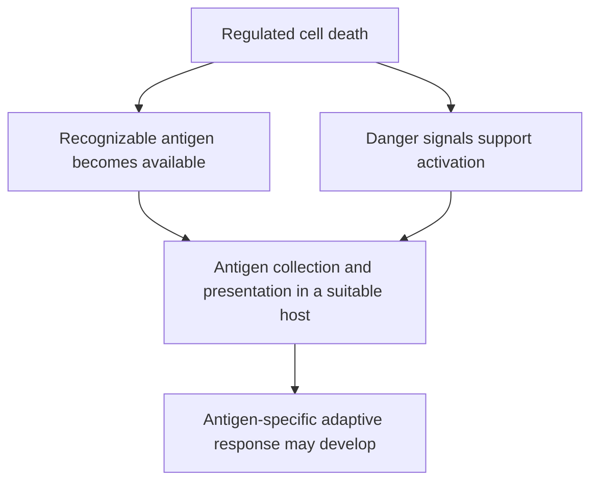

# Immunogenic cell death

## In one sentence

Immunogenic cell death is regulated cell death that can initiate an antigen-specific adaptive immune response in a compatible, immune-competent host.

## The intuition

A dying cell leaves material behind. The immune system can quietly clear that material, or it can learn from it. Imagine finding a damaged parcel: the contents provide information, while the surrounding signals help determine whether the parcel calls for an active response. In immunogenic cell death (ICD), both the material and the response to it matter.

## How it works

The [operational consensus definition](https://pubmed.ncbi.nlm.nih.gov/32209603/) connects a dying cell to an adaptive response in its host. **Antigenicity** means that the material contains targets the host's immune repertoire can recognize. **Adjuvanticity** means that the accompanying signals support immune activation. Neither property alone completes the process.

Stressed or dying cells can expose or release **damage-associated molecular patterns (DAMPs)**. These are molecules whose location and timing can signal tissue injury. Surface exposure of the protein calreticulin can help phagocytes collect dying cells. Extracellular **adenosine triphosphate (ATP)** can support immune-cell recruitment and activation. Released **high-mobility group box 1 (HMGB1)** can support antigen processing through particular sensing pathways. These are studied mechanisms, not a universal three-marker checklist.

Collected tumor material still needs to be processed and displayed. [Cross-presentation](/wiki/education/concepts/immunology/antigen-presentation/cross-presentation) lets a presenting cell display externally acquired antigen to a suitable T cell. [T-cell priming](/wiki/education/concepts/immunology/t-cells/t-cell-priming-three-signals) requires recognition and a supporting signal context. Suppressive tissue conditions, missing responders or inadequate presentation can interrupt this route.

*The diagram shows requirements for immune learning; observing cell death does not establish the final response.*

Apoptosis describes a cell-death process; necrosis describes a different pattern of cellular breakdown. Neither word establishes immunogenicity. Some apoptotic deaths are immunogenic under tested conditions. Rapid tissue destruction can release abundant material without generating protective adaptive immunity. The host and treatment context remain part of the claim.

## Why it matters in cancer

Some chemotherapy and radiation experiments show that immune responses contribute to tumor control. For example, [Obeid and colleagues](https://pubmed.ncbi.nlm.nih.gov/17187072/) tested calreticulin exposure and immune protection in mouse models. Such experiments explain a mechanism. They do not show that every treatment producing that signal will improve survival in every cancer.

## How it is measured

Cell-death assays and measurements of calreticulin, ATP or HMGB1 can support a mechanistic hypothesis. They are **surrogates**, meaning indirect indicators. Stronger experimental tests measure antigen-specific immunity and use controls to test its role. A classic mouse assay exposes animals to treated dying tumor cells, then challenges them with living cells of the same tumor type. Its model, immune compatibility and controls must be stated. It is not a clinical vaccine recommendation.

## Worked example and practice

In a fictional laboratory study, treatment kills cultured tumor cells and raises extracellular ATP. The report calls the treatment an effective cancer vaccine. What is missing?

**Answer:** Death and one danger signal are demonstrated. Antigen-specific adaptive immunity, its dependence on the dying cells, and protection in an appropriate host remain untested. Clinical benefit requires additional evidence in people.

## Common confusions

- Inflammation is not automatically antigen-specific immune memory.
- A danger signal is not proof of immunogenic cell death.
- Local tumor killing does not establish a distant tumor response.
- A treatment's other effects on immune cells are not all caused by cell death.

## Explain it back

“The cells must die in a way that gives a suitable host both recognizable material and the signals needed to learn from it.”

## Related concepts

- [The cancer-immunity cycle](/wiki/education/concepts/immunology/tumor-immunology/cancer-immunity-cycle)
- [In-situ vaccination](/wiki/education/concepts/immunology/tumor-immunology/in-situ-vaccination)
- [An abscopal effect](/wiki/education/concepts/immunology/tumor-immunology/abscopal-effect)

## Sources and scope

Source check: October 9, 2026. Definitions, experimental mechanisms and assay interpretation; no treatment-specific clinical benefit is inferred. Expert and learner review remain pending.

- [Galluzzi et al., 2020: consensus definition, detection and interpretation of immunogenic cell death](https://pubmed.ncbi.nlm.nih.gov/32209603/).
- [Obeid et al., 2007: calreticulin exposure and immunogenic cancer-cell death in experimental models](https://pubmed.ncbi.nlm.nih.gov/17187072/).
- [Ghiringhelli et al., 2009: extracellular ATP, dendritic-cell activation and adaptive immunity in tested models](https://pubmed.ncbi.nlm.nih.gov/19767732/).
- [Apetoh et al., 2007: HMGB1 sensing and antigen processing after chemotherapy or radiotherapy](https://pubmed.ncbi.nlm.nih.gov/17704786/).

<!-- BEGIN GENERATED USED IN -->
## Used in

- [Understand local therapy and the immune system](/wiki/education/guides/local-therapy-and-the-immune-system/index)
- [Separate local injury from immune learning](/wiki/education/local-treatment-modalities/01-mechanism)
- [Match each measurement to its claim](/wiki/education/local-treatment-modalities/05-tissue-and-sample-budget)
- [Compare delivery and recognition separately](/wiki/education/local-treatment-modalities/06-comparisons)
<!-- END GENERATED USED IN -->
