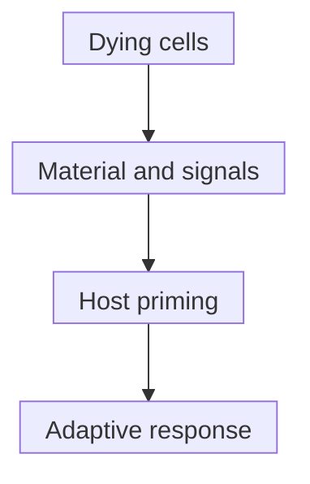

# Immunogenic cell death

## In one sentence

Immunogenic cell death is regulated cell death that can initiate an antigen-specific adaptive immune response in a compatible, immune-competent host.

## The intuition

A dying cell can leave both teaching material and an alarm. The material supplies potential [antigens](/wiki/education/concepts/immunology/antigen-presentation/antigen-and-epitope); the alarm helps immune cells respond. But a parcel and a ringing bell do not prove that anyone learned the lesson. The analogy misses the timing, responding host and immune machinery needed for that learning.

## How it works

**Immunogenic cell death (ICD)** joins two requirements. **Antigenicity** means suitable targets are available to the host's responding cells. **Adjuvanticity** means accompanying signals support immune activation. Both depend on context; the same dying material need not work in every host. The [2020 ICD consensus](https://pubmed.ncbi.nlm.nih.gov/32209603/) makes the adaptive response part of the definition.

[Damage-associated molecular patterns (DAMPs)](/wiki/education/concepts/immunology/innate-and-unconventional-cells/pattern-recognition-damps-and-pamps) can help connect injury to immune sensing. In defined tumor experiments, surface **calreticulin** supported uptake of dying cells; released **adenosine triphosphate (ATP)** supported dendritic-cell signaling through a tested receptor pathway; **high-mobility group box 1 (HMGB1)** supported processing of dying-cell material. These are mechanistic examples, not a universal three-marker checklist. Their amount, location, timing and the recipient's sensing machinery matter.

[Dendritic cells](/wiki/education/concepts/immunology/innate-and-unconventional-cells/dendritic-cells) may collect material and [cross-present](/wiki/education/concepts/immunology/antigen-presentation/cross-presentation) it to T cells. Appropriate [priming](/wiki/education/concepts/immunology/t-cells/t-cell-priming-three-signals) and a compatible repertoire remain necessary. Neither apoptosis nor necrotic appearance automatically establishes this chain.

*These are requirements to test in a compatible host, not guaranteed consequences of killing cells.*

## Why it matters in cancer

ICD offers a way to investigate how local injury might support broader immune recognition. DAMP measurements alone cannot demonstrate tumor-specific immune memory, distant control or patient benefit.

A recognized functional test uses treated, dying tumor cells as a vaccine in compatible immune-competent mice, then challenges them with living matched tumor cells. The consensus describes removing the inducing chemical and adding no separate immune adjuvant. Protection and specificity are tested with appropriate comparison groups. This addresses immunogenicity in that model; it does not validate a clinical regimen. Comparing immune-competent and immune-deficient hosts alone may reveal immune involvement without isolating ICD from other immunostimulation.

## Assay card

| Field | Keep with the result |
|---|---|
| Measures | Death, individual danger signals, priming or protective immunity: name which claim was tested |
| How | Combine death readouts, signal assays and controlled host-based functional experiments |
| Input and tissue cost | Cultured or isolated tumor cells, supernatant and host models; tested aliquots are consumed |
| Output and units | Dead-cell fraction, signal concentration or surface staining; challenge incidence/growth under a defined protocol |
| Thresholds | Assay-specific; no universal marker cutoff establishes ICD |
| Failure modes | Residual inducer, poor death confirmation, incompatible antigens, contamination or inadequate controls |
| What it cannot tell you | Clinical benefit, whole-body tumor recognition or a preferred treatment |
| Validation tier | Mechanistic/functional model evidence; clinical conclusions require separate trials |

## Common confusions

- A DAMP is not automatically a tumor-specific antigen.
- Inflammation and adaptive immune learning are different outcomes.
- A death marker does not establish immunogenicity.
- Functional protection in a model is stronger evidence than marker release, but remains model-bound.

## Try it

A fictional culture shows increased death and extracellular ATP. Its researcher calls it an effective cancer vaccine. What is missing?

**Answer:** The experiment measured injury and one signal. Antigen-specific adaptive responses and controlled functional protection remain untested. Controls must also exclude an effect of carried-over inducer. Even successful model vaccination would leave clinical benefit unresolved.

## Explain it back

“DAMPs support a proposed mechanism; ICD requires ___.” One answer: “evidence of adaptive immune learning in a compatible responding host.”

## Takeaway

**Measure the alarm, the learning and the outcome separately.**

## Related concepts

- [Apoptosis and the BCL-2 family](/wiki/education/concepts/cancer-biology/cell-death-and-survival/apoptosis-and-bcl2-family)
- [Necrosis](/wiki/education/concepts/cancer-biology/cell-death-and-survival/necrosis)
- [In-situ vaccination](/wiki/education/concepts/immunology/tumor-immunology/in-situ-vaccination)

## Sources and scope

Source-checked October 10, 2026. General mechanism and model evidence; fictional practice. Expert and learner review remain pending.

- [Galluzzi et al., 2020: consensus definition, functional tests and interpretation](https://pubmed.ncbi.nlm.nih.gov/32209603/).
- [Obeid et al., 2007: calreticulin and immunogenicity in tumor models](https://pubmed.ncbi.nlm.nih.gov/17187072/).
- [Ghiringhelli et al., 2009: ATP-dependent immune signaling in defined experiments](https://pubmed.ncbi.nlm.nih.gov/19767732/).
- [Apetoh et al., 2007: HMGB1 and host sensing of dying-cell material](https://pubmed.ncbi.nlm.nih.gov/17704786/).

<!-- BEGIN GENERATED USED IN -->
## Used in

- [Understand local therapy and the immune system](/wiki/education/guides/local-therapy-and-the-immune-system/index)
- [Separate local injury from immune learning](/wiki/education/local-treatment-modalities/01-mechanism)
- [Match each measurement to its claim](/wiki/education/local-treatment-modalities/05-tissue-and-sample-budget)
- [Compare delivery and recognition separately](/wiki/education/local-treatment-modalities/06-comparisons)
<!-- END GENERATED USED IN -->
