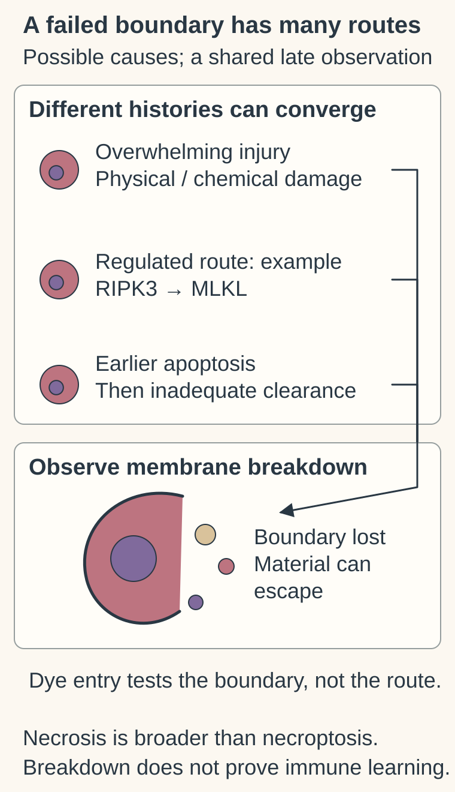

# Necrosis

## In one sentence

Necrosis is a pattern of cell and tissue breakdown involving loss of cell-membrane integrity, which can result from severe injury or regulated death mechanisms.

## The intuition

A building's collapsed walls tell you that its structure failed. They do not tell you whether the cause was a storm, a fire or a controlled demolition gone differently than expected. **Necrotic** appearance works similarly. It describes the outcome, while the route to that outcome needs additional evidence. Cells are more complicated than buildings: their death machinery can change which material escapes and how neighboring cells respond.

**Before you start:** [The cell membrane](/wiki/education/concepts/biology-basics/cells/cell-and-membrane) maintains a boundary. [Hematoxylin and eosin (H&E) morphology](/wiki/education/concepts/measurement/pathology-readouts/h-and-e-morphology) makes cell shapes and tissue architecture visible.

## How it works

Three illustrative histories can lead to a similar late membrane-loss observation: overwhelming injury, a regulated route such as RIPK3–MLKL necroptosis, or apoptosis followed by inadequate clearance. These are examples, not every death route or a universal timetable. The broken boundary depicts a convergent appearance, not pathway attribution, immune memory, treatment success or clearance of an entire tumor.

Necrotic cells commonly swell, lose membrane integrity and release intracellular material. In tissue, nuclei and normal architecture can be lost as breakdown proceeds. A pathologist interprets these features together with the specimen and clinical context. “Necrosis present” is not the name of one molecular pathway.

**Accidental cell death** follows overwhelming physical or chemical injury that disrupts vital structures. **Regulated cell death** depends on molecular machinery that can, under suitable conditions, be changed experimentally. Regulated mechanisms can also end in necrotic morphology. This is why “necrosis means unregulated death” is too narrow. [Galluzzi 2018](https://www.nature.com/articles/s41418-017-0012-4).

One example is **necroptosis**, a regulated pathway involving receptor-interacting protein kinase 3 (RIPK3) and mixed-lineage kinase domain-like protein (MLKL). RIPK3-dependent activation of MLKL can lead to membrane disruption. Sun and colleagues used biochemical and cell experiments to establish MLKL's downstream role. Finding a necrotic region on a slide does not establish this specific mechanism. [Sun 2012](https://pubmed.ncbi.nlm.nih.gov/22265413/).

Another route is **secondary necrosis**: a cell starts [apoptosis](/wiki/education/concepts/cancer-biology/cell-death-and-survival/apoptosis-and-bcl2-family), then loses membrane integrity when clearance is inadequate. A late snapshot may therefore hide an earlier apoptotic phase. Different regulated routes, including [ferroptosis](/wiki/education/concepts/cancer-biology/cell-death-and-survival/ferroptosis), require their own mechanistic tests.

| Observation | What it supports | What remains open |
|---|---|---|
| Necrotic tissue on H&E | Breakdown in the represented region | Cause, timing and molecular pathway |
| Membrane-impermeant dye enters cells | Membrane integrity is lost under the assay conditions | Which death route led there |
| A pathway-specific perturbation changes death | A causal role may be supported with suitable controls | Specificity, alternative routes and relevance outside that model |

## Why it matters in cancer

Necrosis can accompany inadequate local blood supply, treatment injury and other causes. Its presence alone cannot distinguish them or prove successful treatment. Sampling a necrotic region can also reduce the viable cells available for a functional assay. It does not describe every region of the tumor.

Released material can trigger inflammation through [damage-associated molecular patterns](/wiki/education/concepts/immunology/innate-and-unconventional-cells/pattern-recognition-damps-and-pamps). In primary experiments, necrotic cells lacking high-mobility group box 1 (HMGB1) produced less inflammation than comparison cells. That supports one danger-signal mechanism in those models. [Scaffidi 2002](https://pubmed.ncbi.nlm.nih.gov/12110890/).

Inflammation is not automatically protective, antigen-specific immunity. Antigen availability, immune sensing, presentation and a compatible responding host still matter. The [immunogenic-cell-death consensus](https://pubmed.ncbi.nlm.nih.gov/32209603/) keeps death and demonstrated adaptive immunity separate. A necrotic appearance cannot select an immune treatment or establish benefit.

## How it is measured

A tissue section is consumed by preparation and staining. Its report may describe necrosis qualitatively or quantify area under a specified method; there is no universal necrosis percentage that identifies a death pathway. Live-cell dye assays consume tested aliquots and report a defined membrane-compromised fraction. Damaged handling, delayed fixation and late sampling can obscure the interpretation. Clinical morphology and research pathway tests have different validation contexts.

## Common confusions

- Necrosis is broader than necroptosis.
- Membrane rupture does not reveal the full preceding sequence.
- Local inflammation does not prove immune memory or distant tumor control.
- Dead tissue in one section does not mean no living tumor remains elsewhere.

## Try it

A fictional culture becomes dye-positive after an intervention. The researcher calls this “necroptosis that will act as a vaccine.” Which claims were skipped?

**Answer:** The dye shows membrane compromise under the tested conditions. Pathway attribution needs specific mechanistic evidence and controls. Adaptive immune learning needs its own host-based tests; patient benefit is another evidence step.

## Explain it back

“What happened to the membrane?” and “Which process caused it?” are different questions. Can you name a measurement for each?

**One answer:** A membrane-integrity assay addresses the first; controlled pathway perturbations and complementary readouts help address the second.

## Takeaway

**Necrotic appearance describes breakdown; mechanism and immune consequence require separate evidence.**

## Related concepts

- [Treatment effect in pathology](/wiki/education/concepts/breast-cancer/surgery-and-pathology-results/treatment-effect-in-pathology)
- [Immunogenic cell death](/wiki/education/concepts/cancer-biology/cell-death-and-survival/immunogenic-cell-death)
- [Perturbation and controls](/wiki/education/concepts/evidence-and-statistics/study-design/perturbation-and-controls)

## Sources and scope

Source-checked October 10, 2026. General morphology, mechanism and research interpretation; fictional exercise. Expert and learner review remain pending.

- [Galluzzi et al., 2018: accidental and regulated death, necrotic morphology and secondary necrosis](https://www.nature.com/articles/s41418-017-0012-4).
- [Sun et al., 2012: RIPK3/MLKL mechanism in experimental cells](https://pubmed.ncbi.nlm.nih.gov/22265413/).
- [Scaffidi et al., 2002: HMGB1 and inflammatory responses in defined experiments](https://pubmed.ncbi.nlm.nih.gov/12110890/).
- [Galluzzi et al., 2020: criteria for immunogenic cell death](https://pubmed.ncbi.nlm.nih.gov/32209603/).

<!-- BEGIN GENERATED USED IN -->
## Used in

- [Test a mechanism in a living model](/wiki/education/molecular-profiling/05-functional-drug-response)
- [Oncology 101: immune foundations](/wiki/education/oncology-101/index)
<!-- END GENERATED USED IN -->
