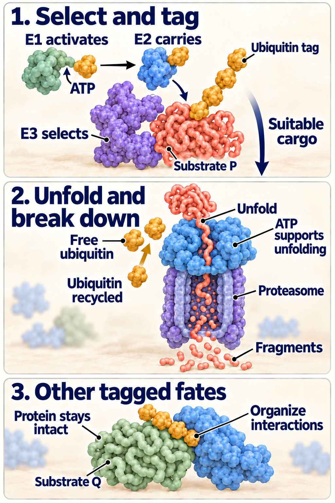

# Ubiquitin and the proteasome

## In one sentence

The ubiquitin–proteasome system marks selected proteins for controlled breakdown, while other ubiquitin signals have jobs beyond destruction.

## The intuition

Imagine removable labels on workshop objects. Some labels send an object to a shredder. Others change where it goes or who works with it. Ubiquitin is such a label, but its arrangement matters. It is not a universal “destroy this” sticker.

The workshop analogy leaves out chemistry: labels must be attached, recognized and removed by different molecular machines. A jam at any of those steps can change the snapshot.

## How it works

*Selected proteins can be tagged, unfolded and broken into fragments while ubiquitin is reused; other tagged proteins can organize interactions. These schematic tag patterns are not a universal destruction code.*

**Ubiquitin** is a small [protein](/wiki/education/concepts/biology-basics/molecules/protein-and-peptide) that can be attached to another protein. A series of [enzymes](/wiki/education/concepts/biology-basics/molecules/enzymes-and-binding) performs the attachment:

| Component | Its distinct job |
|---|---|
| E1, ubiquitin-activating enzyme | Uses adenosine triphosphate, or ATP, to activate ubiquitin and form a temporary linkage. |
| E2, ubiquitin-conjugating enzyme | Receives and carries activated ubiquitin. |
| E3, ubiquitin ligase | Helps recognize the substrate and promotes ubiquitin transfer. |

A **substrate** is the molecule being acted on. E3 families use different transfer mechanisms; “E3” does not mean each works identically. The early E1/E2/E3 experiments isolated these jobs from reticulocyte extracts, preparations from immature red blood cells.

One ubiquitin or a chain can be attached. Some arrangements help deliver suitable proteins to the **proteasome**, a protein complex that unfolds cargo and cuts it into smaller pieces. ATP also supports the regulated unfolding machinery. Ubiquitin is removed and recycled. Other signals organize interactions, trafficking or damage responses rather than immediate destruction. Primary yeast experiments showed that chain types can have different, partly overlapping functions; do not reduce every chain to one rigid instruction.

The proteasome can remove damaged proteins and also working proteins whose job is finished. [Autophagy](/wiki/education/concepts/cancer-biology/cell-death-and-survival/autophagy) uses lysosomes for cellular cargo instead. These routes interact, but they are not interchangeable machines.

## Why it matters in cancer

Turnover controls growth and stress regulators as well as protein quality. A high protein amount can arise from more production, less removal or both. A variant in an E3 component does not establish a general proteasome defect or sensitivity to a proteasome inhibitor.

For example, **cullin 3 (CUL3)** is a scaffold used with different adaptors. **Kelch-like ECH-associated protein 1 (KEAP1)** is one adaptor studied in handling **nuclear factor erythroid 2-related factor 2 (NRF2)**. The [KEAP1–NRF2 owner](/wiki/education/concepts/cancer-biology/signaling-pathways/nrf2-keap1) explains that stress circuit. A CUL3 finding alone cannot assign its consequence to NRF2 or every substrate.

## How it is measured

Proteasome catalytic activity, ubiquitinated cargo and a specific protein's lifetime are different readouts. They may use substrate conversion per minute, normalized band intensity or a decay time in hours. No single readout measures every job of the system.

Follow a named protein over time while accounting for new synthesis. Pulse-labeling or a controlled temporary synthesis block can help, but the intervention can itself cause stress. Check cell viability and matched handling. Independent perturbations and restoration of a regulator help distinguish a direct substrate relationship from a secondary cellular response.

## Common confusions

- **Ubiquitin versus destruction:** attachment can carry other messages.
- **One adaptor versus the whole system:** substrate recognition can be selective.
- **High amount versus high production:** slower removal can create the same result.
- **Enzyme engagement versus selective killing:** changing the proteasome does not prove a useful safety window.

## Try it

In a fictional culture, protein P is unusually abundant. During a controlled synthesis-block experiment, P disappears more slowly than in a matched culture. Restoring an altered E3 adaptor returns P's turnover toward the control. Does this establish a global proteasome failure?

**Answer:** No. With synthesis, stress and viability controls, it supports slower P turnover and a role for that adaptor. Other substrates and proteasome catalytic activity need separate tests. Restoration strengthens attribution, but additional interaction or attachment experiments would test whether P is handled directly. It does not establish treatment benefit.

## Explain it back

“E1 ___; E2 ___; E3 ___; protein abundance also depends on ___.”

One answer: “activates ubiquitin; carries it; helps select and modify a substrate; synthesis as well as removal.”

## Takeaway

**Name the regulator, substrate and measured step before generalizing about protein destruction.**

## Related concepts

- [Wnt–β-catenin signaling](/wiki/education/concepts/cancer-biology/signaling-pathways/wnt-beta-catenin): another use of regulated protein destruction.
- [The proteostasis lesson](/wiki/education/molecular-profiling/evee-pathways/01-autophagy-and-proteostasis).

## Sources and scope

Source check: October 10, 2026. General mechanism education; protein P is fictional. Expert and learner review remain pending.

- [Hershko et al. (1983)](https://pubmed.ncbi.nlm.nih.gov/6305978/): E1/E2/E3 separation and ATP-dependent conjugation in reticulocyte extracts.
- [Hershko and Rose (1987)](https://pubmed.ncbi.nlm.nih.gov/3031653/): ubiquitin recycling and its relationship to degradation in a rabbit-reticulocyte system.
- [Kobayashi et al. (2004)](https://pubmed.ncbi.nlm.nih.gov/15282312/): KEAP1 adaptor function in CUL3-dependent NRF2 turnover.
- [Snoberger et al. (2017)](https://pubmed.ncbi.nlm.nih.gov/28421184/): ATP-dependent substrate unfolding in biochemical proteasomal machinery experiments.
- [Xu et al. (2009)](https://pubmed.ncbi.nlm.nih.gov/19345192/): different ubiquitin-chain functions studied through yeast proteomics and genetic perturbation.

<!-- BEGIN GENERATED USED IN -->
## Used in

- [Autophagy and proteostasis: amount, flow, and dependence](/wiki/education/molecular-profiling/evee-pathways/01-autophagy-and-proteostasis)
- [Stress defenses and chromatin readers: test the direction](/wiki/education/molecular-profiling/evee-pathways/04-cul3-nrf2-ferroptosis-and-bet)
- [Pathway mechanisms: a supporting lesson library](/wiki/education/molecular-profiling/evee-proposed-pathways)
<!-- END GENERATED USED IN -->
