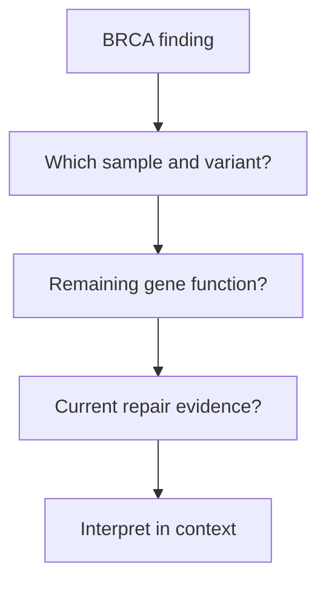

# BRCA1 and BRCA2

## In one sentence

BRCA1 and BRCA2 are genes whose protein products help preserve genome stability through homologous recombination and other functions associated with DNA repair.

## The intuition

Imagine a repair crew whose coordinator and specialist have different jobs. **BRCA1** and **BRCA2** name genes and, by convention, their protein products. They participate in overlapping repair work, but they are not identical tools. The analogy misses a crowded, regulated protein network: losing one component can change several processes rather than merely remove one worker.

Everyone normally carries these genes. “BRCA positive” is incomplete language: positive for which variant, in which sample, with what interpretation?

## How it works

[Homologous recombination (HR)](/wiki/education/concepts/cancer-biology/genome-instability-and-repair/homologous-recombination-and-hrd) uses matching genetic information to repair certain kinds of deoxyribonucleic acid (DNA) damage. BRCA1 contributes to coordinating this repair. In an early experiment, Brca1-deficient mouse embryonic stem cells repaired defined chromosome breaks less effectively by HR. This established a repair role in that model, rather than the effect of every human BRCA1 variant. [Moynahan 1999](https://pubmed.ncbi.nlm.nih.gov/10549283/).

BRCA2 helps **RAD51**, a protein that finds matching DNA, assemble on single-stranded DNA. Studies using purified full-length human BRCA2 showed that it helps load and stabilize RAD51 on the appropriate substrate. This is a specific molecular function, not a complete description of everything BRCA2 does in a cell. [Jensen 2010](https://pmc.ncbi.nlm.nih.gov/articles/PMC2952063/).

BRCA1 and BRCA2 act as [tumor suppressors](/wiki/education/concepts/cancer-biology/what-cancer-is/oncogene-and-tumor-suppressor). A **pathogenic variant** is a change supported as harmful by its clinical and biological interpretation. A **variant of uncertain significance (VUS)** has insufficient evidence for that conclusion. A VUS must not be relabeled as a damaging repair defect merely because it lies in a familiar gene. [NCI BRCA fact sheet](https://www.cancer.gov/about-cancer/causes-prevention/genetics/brca-fact-sheet).

## Why it matters in cancer

An inherited, or [germline](/wiki/education/concepts/biology-basics/genetics/germline-vs-somatic), pathogenic variant can increase cancer susceptibility. A tumor may lose or disable its remaining working copy. **Biallelic inactivation** means both gene copies are functionally disrupted. A tumor test must assess the actual context; one variant call does not automatically establish that state. Acquired, or **somatic**, changes can also affect these genes.

[Hereditary breast-cancer genes](/wiki/education/concepts/breast-cancer/hereditary-risk/hereditary-breast-cancer-genes) places BRCA1/2 alongside other susceptibility genes. The origin of the variant, its classification, the remaining allele and current repair function are separate questions. A tumor-only test does not by itself establish inheritance. Genetic findings also have different implications from a [genomic-scar](/wiki/education/concepts/cancer-biology/genome-instability-and-repair/genomic-scars) score.

Repair can change over time. A **reversion** is a later change that restores function lost through an earlier alteration, for example by restoring a readable coding sequence. Reversions and other repair-restoration mechanisms were documented in selected resistant metastatic breast cancers; that small cohort did not establish their frequency in all cancers. [Waks 2020](https://pubmed.ncbi.nlm.nih.gov/32245699/).

## How it is measured

Germline testing commonly uses blood or saliva; tumor sequencing uses tumor material and may be paired with a normal sample. Both consume collected material. Reports should specify sample, variant, classification and method limitations. Tumor copy-number and allele analyses can help assess the remaining copy, but purity and complex chromosome states complicate interpretation.

Functional repair assays address a different question from sequence classification. Neither a sequence result nor a reversion hypothesis replaces setting-specific clinical evidence or current eligibility criteria.

## Common confusions

- **The gene versus its variant:** possessing BRCA1 and BRCA2 is normal.
- **VUS versus pathogenic:** uncertain means unresolved, not probably damaging for teaching purposes.
- **Germline versus biallelic loss:** inheritance and tumor gene-function state describe different things.
- **An old defect versus current function:** evolution can change a surviving tumor population.

## Try it

A fictional tumor report lists “BRCA2 VUS”; the normal sample was not tested, and the remaining copy was not assessed. Can we call inherited BRCA2-related HR deficiency?

**Answer:** no. Variant effect, inheritance and tumor repair state are all unresolved. The report supports a finding that needs interpretation, not that combined conclusion.

## Explain it back

Complete: “BRCA2 helps RAD51 with ___, but a BRCA2 variant alone does not tell us ___.”

**One possible answer:** HR repair; whether both gene copies are disabled or repair is currently impaired.

## Takeaway

**Interpret the variant, its origin and tumor function separately before building a BRCA repair claim.**

## Related concepts

- [DNA damage and repair](/wiki/education/concepts/cancer-biology/genome-instability-and-repair/dna-damage-and-repair-overview) place these genes in the broader repair system.
- [Synthetic lethality](/wiki/education/concepts/therapeutics/how-drugs-work/synthetic-lethality) explains an interaction between paired impairments.

## Sources

Source check: 2026-10-09. Gene function and test interpretation; expert and learner review pending. This page gives no personal cancer forecast or treatment recommendation.

- [Moynahan and colleagues 1999: BRCA1 function in a mouse-cell HR reporter](https://pubmed.ncbi.nlm.nih.gov/10549283/).
- [Jensen and colleagues 2010: purified human BRCA2 promotes RAD51-mediated recombination](https://pmc.ncbi.nlm.nih.gov/articles/PMC2952063/).
- [NCI: BRCA gene changes, inherited versus acquired findings and VUS interpretation](https://www.cancer.gov/about-cancer/causes-prevention/genetics/brca-fact-sheet).
- [Waks and colleagues 2020: resistance and repair restoration in a selected metastatic breast cancer cohort](https://pubmed.ncbi.nlm.nih.gov/32245699/).

<!-- BEGIN GENERATED USED IN -->
## Used in

- [Connect repair biology to PARP sensitivity](/wiki/education/guides/from-variant-to-drug/02-connect-repair-biology-to-parp-sensitivity)
<!-- END GENERATED USED IN -->
