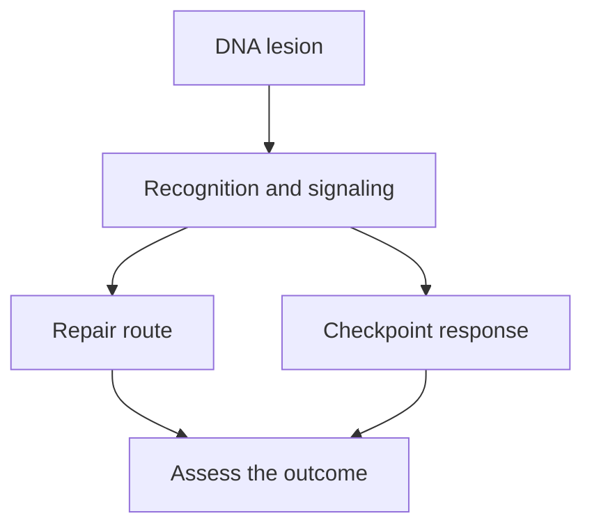

# DNA damage and repair: an overview

## In one sentence

DNA repair is a collection of processes that recognize and correct damage to genetic material, with different routes for different kinds of damage.

## The intuition

Picture a library with several repair teams: one fixes a damaged letter, another replaces a stained strip, and another reconnects a torn page. Cells likewise need several ways to maintain [deoxyribonucleic acid (DNA)](/wiki/education/concepts/biology-basics/genetics/central-dogma). The analogy stops at the page: a cell's DNA is being copied, packaged and read, so repair must work around other activities.

**Damage is a physical or chemical lesion; a mutation is a lasting sequence change.** Damage can be repaired before it becomes a mutation. A mutation can remain after the original damage is gone.

## How it works

The route depends on the problem. This is a map of major jobs, rather than an exhaustive list. [Alberts 2002](https://www.ncbi.nlm.nih.gov/books/NBK26879/), [Brown 2002](https://www.ncbi.nlm.nih.gov/books/NBK21114/).

| Problem | A repair route |
|---|---|
| An altered individual base | **Base excision repair (BER)** removes the damaged base and rebuilds the missing DNA. |
| A bulky lesion that distorts the helix | **Nucleotide excision repair (NER)** removes a short stretch containing it. |
| A mismatch left during copying | **Mismatch repair (MMR)** corrects an incorrectly paired base or small copying slip. |
| Both DNA strands broken | [Homologous recombination (HR)](/wiki/education/concepts/cancer-biology/genome-instability-and-repair/homologous-recombination-and-hrd) can use a matching template; [end joining](/wiki/education/concepts/cancer-biology/genome-instability-and-repair/nhej-and-mmej) reconnects ends through other routes. |

**DNA damage response (DDR)** is the broader system of sensing, signaling and coordinating what happens next. A **checkpoint** can delay progression through the cell cycle, giving repair time. A warning signal is not itself a completed repair. Experiments on RPA, a protein that coats single-stranded DNA, showed how exposed DNA can recruit the ATR checkpoint machinery. [Zou and Elledge 2003](https://pubmed.ncbi.nlm.nih.gov/12791985/).

Cells may repair damage, tolerate it temporarily, stop dividing or die. The diagram deliberately ends with assessment: a response marker cannot tell us which outcome occurred.

## Why it matters in cancer

Repair defects can allow changes that contribute to cancer. At the same time, surviving tumor cells still rely on repair and stress responses. This helps explain why the same broad subject includes both cancer prevention and experimental cancer vulnerabilities.

A repair-gene variant, a [genomic scar](/wiki/education/concepts/cancer-biology/genome-instability-and-repair/genomic-scars), a damage signal and cell death answer different questions. None substitutes for all the others.

## How it is measured

**Gamma-H2AX (γH2AX)** is a form of a DNA-packaging protein with a phosphate group attached. The original experiments showed that it rises rapidly after induced double-strand breaks. Its signal reflects a cellular response around damage, rather than reading the broken DNA sequence directly. [Rogakou 1998](https://pubmed.ncbi.nlm.nih.gov/9488723/).

Microscopy may report foci per cell; other experiments report repaired reporter constructs or damage remaining over time. Specimen quality, cell type, timing, cell-cycle state and controls determine what is interpretable. There is no single “all repair pathways working” cutoff, and a research staining result does not establish drug sensitivity.

## Common confusions

- **Damage versus mutation:** a current lesion and a fixed sequence change are different objects.
- **Signaling versus repair:** a loud alarm does not prove either repair success or failure.
- **One pathway versus the whole system:** HR deficiency does not mean that every repair route is absent.

## Try it

A fictional culture has increased γH2AX one hour after an experimental insult. A scientist concludes, “These cells cannot repair DNA.” What is missing?

**Answer:** a time course and suitable controls, plus a measure of the relevant repair outcome. A rise in damage signaling alone does not show that lesions persist, that HR is defective or that the cells will die.

## Explain it back

Why might a cell have DNA damage without acquiring a new mutation?

**One possible answer:** it can recognize and repair the lesion before the altered information becomes a lasting sequence change.

## Takeaway

**Identify the damage, the repair route and the measured outcome before interpreting a repair claim.**

## Related concepts

- [BRCA1 and BRCA2](/wiki/education/concepts/cancer-biology/genome-instability-and-repair/brca1-and-brca2) are important repair genes.
- [Replication stress](/wiki/education/concepts/cancer-biology/genome-instability-and-repair/replication-stress) concerns trouble during DNA copying.

## Sources

Source check: 2026-10-09. Foundational mechanism and measurement education; expert and learner review pending. No diagnostic threshold or treatment recommendation is implied.

- [Alberts and colleagues 2002: DNA Repair, Molecular Biology of the Cell, fourth edition](https://www.ncbi.nlm.nih.gov/books/NBK26879/).
- [Brown 2002: Mutation, Repair and Recombination, Genomes, second edition](https://www.ncbi.nlm.nih.gov/books/NBK21114/).
- [Zou and Elledge 2003: RPA-associated DNA and ATR checkpoint recruitment, cell and biochemical experiments](https://pubmed.ncbi.nlm.nih.gov/12791985/).
- [Rogakou and colleagues 1998: γH2AX after experimentally induced double-strand breaks](https://pubmed.ncbi.nlm.nih.gov/9488723/).

<!-- BEGIN GENERATED USED IN -->
## Used in

- [From a variant to a drug claim](/wiki/education/guides/from-variant-to-drug/index)
- [Follow a splice change toward repair function](/wiki/education/multi-omics-foundations/05-splicing-and-dna-repair)
<!-- END GENERATED USED IN -->
