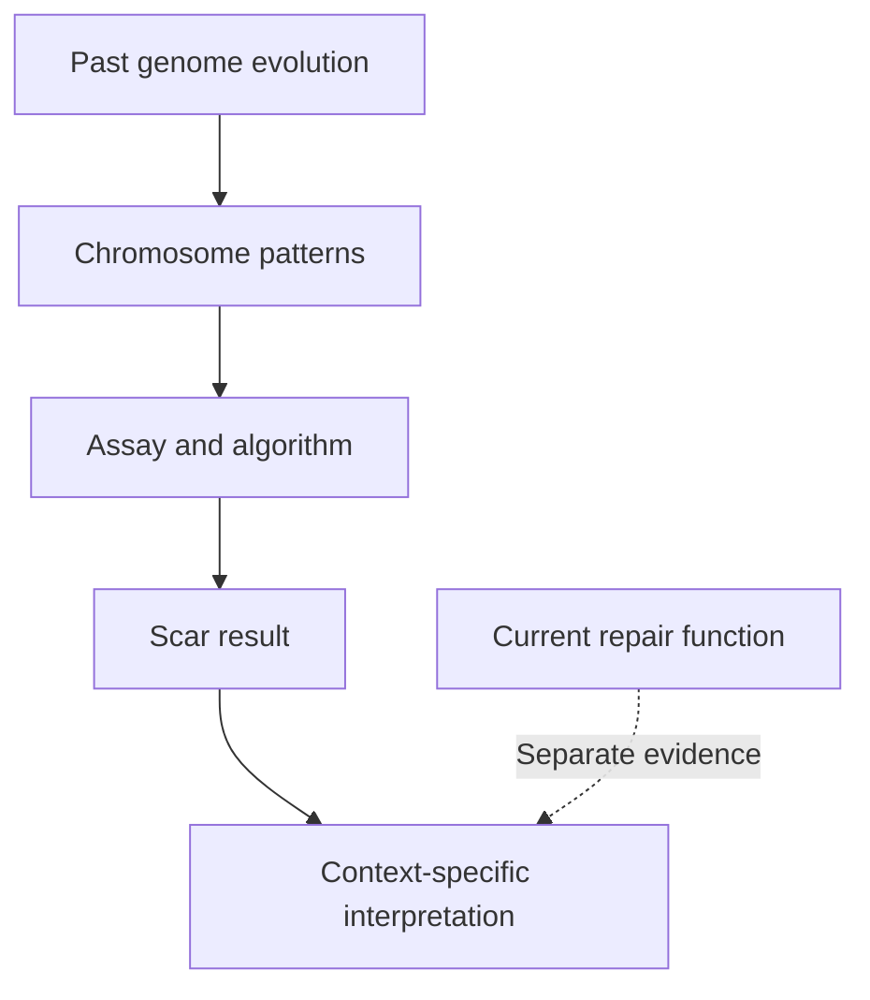

# Genomic scars

## In one sentence

Genomic scars are persistent patterns of chromosome imbalance or rearrangement that record aspects of a tumor’s past evolution, rather than directly measuring its current repair activity.

## The intuition

A patched road can reveal years of wear without telling you whether today's repair crew works well. **Genomic scars** are likewise historical traces in a tumor's chromosomes. They can support a repair hypothesis, but the analogy has limits: several processes create chromosome changes, and an assay compresses only selected patterns into a score.

## How it works

A chromosome normally has copies contributed by each parent. An **allele** is a version of a DNA sequence. **Allelic imbalance** means those parental contributions are unequal in a region. **Loss of heterozygosity (LOH)** means a previously mixed region has lost one parental version. It can occur with physical copy loss or with two copies of the same parental version, called **copy-neutral LOH**.

Three widely studied scar measures count different features:

| Measure | What is counted in the original method |
|---|---|
| LOH-based score | LOH regions longer than 15 megabases but shorter than a whole chromosome, studied in epithelial ovarian tumors. [Abkevich 2012](https://pubmed.ncbi.nlm.nih.gov/23047548/). |
| **Telomeric allelic imbalance (TAI)** | Imbalanced regions reaching a chromosome end, the **telomere**, without crossing its central joining region, the **centromere**. [Birkbak 2012](https://pubmed.ncbi.nlm.nih.gov/22576213/). |
| **Large-scale state transitions (LST)** | Transitions between adjacent regions each at least 10 megabases long, with different copy numbers and/or allelic contents, after filtering and smoothing variations smaller than 3 megabases. The original method counts within chromosome arms and excludes centromeric breaks. [Popova 2012](https://pubmed.ncbi.nlm.nih.gov/22933060/). |

A **megabase (Mb)** is one million DNA bases. The LST rule concerns adjacent segment sizes, not a 10-Mb deletion. These study-specific algorithms are not interchangeable clinical positivity thresholds.

Some assays combine LOH, TAI and LST counts into a score. Telli and colleagues evaluated such a score in defined neoadjuvant triple-negative breast cancer studies. Association with response in that population did not establish a universal treatment rule. [Telli 2016](https://pubmed.ncbi.nlm.nih.gov/26957554/).

## Why it matters in cancer

Scars can preserve evidence after the process that helped create them changes. An earlier BRCA repair defect and later repair restoration can coexist in the same tumor history. Reversion and non-reversion resistance mechanisms were documented in a selected metastatic breast cancer cohort. An old scar should therefore not be treated as a live demonstration of defective repair. [Waks 2020](https://pubmed.ncbi.nlm.nih.gov/32245699/).

## Assay card

| Field | Reading the result carefully |
|---|---|
| Input and tissue cost | Tumor DNA from tissue suitable for the specific assay; extraction consumes material. Fixed or frozen acceptance and required tumor fraction are method-specific. |
| How | Measure chromosome and allele signals; estimate purity and ploidy, meaning chromosome-copy content; divide the genome into segments; apply the defined counting rules. |
| Output and units | Feature counts or a composite score. A count is not a percentage of cells with failed repair. |
| Thresholds | Record the assay version, score definition, cutoff, cancer population and intended use. Segment-size filters and clinical score cutoffs do different jobs. |
| Failure modes | Low tumor content, degraded DNA, inaccurate purity/ploidy estimates and oversegmentation from noise. |
| Limits and validation | Cannot identify every cause, establish present HR function or guarantee drug benefit. Research-method evidence does not transfer automatically to a clinical assay or a different setting. |

## Common confusions

- **LOH versus deletion:** losing a parental version need not reduce total copy number.
- **Scar score versus mutation burden:** chromosome patterns and counts of sequence mutations are different measurements.
- **A segment rule versus a response cutoff:** 10 Mb defines part of the original LST algorithm, not a drug-selection threshold.
- **Past damage versus present repair:** a scar does not disappear simply because repair changes.

## Try it

In a fictional filtered profile, one within-arm transition connects 12-Mb and 8-Mb segments; another connects 12-Mb and 14-Mb segments. Which meets Popova's size rule?

**Answer:** only the second. Both adjacent segments must be at least 10 Mb. This exercise tests the counting rule, not HR deficiency or a clinical response threshold.

## Explain it back

What additional question remains after a scar assay suggests past repair impairment?

**One possible answer:** whether repair is currently impaired and this assay has predictive evidence in the clinical setting.

## Takeaway

**A genomic scar is historical evidence interpreted through a particular assay, not a direct readout of current repair.**

## Related concepts

- [Mutational signatures](/wiki/education/concepts/cancer-biology/genome-instability-and-repair/mutational-signatures) examine patterns across sequence changes.
- [BRCA1 and BRCA2](/wiki/education/concepts/cancer-biology/genome-instability-and-repair/brca1-and-brca2) separate variant findings from repair function.

## Sources

Source check: 2026-10-09. Algorithm definitions and interpretation education; expert and learner review pending. No universal threshold or validated individual sensitivity is asserted.

- [Abkevich and colleagues 2012: an LOH-based score in epithelial ovarian cancer](https://pubmed.ncbi.nlm.nih.gov/23047548/).
- [Birkbak and colleagues 2012: telomeric allelic imbalance in cell lines and defined tumor cohorts](https://pubmed.ncbi.nlm.nih.gov/22576213/); [2013 correction adds TCGA data attribution](https://doi.org/10.1158/2159-8290.CD-13-0326).
- [Popova and colleagues 2012: original LST definition in basal-like breast carcinoma, page 5457](https://pubmed.ncbi.nlm.nih.gov/22933060/).
- [Telli and colleagues 2016: composite scar score in platinum-containing neoadjuvant TNBC studies](https://pubmed.ncbi.nlm.nih.gov/26957554/).
- [Waks and colleagues 2020: repair restoration in selected resistant metastatic breast cancers](https://pubmed.ncbi.nlm.nih.gov/32245699/).

<!-- BEGIN GENERATED USED IN -->
## Used in

- [Connect repair biology to PARP sensitivity](/wiki/education/guides/from-variant-to-drug/02-connect-repair-biology-to-parp-sensitivity)
- [PARP trapping and recycling](/wiki/education/guides/from-variant-to-drug/04-parp-trapping-and-recycling)
- [Follow a splice change toward repair function](/wiki/education/multi-omics-foundations/05-splicing-and-dna-repair)
<!-- END GENERATED USED IN -->
