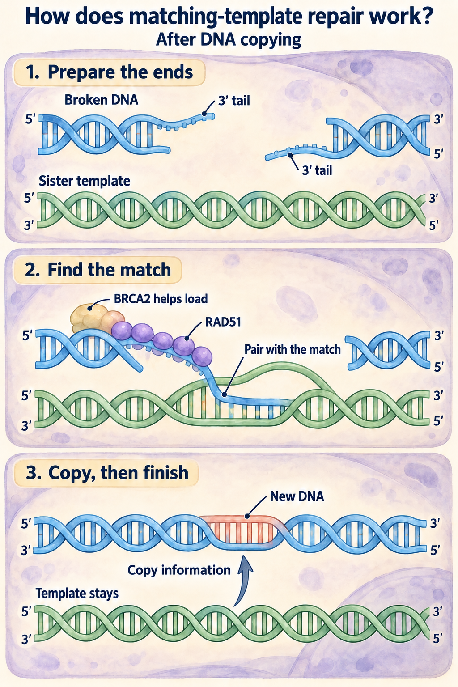
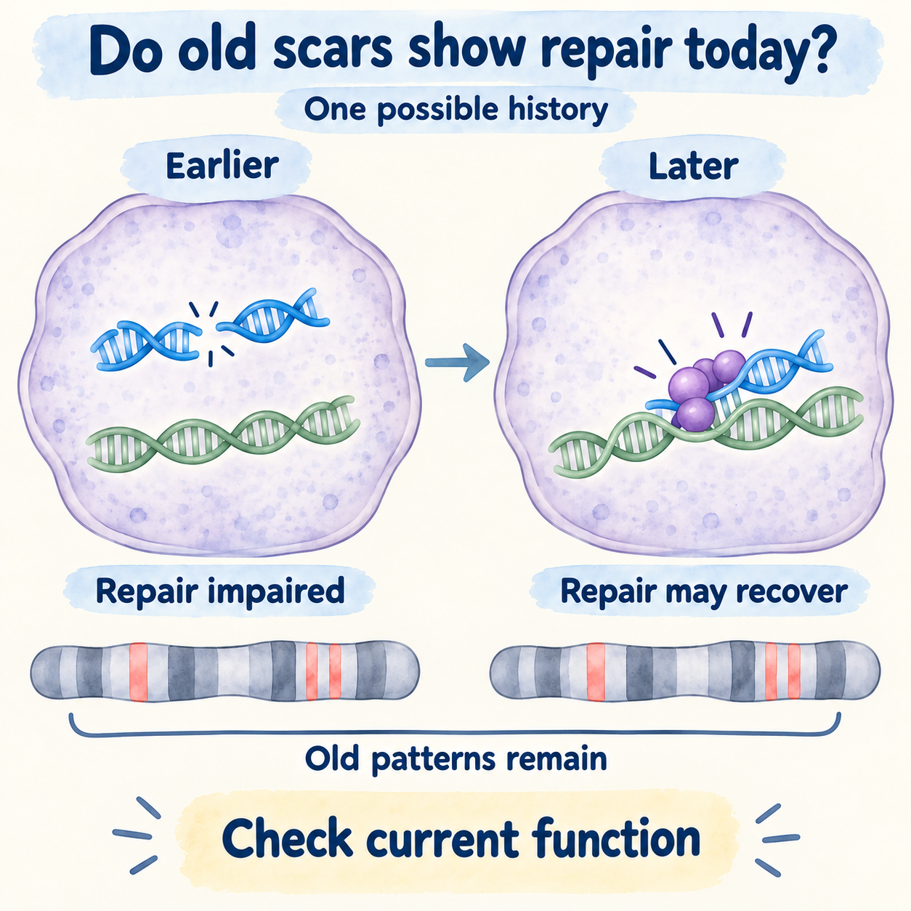

# Homologous recombination and HRD

## In one sentence

Homologous recombination repairs damaged DNA using a matching template; homologous recombination deficiency means this repair process is impaired.

## The intuition

Imagine repairing a torn page by looking at an intact copy. **Homologous recombination (HR)** uses matching genetic information to help reconstruct damaged [deoxyribonucleic acid (DNA)](/wiki/education/concepts/biology-basics/genetics/central-dogma). **Homologous recombination deficiency (HRD)** describes a weakness in that process. The analogy misses the moving parts: cells must recognize damage, prepare the DNA ends, find a template, and finish the repair.

## How it works

After a cell copies its DNA, each chromosome has a closely matching sister copy. HR uses this template to repair certain DNA breaks and damage associated with DNA copying. Its availability therefore depends partly on where the cell is in its cycle of growth and division.

[BRCA1 and BRCA2](/wiki/education/concepts/cancer-biology/genome-instability-and-repair/brca1-and-brca2) are repair proteins, named for the genes that encode them. Together with partners, they help coordinate HR. RAD51, another repair protein, helps find and pair with the matching template. A damaging change in a repair gene can impair the pathway, but finding *any* variant in that gene does not establish HRD. The variant's effect, remaining working copies, and other repair machinery matter.

<em>A prepared DNA end uses a matching sister template with RAD51 support. This simplified route applies when a suitable template is available; it omits many proteins and finishing steps. <a href="https://pmc.ncbi.nlm.nih.gov/articles/PMC2952063/">Jensen 2010</a> <a href="https://pmc.ncbi.nlm.nih.gov/articles/PMC313931/">Johnson and Jasin 2000</a></em>

Read the drawing from top to bottom: a prepared blue 3′ end finds matching information in the sister template; the coral stretch shows newly copied DNA, and the template remains. This is one successful route when a suitable template is available. An interruption in repair could indicate a problem, but the drawing does not diagnose its cause or establish HRD from a gene finding.

[BRCAness](/wiki/education/concepts/breast-cancer/hereditary-risk/brcaness) is a research description of BRCA-like biology without an identified BRCA1/2 mutation. Its definition and evidence need to stay attached; it is not a single interchangeable assay result.

Repair failure can leave [genomic scars](/wiki/education/concepts/cancer-biology/genome-instability-and-repair/genomic-scars), persistent patterns that describe accumulated damage rather than today's repair capacity. Different assays and cutoffs need their own validation for a defined treatment and cancer setting. Telli and colleagues studied one composite scar score in triple-negative breast cancer treated with **platinum-containing** chemotherapy before surgery; that setting does not establish a cutoff for other chemotherapy regimens or other drugs. [Telli 2016](https://pubmed.ncbi.nlm.nih.gov/26957554/). [Composite HRD scores](/wiki/education/concepts/cancer-biology/genome-instability-and-repair/composite-hrd-scores) explains how such scores and cutoffs are built and what they have predicted.

A tumor can retain old scars while a surviving population restores repair, most often through a [BRCA reversion mutation](/wiki/education/concepts/cancer-biology/genome-instability-and-repair/brca-reversion-mutations), a second change that restores the damaged protein.

<em>Old genome patterns can remain while repair changes. This is one possible history, not an assay result: a gene finding, scar score and current function answer different questions. <a href="https://pmc.ncbi.nlm.nih.gov/articles/PMC5961353/">Cruz 2018</a> <a href="https://pmc.ncbi.nlm.nih.gov/articles/PMC7946408/">Waks 2020</a></em>

Compare the two timepoints: the old pattern marks stay while repair may recover. The marks describe history, so they cannot by themselves tell us how repair works now. A possible repair-gene defect and a current functional result need their own evidence and controls; neither this drawing nor the retained marks determine treatment choice.

## Why it matters in cancer

Impaired HR matters clinically because two drug classes exploit it:

- **Platinum drugs** such as carboplatin and cisplatin create DNA crosslinks whose repair relies partly on HR. HR-deficient TNBC was more likely to respond to platinum-containing neoadjuvant chemotherapy in pooled trials. [Platinum agents](/wiki/education/concepts/therapeutics/chemotherapy/platinum-agents); [Telli 2016](https://pubmed.ncbi.nlm.nih.gov/26957554/).
- **PARP inhibitors** such as olaparib block a second repair enzyme and trap it on DNA. In laboratory models, BRCA1- or BRCA2-deficient cells were profoundly more sensitive to PARP inhibition than repair-competent cells, the founding example of [synthetic lethality](/wiki/education/concepts/therapeutics/how-drugs-work/synthetic-lethality): two losses that are each survivable become lethal together. [PARP inhibitors and trapping](/wiki/education/concepts/therapeutics/targeted-small-molecules/parp-inhibitors-and-trapping); [Farmer 2005](https://pubmed.ncbi.nlm.nih.gov/15829967/).

When HR fails, cells lean on error-prone backups, [non-homologous and microhomology-mediated end joining](/wiki/education/concepts/cancer-biology/genome-instability-and-repair/nhej-and-mmej). Those backups leave the [genomic scars](/wiki/education/concepts/cancer-biology/genome-instability-and-repair/genomic-scars) and [mutational signatures](/wiki/education/concepts/cancer-biology/genome-instability-and-repair/mutational-signatures) used to infer HRD. HR also protects stalled DNA-copying forks, which links it to [replication stress](/wiki/education/concepts/cancer-biology/genome-instability-and-repair/replication-stress). For the wider map of damage types and repair routes, see the [DNA damage and repair overview](/wiki/education/concepts/cancer-biology/genome-instability-and-repair/dna-damage-and-repair-overview).

Biological plausibility and a drug's approved use are separate questions. For example, the U.S. Food and Drug Administration (FDA) olaparib label specifies a **germline BRCA mutation**, along with other clinical criteria, for its early breast cancer use after primary treatment. A tumor-only BRCA finding or high scar score does not substitute for that germline criterion. Somatic BRCA alterations and broader HRD hypotheses need evidence in their own setting. [FDA label, section 1.4](https://www.accessdata.fda.gov/drugsatfda_docs/label/2025/208558s031lbl.pdf).

## How it is measured

Gene testing asks about a possible cause; scar testing asks about accumulated consequences; functional assays ask about present repair behavior. **RAD51 foci** are small visible assemblies of RAD51 in cells. Their interpretation requires adequate tumor cells, DNA damage, and cells in an appropriate phase of the cell cycle. Few foci without those controls can be uninformative. Some assays use fixed tissue, so “functional” does not always mean a living drug culture. [Cruz 2018](https://pmc.ncbi.nlm.nih.gov/articles/PMC5961353/).

## Common confusions

- **A cause versus a consequence:** a repair-gene alteration and a genomic scar answer different questions.
- **Past versus present:** scars can persist after repair capacity changes.
- **Germline versus somatic:** [where a variant arose](/wiki/education/concepts/biology-basics/genetics/germline-vs-somatic) matters for inheritance and for some treatment indications.
- **Weak signal versus weak repair:** an inadequate functional assay cannot establish HRD.
- **HRD versus guaranteed response:** other resistance mechanisms, exposure, and treatment setting still matter.
- **Three meanings of "HR":** in DNA repair it means homologous recombination; in pathology, hormone receptor; in trial results, hazard ratio.

## Try it

A fictional tumor has lost both working copies of BRCA2. Which repair route does it lose for breaks after DNA copying, which routes take over, and what would you expect to find in its genome years later?

Show answer

It loses template-guided homologous recombination. Error-prone end joining, including microhomology-mediated end joining, takes over, leaving small deletions flanked by short repeats and larger chromosome rearrangements: genomic scars. Those scars would remain even if a later reversion restored BRCA2, so a scar score alone could not tell you whether repair is impaired today.

## Explain it back

Homologous recombination repairs a break by copying ______; when it fails, cells rely on ______, which leaves ______ that can outlast the defect.

**One possible answer:** the matching sister DNA; error-prone end joining; genomic scars.

## Takeaway

**Homologous recombination is template-guided DNA repair; losing it makes tumors more vulnerable to platinum and PARP inhibitors, but a gene finding, a scar score and current repair function are three different pieces of evidence.**

## Related concepts

- [Synthetic lethality](/wiki/education/concepts/therapeutics/how-drugs-work/synthetic-lethality) explains the paired vulnerability.
- [Genomic scars](/wiki/education/concepts/cancer-biology/genome-instability-and-repair/genomic-scars) and [mutational signatures](/wiki/education/concepts/cancer-biology/genome-instability-and-repair/mutational-signatures) are the main ways HRD is inferred from DNA.
- [NHEJ and MMEJ](/wiki/education/concepts/cancer-biology/genome-instability-and-repair/nhej-and-mmej) are the backup break-repair routes.
- [Oncogenes and tumor suppressors](/wiki/education/concepts/cancer-biology/what-cancer-is/oncogene-and-tumor-suppressor) explain how gene function can change.
- [Analytical validity, clinical validity, and utility](/wiki/education/concepts/measurement/computational-analysis/analytical-validity-clinical-validity-and-utility) separate measurement from medical benefit.

## Sources

Source check: 2026-11-07. Mechanism and measurement education; expert and learner review pending. No universal score threshold or individual response prediction is implied.

- [Farmer 2005: BRCA-deficient cells are highly sensitive to PARP inhibition in experimental models](https://pubmed.ncbi.nlm.nih.gov/15829967/).
- [Telli 2016: a composite genomic-scar score in platinum-containing neoadjuvant triple-negative breast cancer trials](https://pubmed.ncbi.nlm.nih.gov/26957554/).
- Drawing provenance for the scar-and-function figure: [provenance record](./images/prompts/hrd-039-public-provenance.json) and [original prompts and review records](./images/prompts/hrd-039-public-provenance.zip).
- [Waks 2020: repair restoration in selected resistant metastatic breast cancers](https://pubmed.ncbi.nlm.nih.gov/32245699/).
- [Cruz 2018: RAD51 foci and PARP-inhibitor resistance](https://pmc.ncbi.nlm.nih.gov/articles/PMC5961353/).
- [FDA olaparib prescribing information, 2025 label, sections 1.4 and 14.4](https://www.accessdata.fda.gov/drugsatfda_docs/label/2025/208558s031lbl.pdf).

<!-- BEGIN GENERATED USED IN -->
## Used in

- [Connect repair biology to PARP sensitivity](/wiki/education/guides/from-variant-to-drug/02-connect-repair-biology-to-parp-sensitivity)
- [PARP trapping and recycling](/wiki/education/guides/from-variant-to-drug/04-parp-trapping-and-recycling)
- [Autophagy: traffic, flow, and dependence](/wiki/education/guides/from-variant-to-drug/05-autophagy-flux-and-dependence)
- [PI3K, AKT, and mTOR: competing effects on repair and recycling](/wiki/education/guides/from-variant-to-drug/06-pi3k-akt-mtor-and-repair)
- [Reading a functional experiment](/wiki/education/guides/from-variant-to-drug/07-reading-a-functional-experiment)
- [From a variant to a drug claim](/wiki/education/guides/from-variant-to-drug/index)
- [Read protein: presence, place and activation](/wiki/education/guides/what-multi-omics-tells-us/06-read-protein)
- [Integrate the evidence and meet the clinical gate](/wiki/education/guides/what-multi-omics-tells-us/10-integrate-the-evidence)
<!-- END GENERATED USED IN -->
