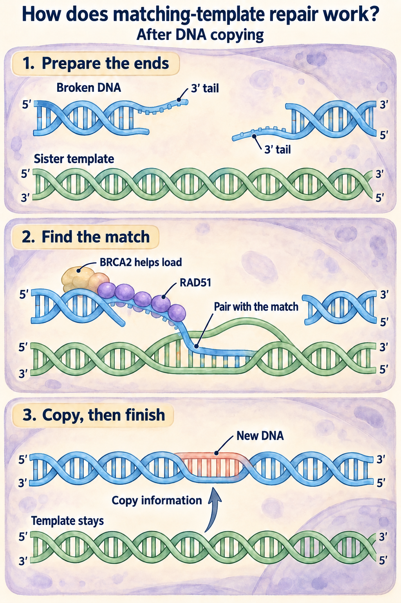
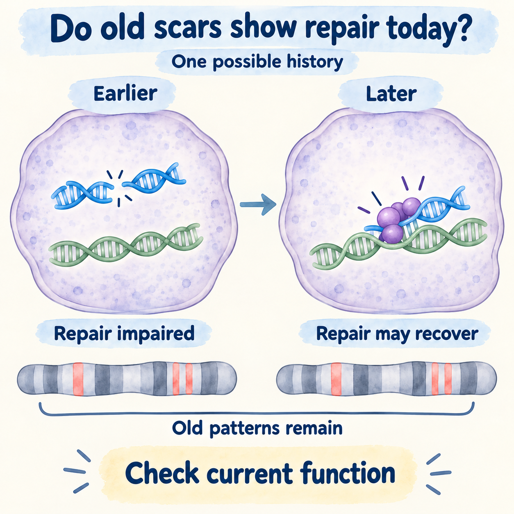

# Homologous recombination and HRD

## In one sentence

Homologous recombination repairs damaged DNA using a matching template; homologous recombination deficiency means this repair process is impaired.

## The intuition

Imagine repairing a torn page by looking at an intact copy. **Homologous recombination (HR)** uses matching genetic information to help reconstruct damaged [deoxyribonucleic acid (DNA)](/wiki/education/concepts/biology-basics/genetics/central-dogma). **Homologous recombination deficiency (HRD)** describes a weakness in that process. The analogy misses the moving parts: cells must recognize damage, prepare the DNA ends, find a template, and finish the repair.

## How it works

After a cell copies its DNA, each chromosome has a closely matching sister copy. HR uses this template to repair certain DNA breaks and damage associated with DNA copying. Its availability therefore depends partly on where the cell is in its cycle of growth and division.

[BRCA1 and BRCA2](/wiki/education/concepts/cancer-biology/genome-instability-and-repair/brca1-and-brca2) are repair proteins, named for the genes that encode them. Together with partners, they help coordinate HR. RAD51, another repair protein, helps find and pair with the matching template. A damaging change in a repair gene can impair the pathway, but finding *any* variant in that gene does not establish HRD. The variant's effect, remaining working copies, and other repair machinery matter.

<em>A prepared DNA end uses a matching sister template with RAD51 support. This simplified route applies when a suitable template is available; it omits many proteins and finishing steps. <a href="https://pmc.ncbi.nlm.nih.gov/articles/PMC2952063/">Jensen 2010</a> <a href="https://pmc.ncbi.nlm.nih.gov/articles/PMC313931/">Johnson and Jasin 2000</a></em>

Read the drawing from top to bottom: a prepared blue 3′ end finds matching information in the sister template; the coral stretch shows newly copied DNA, and the template remains. This is one successful route when a suitable template is available. An interruption in repair could indicate a problem, but the drawing does not diagnose its cause or establish HRD from a gene finding.

[BRCAness](/wiki/education/concepts/breast-cancer/hereditary-risk/brcaness) is a research description of BRCA-like biology without an identified BRCA1/2 mutation. Its definition and evidence need to stay attached; it is not a single interchangeable assay result.

Repair failure can leave [genomic scars](/wiki/education/concepts/cancer-biology/genome-instability-and-repair/genomic-scars), persistent patterns that describe accumulated damage rather than today's repair capacity. Different assays and cutoffs need their own validation for a defined treatment and cancer setting. Telli and colleagues studied one scar-based score in triple-negative breast cancer treated with chemotherapy before surgery; that setting does not establish a universal drug-response cutoff. [Telli 2016](https://pubmed.ncbi.nlm.nih.gov/26957554/).

A tumor can retain old scars while a surviving population restores repair. A **BRCA reversion** is a later genetic change that restores a previously disrupted protein's function, sometimes by restoring its readable coding sequence. Such changes were observed in a selected metastatic breast cancer cohort after resistance to repair-targeting treatment. That study did not estimate their frequency in all breast cancers. [Waks 2020](https://pubmed.ncbi.nlm.nih.gov/32245699/).

<em>Old genome patterns can remain while repair changes. This is one possible history, not an assay result: a gene finding, scar score and current function answer different questions. <a href="https://pmc.ncbi.nlm.nih.gov/articles/PMC5961353/">Cruz 2018</a> <a href="https://pmc.ncbi.nlm.nih.gov/articles/PMC7946408/">Waks 2020</a></em>

Compare the two timepoints: the old pattern marks stay while repair may recover. The marks describe history, so they cannot by themselves tell us how repair works now. A possible repair-gene defect and a current functional result need their own evidence and controls; neither this drawing nor the retained marks determine treatment choice.

<a href="./images/prompts/hrd-039-public-provenance.json">Drawing provenance</a> · <a href="./images/prompts/hrd-039-public-provenance.zip">Original prompts and review records</a>

## Why it matters in cancer

Impaired HR can create a vulnerability to some DNA-damaging or repair-targeting drugs. The related concept of [synthetic lethality](/wiki/education/concepts/therapeutics/how-drugs-work/synthetic-lethality) explains why a second impairment may become especially harmful in a cell that already lacks an important repair function.

Biological plausibility and a drug's approved use are separate questions. For example, the U.S. Food and Drug Administration (FDA) olaparib label specifies a **germline BRCA mutation**, along with other clinical criteria, for its early breast cancer use after primary treatment. A tumor-only BRCA finding or high scar score does not substitute for that germline criterion. Somatic BRCA alterations and broader HRD hypotheses need evidence in their own setting. [FDA label, section 1.4](https://www.accessdata.fda.gov/drugsatfda_docs/label/2025/208558s031lbl.pdf).

## How it is measured

Gene testing asks about a possible cause; scar testing asks about accumulated consequences; functional assays ask about present repair behavior. **RAD51 foci** are small visible assemblies of RAD51 in cells. Their interpretation requires adequate tumor cells, DNA damage, and cells in an appropriate phase of the cell cycle. Few foci without those controls can be uninformative. Some assays use fixed tissue, so “functional” does not always mean a living drug culture. [Cruz 2018](https://pmc.ncbi.nlm.nih.gov/articles/PMC5961353/).

## Common confusions

- **A cause versus a consequence:** a repair-gene alteration and a genomic scar answer different questions.
- **Past versus present:** scars can persist after repair capacity changes.
- **Germline versus somatic:** [where a variant arose](/wiki/education/concepts/biology-basics/genetics/germline-vs-somatic) matters for inheritance and for some treatment indications.
- **Weak signal versus weak repair:** an inadequate functional assay cannot establish HRD.
- **HRD versus guaranteed response:** other resistance mechanisms, exposure, and treatment setting still matter.

## Related concepts

- [Synthetic lethality](/wiki/education/concepts/therapeutics/how-drugs-work/synthetic-lethality) explains the paired vulnerability.
- [Oncogenes and tumor suppressors](/wiki/education/concepts/cancer-biology/what-cancer-is/oncogene-and-tumor-suppressor) explain how gene function can change.
- [Analytical validity, clinical validity, and utility](/wiki/education/concepts/measurement/computational-analysis/analytical-validity-clinical-validity-and-utility) separate measurement from medical benefit.

## Sources

Source check: 2026-10-09. Mechanism and measurement education; expert and learner review pending. No universal score threshold or individual response prediction is implied.

- [Farmer 2005: repair deficiency and PARP inhibition in experimental models](https://www.nature.com/articles/nature03445).
- [Telli 2016: a genomic-scar score in neoadjuvant triple-negative breast cancer studies](https://pubmed.ncbi.nlm.nih.gov/26957554/).
- [Waks 2020: repair restoration in selected resistant metastatic breast cancers](https://pubmed.ncbi.nlm.nih.gov/32245699/).
- [Cruz 2018: RAD51 foci and PARP-inhibitor resistance](https://pmc.ncbi.nlm.nih.gov/articles/PMC5961353/).
- [FDA olaparib prescribing information, 2025 label, sections 1.4 and 14.4](https://www.accessdata.fda.gov/drugsatfda_docs/label/2025/208558s031lbl.pdf).

<!-- BEGIN GENERATED USED IN -->
## Used in

- [Connect repair biology to PARP sensitivity](/wiki/education/guides/from-variant-to-drug/02-connect-repair-biology-to-parp-sensitivity)
- [PARP trapping and recycling](/wiki/education/guides/from-variant-to-drug/04-parp-trapping-and-recycling)
- [Autophagy: traffic, flow, and dependence](/wiki/education/guides/from-variant-to-drug/05-autophagy-flux-and-dependence)
- [PI3K, AKT, and mTOR: competing effects on repair and recycling](/wiki/education/guides/from-variant-to-drug/06-pi3k-akt-mtor-and-repair)
- [Reading a functional experiment](/wiki/education/guides/from-variant-to-drug/07-reading-a-functional-experiment)
- [From a variant to a drug claim](/wiki/education/guides/from-variant-to-drug/index)
- [Ask whether protein is present, placed and active](/wiki/education/molecular-profiling/03-protein-expression-and-activation)
- [Follow a splice change toward repair function](/wiki/education/multi-omics-foundations/05-splicing-and-dna-repair)
<!-- END GENERATED USED IN -->
