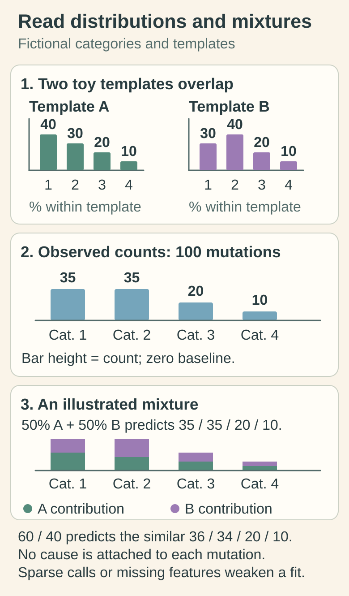
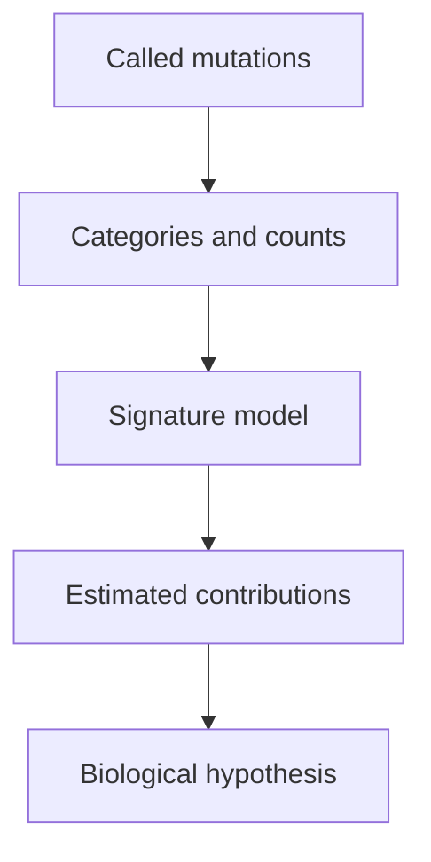

# Mutational signatures

## In one sentence

Mutational signatures are recurring patterns across many DNA changes that can provide evidence about the processes that generated a tumor’s mutations.

## The intuition

Suppose a manuscript contains repeated kinds of typing errors. The overall pattern may suggest a sticking key or a particular editing process. **Mutational signatures** do something similar for [deoxyribonucleic acid (DNA)](/wiki/education/concepts/biology-basics/genetics/central-dogma): they summarize patterns across many changes. The analogy cannot identify a culprit with certainty, because several processes can leave similar errors and act at different times.

## How it works

Sequencing and [variant calling](/wiki/education/concepts/measurement/sequencing-basics/variant-calling) first identify DNA changes. Researchers group those changes into categories and analyze their distribution. A **single-base substitution (SBS)** changes one base; **doublet-base substitutions (DBS)** change two adjacent bases; **insertions and deletions**, or **indels**, add or remove sequence. The mutation and its surrounding sequence can help define a category.

A signature describes a distribution across categories. A tumor may contain a mixture of signatures, so an algorithm estimates the contribution of each. That assignment is a model-based inference, not a label directly attached to every mutation by the sequencing machine. Large primary cancer-genome studies established catalogs of recurring patterns and investigated their causes. Some have strong biological explanations; others remain uncertain. [Alexandrov 2013](https://pubmed.ncbi.nlm.nih.gov/23945592/), [Alexandrov 2020](https://pubmed.ncbi.nlm.nih.gov/32025018/).

Some patterns are associated with defective DNA repair. **SBS3**, a particular substitution signature, has been associated with impaired [homologous recombination (HR)](/wiki/education/concepts/cancer-biology/genome-instability-and-repair/homologous-recombination-and-hrd). Association is not a unique diagnosis of a BRCA1 or BRCA2 mutation: a repair process can be disrupted in several ways.

**HRDetect** is an example of a research classifier combining several genomic features, including substitution, indel and rearrangement patterns, to estimate BRCA-related repair deficiency. It is not simply “SBS3 positive.” Its original training and evaluation used particular tumor datasets and sequencing methods. [Davies 2017](https://pubmed.ncbi.nlm.nih.gov/28288110/).

*A signature describes a distribution across categories. The toy templates overlap, and the displayed mixtures are arithmetic illustrations, not an executed model fit, SBS3 or HRDetect. A similar reconstruction cannot identify the cause of every mutation; sparse calls and missing features remain important.*

[Open the light diagram](./images/mutational-signature-mixtures-v1-light.svg) · [Open the dark diagram](./images/mutational-signature-mixtures-v1-dark.svg)

The arrows move from observations to interpretation. They do not move directly from a signature to a drug choice.

## Why it matters in cancer

Signatures help researchers investigate exposures, repair defects and tumor evolution. They may reveal a pattern when no single causative gene alteration has been established. That is a reason to investigate further, rather than fill the gap with an assumed mechanism.

A signature summarizes accumulated mutations. It does not directly observe present repair activity. Likewise, a classifier score for a repair state is not the probability that a patient will respond to a drug. That requires separate validation with the relevant endpoint, treatment and population.

## Assay card

| Field | What to ask |
|---|---|
| Input and tissue cost | Tumor DNA, often paired with normal DNA; extraction consumes tissue. Accepted specimen quality and amount depend on the method. |
| How | Call mutations; classify them; fit or extract patterns; assess uncertainty and model fit. |
| Output and units | Mutation counts assigned to signatures, proportions or estimated contributions; a classifier may instead output a model score. Check its definition. |
| Thresholds | No universal “signature present” or drug-response cutoff. Record catalog, software version, feature set and validation population. |
| Failure modes | Too few mutations, artifacts, missed variants, similar signatures competing for assignment and a poor model fit. |
| Limits and validation | Research inference may not transfer between panels, exomes and whole genomes. A different method needs its own analytical and clinical validation. |

In the original HRDetect study, applying whole-genome-derived features to whole-exome data reduced detection performance; retraining changed the result. Missing genomic features are therefore more than an incidental format difference. [Davies 2017](https://pubmed.ncbi.nlm.nih.gov/28288110/).

## Common confusions

- **Signature versus a target mutation:** a pattern across changes is not one protein altered by one variant.
- **Amount versus certainty:** a small estimated contribution can be unstable when competing explanations fit similarly.
- **SBS3 versus HRDetect:** one feature and a multifeature classifier are not the same test.
- **Classifier probability versus response probability:** the modeled outcome must be named.

## Try it

Compare the observed catalogue with the two toy mixture predictions. Which prediction reproduces its counts exactly, and does that identify every mutation’s cause? **Answer:** The illustrated 50/50 mixture reproduces 35, 35, 20 and 10; the 60/40 mixture gives the similar 36, 34, 20 and 10. That comparison does not attach a cause to each call or supply a drug-response probability.

A fictional small panel detects a few mutations. An exploratory fit assigns some to SBS3. Someone copies a whole-genome HRDetect interpretation into the report. What went wrong?

**Answer:** the data and model are mismatched. Sparse mutations and unavailable rearrangement features can make the estimate unreliable. The correct next step is to check method-specific performance and uncertainty, not infer drug sensitivity.

## Explain it back

Why can two tumors share a signature without sharing the same causative mutation?

**One possible answer:** different disruptions can affect the same process, and some patterns also have competing explanations.

## Takeaway

**A mutational pattern supports a scoped hypothesis; its meaning depends on the data, model and validation.**

## Related concepts

- [Genomic scars](/wiki/education/concepts/cancer-biology/genome-instability-and-repair/genomic-scars) focus on chromosome imbalance and rearrangement measures.
- [Analytical validity, clinical validity and utility](/wiki/education/concepts/measurement/computational-analysis/analytical-validity-clinical-validity-and-utility) separate a reliable computation from useful clinical evidence.

## Sources

Source check: 2026-10-09. Signature mechanisms and research interpretation; expert and learner review pending. No research classifier is presented as validated individual treatment sensitivity.

- [Alexandrov and colleagues 2013: recurring patterns in primary cancer-genome analyses](https://pubmed.ncbi.nlm.nih.gov/23945592/).
- [Alexandrov and colleagues 2020: expanded signature repertoire and methodological uncertainty](https://pubmed.ncbi.nlm.nih.gov/32025018/); [2023 correction concerns consortium attribution and affiliations](https://doi.org/10.1038/s41586-022-05600-5).
- [Davies and colleagues 2017: HRDetect model, genomic features and platform-specific performance](https://pubmed.ncbi.nlm.nih.gov/28288110/).

<!-- BEGIN GENERATED USED IN -->
## Used in

- [Connect repair biology to PARP sensitivity](/wiki/education/guides/from-variant-to-drug/02-connect-repair-biology-to-parp-sensitivity)
- [Follow a splice change toward repair function](/wiki/education/multi-omics-foundations/05-splicing-and-dna-repair)
<!-- END GENERATED USED IN -->
