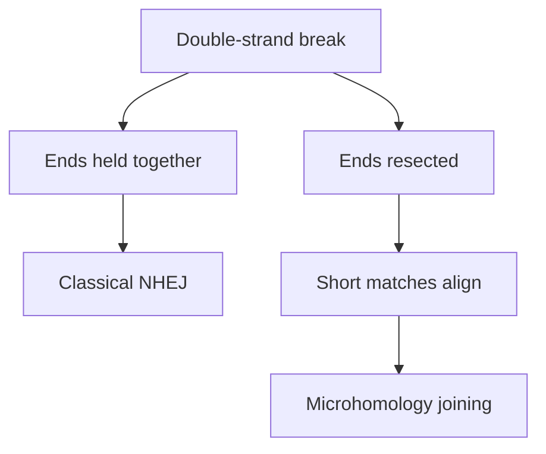

# NHEJ and microhomology-mediated end joining

## In one sentence

Classical nonhomologous end joining reconnects broken DNA ends without requiring a long matching template, whereas microhomology-mediated end joining aligns short matching sequences exposed near the break.

## The intuition

Think of reconnecting two broken cords. One method holds the ends together and makes a joint. Another trims back the ends until short matching marks can be aligned. **Classical nonhomologous end joining (c-NHEJ)** and **microhomology-mediated end joining (MMEJ)** are roughly those two strategies for repairing a double-strand break in deoxyribonucleic acid (DNA).

The limit of the analogy matters: DNA ends have chemical structures, and the proteins available, cell-cycle state and amount of end processing influence the route. Cells do not choose from a fixed menu with equal access to every option.

## How it works

In c-NHEJ, **Ku**, a protein complex, binds DNA ends. Other factors help hold, process and seal them. **DNA ligase IV**, working with the XRCC4 support protein, seals breaks in the DNA backbone. Experiments with purified factors and cells showed how this machinery can accommodate different end structures. Some compatible ends can be rejoined directly; difficult ends may need processing that changes the sequence. “No long template required” therefore does not mean “always inaccurate.” [Conlin 2017](https://pmc.ncbi.nlm.nih.gov/articles/PMC5649367/).

MMEJ begins with **resection**, trimming DNA to expose single-stranded stretches. Short matching sequences, called **microhomologies**, can then align. Processing and synthesis complete the joint, often losing intervening sequence. Engineered chromosome-break reporters show that alternative joining has dependencies distinct from HR and from other resection-based routes. [Bennardo 2008](https://pubmed.ncbi.nlm.nih.gov/18584027/).

**DNA polymerase theta (Polθ)**, encoded by **POLQ**, can support this kind of joining by aligning and extending exposed ends. Work with purified human Polθ and human cells established such activity. **Theta-mediated end joining (TMEJ)** names joining mediated by that protein. MMEJ describes use of microhomology; the two labels overlap but are not interchangeable proof of a specific enzyme. [Kent 2015](https://pubmed.ncbi.nlm.nih.gov/25643323/).

This map omits HR and additional routes. It shows the contrast in handling ends, rather than a guaranteed sequence for every break.

## Why it matters in cancer

Joining can keep a cell alive while leaving deletions or rearrangements. If the wrong chromosome ends are paired, the outcome can be a **translocation**, a connection between chromosome pieces that were previously separate.

Altered availability of one repair route can shift use of others. That is a mechanism to investigate, not proof that a tumor depends on Polθ or will benefit from inhibiting it. [Synthetic lethality](/wiki/education/concepts/therapeutics/how-drugs-work/synthetic-lethality) requires evidence about the paired impairments and cell survival.

## How it is measured

Researchers can induce a defined break, sequence the repaired junction and measure successful joining in a reporter. Output may be a fraction of repaired cells or a distribution of junction sequences. These studies require viable model cells or purified components and consume experimental material.

To identify a mechanism, perturb a repair factor and include controls and, where feasible, a rescue that restores its function. A short matching sequence at one tumor junction alone cannot identify every protein that made it. Reporter performance also depends on its designed break and cell model; no universal patient-response threshold follows.

## Common confusions

- **NHEJ versus MMEJ:** “end joining” is a family description, not one mechanism.
- **Alternative joining versus TMEJ:** broader historical labels do not all mean POLQ-mediated repair.
- **Microhomology versus a long template:** a few matching bases are not the sister-copy template used in HR.
- **A junction pattern versus dependence:** an endpoint sequence is evidence about an outcome, not a drug-response experiment.

## Try it

In a fictional culture, a repaired junction contains a short matching sequence and a deletion. Does this establish Polθ dependence?

**Answer:** no. It is compatible with microhomology-associated joining. Factor-specific perturbations, repair measurements and survival controls are needed to test the proposed dependence.

## Explain it back

Why can c-NHEJ sometimes preserve the original sequence?

**One possible answer:** compatible ends can be sealed without trimming away bases; other end structures require additional processing.

## Takeaway

**The repaired junction suggests a route; controlled experiments test the responsible machinery and dependence.**

## Related concepts

- [Homologous recombination and homologous recombination deficiency (HRD)](/wiki/education/concepts/cancer-biology/genome-instability-and-repair/homologous-recombination-and-hrd) explain the template-based alternative.
- [Mutational signatures](/wiki/education/concepts/cancer-biology/genome-instability-and-repair/mutational-signatures) summarize patterns across many mutations.

## Sources

Source check: 2026-10-09. Repair mechanism education; expert and learner review pending. Experimental end joining is not a validated treatment-selection test.

- [Conlin and colleagues 2017: ligase IV and end processing, purified factors, single-molecule analysis and cells](https://pmc.ncbi.nlm.nih.gov/articles/PMC5649367/).
- [Bennardo and colleagues 2008: distinct pathways in engineered mammalian break reporters](https://pubmed.ncbi.nlm.nih.gov/18584027/).
- [Kent and colleagues 2015: human Polθ-supported microhomology joining in biochemical and cellular models](https://pubmed.ncbi.nlm.nih.gov/25643323/).

<!-- BEGIN GENERATED USED IN -->
## Used in

- [Connect repair biology to PARP sensitivity](/wiki/education/guides/from-variant-to-drug/02-connect-repair-biology-to-parp-sensitivity)
<!-- END GENERATED USED IN -->
