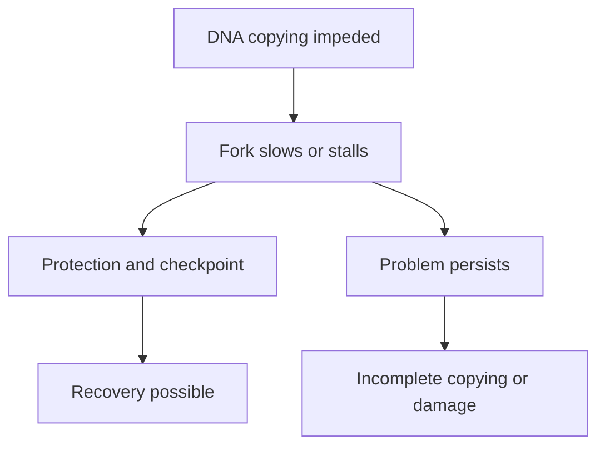

# Replication stress

## In one sentence

Replication stress is difficulty completing DNA copying normally, including slowed or stalled replication forks and the cellular responses to those problems.

## The intuition

Imagine a copier moving along a long document. It can pause because the page is damaged, the feed jams or supplies run short. **Replication stress** is trouble during the copying of [deoxyribonucleic acid (DNA)](/wiki/education/concepts/biology-basics/genetics/central-dogma). The analogy misses the biology: DNA copying has many simultaneous starting points, repair proteins can stabilize paused machinery, and an unsuccessful restart can damage the chromosome.

## How it works

A **replication fork** is the moving junction where the DNA double helix opens and new strands are made. DNA building blocks are called **nucleotides**. If the supply cannot meet demand, or copying meets an obstacle, fork progression can slow or stop.

A slowdown does not necessarily mean that DNA has already broken. Protection, checkpoints and restart mechanisms can allow recovery. Exposed single-stranded DNA is coated by **replication protein A (RPA)**. RPA-associated DNA helps recruit a checkpoint complex containing **ATR**, a kinase that transfers phosphate groups, and its partner **ATR-interacting protein (ATRIP)**. Primary biochemical and cellular experiments established this recruitment and signaling role. [Zou and Elledge 2003](https://pubmed.ncbi.nlm.nih.gov/12791985/).

If the problem is not resolved, copying can remain incomplete or damaged forks can become breaks. The protective response and the harmful outcome are different stages; observing one does not prove the other occurred.

## Why it matters in cancer

An [oncogene](/wiki/education/concepts/cancer-biology/what-cancer-is/oncogene-and-tumor-suppressor) can push cells into DNA copying in a poorly coordinated way. In experiments expressing activated H-Ras in normal human cells, an early phase of excessive replication preceded a damage response and **senescence**, a durable stop in cell division. This was a model of oncogene-induced stress, not a universal outcome of every oncogene. [Di Micco 2006](https://pubmed.ncbi.nlm.nih.gov/17136094/).

In another study, newly transformed human-cell models had insufficient nucleotide supplies and disturbed replication dynamics. Nucleosides supplied in culture improved those dynamics in that experimental setting. The finding explains a mechanism; it does not recommend a supplement or establish how a patient's tumor would respond. [Bester 2011](https://pmc.ncbi.nlm.nih.gov/articles/PMC3740329/).

Surviving cancers can adapt to stress. High expression of a checkpoint or copying gene therefore does not establish stress intensity, dependency on that protein or sensitivity to an inhibitor.

## Assay card

*From a fork to a copying rate.* The fork points into the parental duplex; new DNA trails behind. Synthesis machinery is simplified. Iododeoxyuridine (IdU) and chlorodeoxyuridine (CldU) are DNA building-block analogues used as successive experimental labels, each supplied for 30 minutes. The **fictional** tracks show equal first pulses and different second pulses: 15 or 7.5 micrometres (μm). With the stated example stretching calibration of 1 μm = 2 kilobases (kb), divide the second-pulse distance by 30 minutes to obtain 1 or 0.5 kb/min. Bester's protocol supplies these pulse times and calibration; these lengths are not its results and the calibration is not universal. These selected ongoing tracks do not measure the fraction of cells in S phase, breaks, recovery or survival. [Bester 2011, full methods](https://pmc.ncbi.nlm.nih.gov/articles/PMC3740329/).

| Field | A research DNA-fiber or combing experiment |
|---|---|
| Measures | Progression of individual DNA-copying tracks, with protocol-dependent measures of stalling, restart or origin use. |
| How | Pulse-label newly made DNA; spread or stretch extracted molecules; detect labeled tracks; compare suitable conditions. |
| Input and tissue cost | Viable cells that can incorporate labels. Extraction destroys the sampled cells; ordinary fixed pathology alone cannot produce this live-labeling measurement. |
| Output and units | Track length or calibrated fork speed, for example kilobases per minute, and protocol-defined event fractions. |
| Thresholds | Experimental comparisons and controls; no universal patient “replication stress positive” cutoff. |
| Failure modes | Labeling differences, stretching calibration, track-selection bias, cell-cycle shifts and model changes during culture. |
| Limits and validation | A shorter track does not identify the cause or prove cell death. These are mechanistic research methods, not automatically validated drug-selection assays. |

Bester's experiments used sequential DNA labels and molecular combing to study replication dynamics. Damage-response staining addresses a related but different quantity. **Gamma-H2AX (γH2AX)** marks phosphorylation of a DNA-packaging protein following damage; it is not a direct fork-speed measurement. [Bester 2011](https://pmc.ncbi.nlm.nih.gov/articles/PMC3740329/), [Rogakou 1998](https://pubmed.ncbi.nlm.nih.gov/9488723/).

## Common confusions

- **Replication stress versus rapid proliferation:** copying often is not the same as copying badly.
- **A stalled fork versus a broken chromosome:** a stall can be stabilized or restarted.
- **Checkpoint activation versus dependence:** responding to stress and requiring a particular protein for survival are separate claims.
- **[Ribonucleic acid (RNA)](/wiki/education/concepts/biology-basics/genetics/central-dogma) abundance versus fork behavior:** expression does not directly measure copying dynamics.

## Try it

In the fictional figure, both labels lasted 30 minutes and DNA stretching was calibrated to 2 kb/μm. Track B has a 7.5 μm second pulse. The culture also has fewer cells in S phase, the phase in which DNA is copied. What is the track's second-pulse copying rate, and does it establish checkpoint dependence?

**Answer:** 7.5 μm × 2 kb/μm ÷ 30 min = **0.5 kb/min** for this selected track. The lower S-phase fraction concerns the population, not this molecule's rate. Check labeling, stretching and track selection. A shorter track does not prove a break, failed recovery or cell death. Checkpoint dependence requires a targeted perturbation and a separate survival outcome.

## Explain it back

What can happen between a fork stall and cell death?

**One possible answer:** protection and checkpoint responses may allow recovery; alternatively, unresolved problems may lead to incomplete copying or DNA damage. Death needs its own measurement.

## Takeaway

**Measure the copying problem, its response and its outcome separately before claiming a replication-stress vulnerability.**

## Related concepts

- [BRCA1 and BRCA2](/wiki/education/concepts/cancer-biology/genome-instability-and-repair/brca1-and-brca2) participate in genome maintenance.
- [Perturbation and controls](/wiki/education/concepts/evidence-and-statistics/study-design/perturbation-and-controls) help test whether a proposed mechanism causes an outcome.

## Sources

Source check: 2026-10-09. Mechanism and research-method education; expert and learner review pending. The laboratory examples do not imply clinical recommendations.

- [Zou and Elledge 2003: RPA-associated DNA and ATR checkpoint recruitment](https://pubmed.ncbi.nlm.nih.gov/12791985/).
- [Di Micco and colleagues 2006: activated H-Ras, hyper-replication and senescence in experimental models](https://pubmed.ncbi.nlm.nih.gov/17136094/).
- [Bester and colleagues 2011: nucleotide supply and replication dynamics in newly transformed human-cell models](https://pmc.ncbi.nlm.nih.gov/articles/PMC3740329/).
- [Rogakou and colleagues 1998: γH2AX is a cellular response after induced DNA breaks](https://pubmed.ncbi.nlm.nih.gov/9488723/).

<!-- BEGIN GENERATED USED IN -->
## Used in

- [PARP trapping and recycling](/wiki/education/guides/from-variant-to-drug/04-parp-trapping-and-recycling)
<!-- END GENERATED USED IN -->
