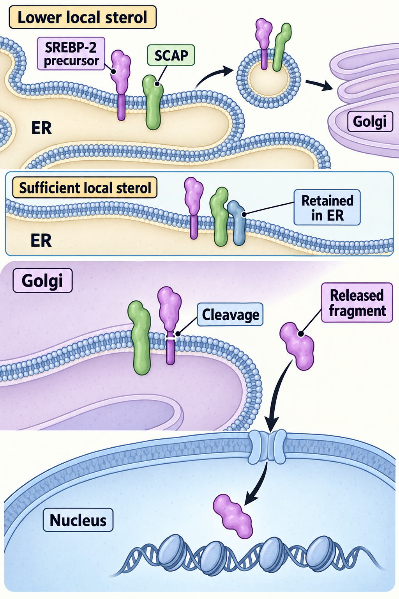

# Cholesterol homeostasis through SCAP–SREBP

## In one sentence

SCAP–SREBP regulation helps cells adjust lipid production and uptake in response to their internal sterol supply.

## The intuition

A workshop checks its supplies before ordering more. A cell also monitors lipid supply, but the location of the stock matters. Cholesterol in the endoplasmic reticulum helps regulate a specific sensing system. Total cholesterol across the whole cell is not a perfect reading of that local signal.

## How it works

**Cholesterol** is a sterol, a type of lipid that contributes to membranes and other cellular functions. Cells can synthesize it and take it up from outside. **Homeostasis** means adjusting processes to keep conditions within a workable range.

**Sterol regulatory element-binding proteins (SREBPs)** are regulators initially made as membrane-bound precursors. **SCAP**, SREBP cleavage-activating protein, helps sense sterol conditions and transport SREBPs. When appropriate conditions permit transport, the complex travels from the **endoplasmic reticulum (ER)** to the **Golgi**, compartments involved in protein processing and trafficking.

Proteolytic processing in the Golgi releases an SREBP fragment that can enter the nucleus and regulate genes. Sterol availability and proteins called Insigs help restrain this transport when supplies are sufficient. Experiments connected small changes in ER cholesterol with regulated SREBP-2 transport. [Radhakrishnan 2008](https://pmc.ncbi.nlm.nih.gov/articles/PMC2652870/).

The family has several members and overlapping roles. SREBP-2 is especially associated with cholesterol regulation; SREBP-1 has major roles in fatty-acid production. A claim should identify the member and readout being tested.

Follow SREBP-2 from membrane precursor to released nuclear fragment. Local endoplasmic reticulum (ER) sterol conditions help control SCAP-mediated transport; sufficient supply can retain the complex in the ER. Golgi processing releases the fragment, rather than sending the whole precursor into the nucleus. Shapes and counts are schematic. Total cholesterol or SREBP RNA alone does not establish this processing.

## Why it matters in cancer

Growing cells need membrane material. Some cancer models change lipid production, uptake, or storage. Dependence on one route depends partly on what the environment supplies and whether another route compensates.

A cholesterol-synthesis inhibitor changes one biochemical step. It does not reproduce every way the SCAP–SREBP control system can change. A statin inhibits HMG-CoA reductase in the mevalonate pathway, which also supplies products beyond cholesterol. A rescue by mevalonate therefore does not uniquely identify cholesterol as the missing product.

## A worked example

A fictional culture has increased nuclear SREBP-2 and increased uptake-related transcripts in lipid-poor medium. Adding an external lipid source reduces that response. This supports a supply-sensitive regulatory state under those conditions.

The culture still grows after a synthesis perturbation in lipid-rich medium. That suggests compensation can matter. It does not prove the pathway is irrelevant under all conditions or establish how a tumor in a person would respond.

## Common confusions

- **Local sterol sensing versus total cholesterol:** compartment location changes the signal.
- **RNA versus processed regulator:** messages do not establish nuclear SREBP activation.
- **Production versus uptake:** either can contribute to lipid supply.
- **Pathway rescue versus unique mechanism:** a supplied metabolite can restore more than one downstream function.

## How it is measured

Research readouts include precursor and nuclear SREBP, responsive transcripts, cellular sterols, uptake, and synthesis rates. Labeling experiments can follow new production rather than total amount. Culture lipids, cell density, and timing affect interpretation. Controlled supplementation helps test the proposed supply bottleneck, but viability and specificity remain separate questions.

## Explain it back

“SCAP senses ___ and moves SREBP to ___, where it is cut to release ___; a statin blocks ___.”

**One possible answer:** sterol levels in the endoplasmic reticulum; the Golgi; a fragment that switches on lipid-production and uptake genes; HMG-CoA reductase, an early step in making cholesterol and other mevalonate products.

## Takeaway

**Cells match cholesterol production and uptake to their sterol supply through SCAP–SREBP, so a lipid result means little until you know what the environment supplies and which route the cell is using.**

## Related concepts

[PI3K–AKT–mTOR](/wiki/education/concepts/cancer-biology/signaling-pathways/pi3k-akt-mtor) coordinates growth and resources through different machinery. [Oxidative phosphorylation](/wiki/education/concepts/cancer-biology/metabolism-and-stress/oxidative-phosphorylation) supplies an energy foundation. [The lipid lesson](/wiki/education/guides/from-variant-to-drug/08-test-a-supply-dependence-with-rescue) compares resource regulation and drug hypotheses.

## Sources

Source check: 2026-11-07. General mechanism education; the worked example is fictional. Expert and learner review pending.

- [Radhakrishnan 2008: ER cholesterol and SREBP-2 transport](https://pmc.ncbi.nlm.nih.gov/articles/PMC2652870/).
- [Lange 2008: rapid ER cholesterol and HMG-CoA reductase responses](https://pubmed.ncbi.nlm.nih.gov/18024962/).

<!-- BEGIN GENERATED USED IN -->
## Used in

- [Test a supply dependence with a rescue experiment](/wiki/education/guides/from-variant-to-drug/08-test-a-supply-dependence-with-rescue)
- [From a variant to a drug claim](/wiki/education/guides/from-variant-to-drug/index)
<!-- END GENERATED USED IN -->
