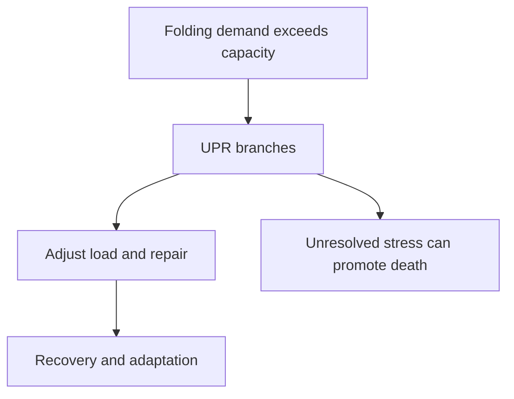

# Endoplasmic reticulum stress and the unfolded protein response

## In one sentence

Endoplasmic reticulum stress occurs when protein-folding demands exceed local capacity, and the unfolded protein response is the signaling program that helps manage that imbalance.

## The intuition

Imagine a workshop's finishing room accumulating more unfinished products than its staff can handle. It can slow incoming work, add helpers and clear faulty products. If recovery fails, the wider workshop may fail too. The analogy has limits: cells sense molecular conditions, and different branches of the response can behave differently.

## How it works

The **endoplasmic reticulum (ER)** is a membrane network where many secreted and cell-surface proteins fold and assemble. Protein helpers called **chaperones** assist this work. An imbalance between demand and capacity is ER stress. It does not mean every protein in the cell is unfolded.

The **unfolded protein response (UPR)** coordinates adjustment through several sensors. Its three familiar branches are useful landmarks, not interchangeable tests:

- **IRE1**, inositol-requiring enzyme 1, processes the RNA message for **XBP1**, X-box binding protein 1. Unconventional splicing produces a form that encodes an active transcriptional regulator.
- **PERK**, protein kinase R-like ER kinase, phosphorylates **eIF2α**, eukaryotic translation initiation factor 2 alpha. This can reduce the load of new protein production while allowing particular stress responses.
- **ATF6**, activating transcription factor 6, is processed to release a fragment that acts in the nucleus and changes gene expression.

These branches can increase folding capacity, alter incoming work and help handle damaged proteins. Sustained unresolved stress can also contribute to programmed cell death. The intensity, duration and cellular setting determine which consequences dominate.

*Detecting a stress response does not establish that cells will die.*

## Why it matters in cancer

Cancer cells can encounter limited nutrients, low oxygen and heavy protein-production demands. UPR signaling may help them adapt. Specific triple-negative breast cancer models showed growth effects after XBP1 depletion and an interaction with hypoxia-related transcription. Those experiments do not show that every tumor with an XBP1 message depends on that pathway, or establish a treatment benefit.

Total XBP1 RNA is also different from the spliced form and active protein. A pathway score combines selected messages; it cannot replace direct branch measurements. [Bulk RNA sequencing](/wiki/education/concepts/measurement/transcriptomics/bulk-rna-seq) adds cell-mixture and technical limits.

## How it is measured

| Field | What to document |
|---|---|
| Input and tissue cost | Appropriately preserved RNA/protein or fixed tissue; viable cells for functional testing, with material consumed |
| Outputs | XBP1 splice-form fraction, processed ATF6, specified phosphoprotein signals and downstream messages |
| Controls | RNA quality, isoform-specific methods, total protein, collection timing and independent perturbation |
| Thresholds and validation | No universal UPR-positive cutoff proves dependence; assays and models require their own validation |
| Limits | One branch does not establish the entire response; eIF2α can be phosphorylated by other stress kinases |

For a death claim, measure death and its timing directly. A rescue or independent perturbation can help attribute the result to the proposed branch. Slower growth or altered ATP is not automatically death.

## Common confusions

- **ER stress versus the UPR:** the first is an imbalance; the second is a response.
- **Total XBP1 versus spliced XBP1:** these answer different questions.
- **Stress versus failure:** successful adaptation can improve survival.
- **Branch activity versus dependence:** a response can be present without being irreplaceable.

## Try it

A fictional culture increases its XBP1 splice-form fraction after a stressor. Viable-cell counts remain stable. Has lethal ER stress been demonstrated?

**Answer:** No. A branch response is supported if the assay controls hold. Cells may be adapting. Follow folding-related outputs, growth and death over time, then use independent controls to test the causal role.

## Explain it back

“The UPR tells me cells are responding to ___; I still need ___ to claim death.”

One answer: “a folding-capacity imbalance; direct death measurements and causal attribution.”

## Takeaway

**Treat the unfolded protein response as a set of adaptation signals, then measure whether adaptation succeeds or fails.**

## Related concepts

- [Hypoxia](/wiki/education/concepts/cancer-biology/tumor-microenvironment/hypoxia), one possible source of tissue stress.
- [Ubiquitin and the proteasome](/wiki/education/concepts/cancer-biology/cell-death-and-survival/ubiquitin-and-proteasome), for regulated protein disposal.

## Sources

Source check: October 9, 2026; expert and learner review pending. The exercise is fictional. Model findings do not establish a clinical selection rule.

- [Walter and Ron, 2011: the unfolded protein response and homeostasis](https://pubmed.ncbi.nlm.nih.gov/22116877/).
- [Yoshida et al., 2001: IRE1-dependent XBP1 splicing](https://pubmed.ncbi.nlm.nih.gov/11779464/).
- [Harding et al., 1999: PERK links folding stress to translation control](https://pubmed.ncbi.nlm.nih.gov/9930704/).
- [Haze et al., 1999: ATF6 processing and nuclear activity](https://pubmed.ncbi.nlm.nih.gov/10564271/).
- [Chen et al., 2014: XBP1 and hypoxia-related signaling in TNBC models](https://pubmed.ncbi.nlm.nih.gov/24670641/).

<!-- BEGIN GENERATED USED IN -->
## Used in

- [Oxidative metabolism and stress: energy, damage, and dependence](/wiki/education/molecular-profiling/evee-pathways/05-oxidative-metabolism-and-stress)
<!-- END GENERATED USED IN -->
