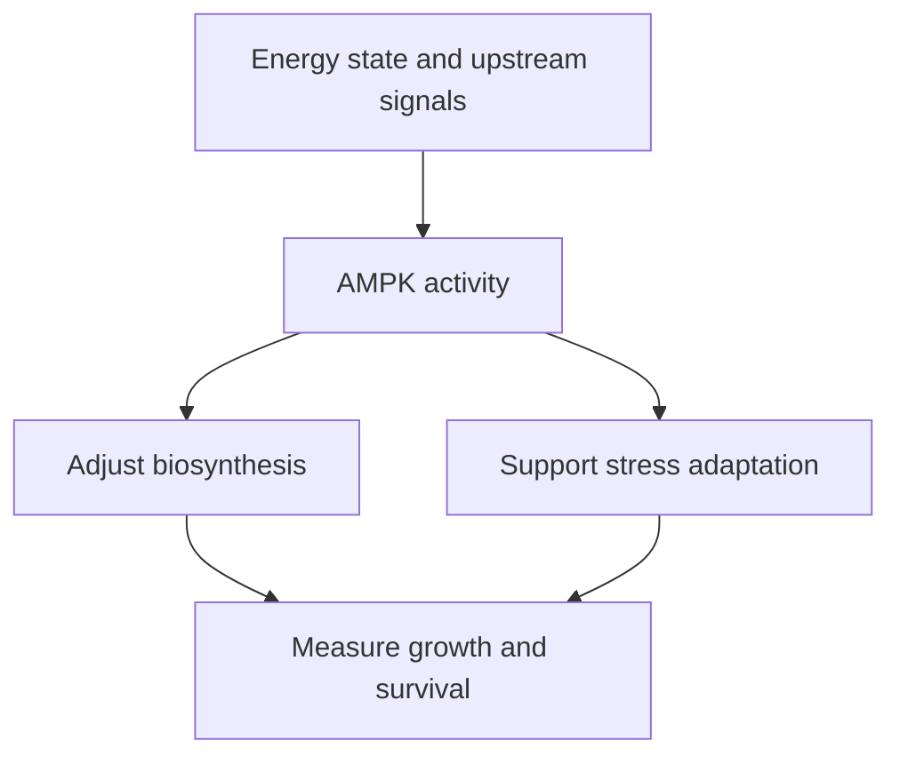

# AMPK: matching cellular work to energy supply

## In one sentence

AMP-activated protein kinase (AMPK) is an enzyme complex that helps cells adjust energy use and production when their energy state changes.

## The intuition

Think of a workshop's energy monitor. When supply becomes strained, it can delay expensive projects and support ways to keep essential work going. Slower production does not mean the workshop has been destroyed. The analogy ends there: AMPK responds to molecules and upstream signals, not a single electricity meter.

## How it works

Cells transfer energy using adenosine triphosphate (**ATP**). Adenosine diphosphate (**ADP**) and adenosine monophosphate (**AMP**) help report the balance of energy supply and use. The name AMP-activated protein kinase reflects one part of this sensing system; it does not mean AMP is the only relevant input.

AMPK contains a catalytic component and regulatory components. AMP or ADP binding can protect its activating phosphate modification from removal. AMP can also directly increase enzyme activity; ADP does not provide the same direct activation. Those effects help connect energy state with signaling.

An upstream kinase, **liver kinase B1 (LKB1)**, can place the activating phosphate on AMPK. A calcium-sensitive route involving **calcium/calmodulin-dependent protein kinase kinase 2 (CaMKK2)** can also activate it in suitable contexts. Thus an AMPK phosphorylation signal does not uniquely identify glucose deprivation or one upstream cause.

AMPK modifies proteins that control energy-consuming and energy-producing processes. For example, it can restrain [mechanistic target of rapamycin complex 1 (mTORC1)](/wiki/education/concepts/cancer-biology/signaling-pathways/pi3k-akt-mtor), including through phosphorylation of its partner raptor. This connects available energy to growth-related work.

*Reduced growth-related work and improved survival can occur together.*

## Why it matters in cancer

The effect depends on the setting. Restraining growth-related signaling can oppose expansion. Yet energy-stressed cancer cells can also use AMPK to survive. In specific model experiments, AMPK preserved reducing power by changing fatty-acid metabolism and limited cell death during energy stress. That result rules out the shortcut “AMPK activation always kills cancer.”

[Autophagy](/wiki/education/concepts/cancer-biology/cell-death-and-survival/autophagy) and other adaptation routes add context. Distinguish a biochemical response, slower growth and death. A drug with several cellular effects is not a selective AMPK test merely because this marker changes.

## How it is measured

| Field | What to document |
|---|---|
| Input and tissue cost | Preserved tissue for staining or protein assays; viable cells for perturbation, with material consumed |
| Outputs | AMP/ADP/ATP measurements, activating AMPK phosphorylation and defined downstream phosphosites; specify concentrations, ratios or normalized signals |
| Controls | Preservation, total protein, site-specific antibody validation, timing and matched genetic perturbation |
| Thresholds and validation | No universal AMPK-high cutoff establishes a tumor vulnerability; research readouts require assay-specific validation |
| Limits | One phosphosite does not measure all enzyme activity, identify the upstream trigger or predict patient benefit |

Measure energy state and function independently. Phosphorylation changes rapidly with collection and handling. A mixed tissue sample may combine responses from malignant, immune and stromal cells.

## Common confusions

- **Energy sensing versus every nutrient signal:** amino-acid and growth-factor sensing also involve other circuits.
- **Activation versus loss of function:** the direction of a gene alteration needs evidence.
- **Less growth versus more death:** these are different outcomes.
- **AMPK response versus drug attribution:** multiple targets can produce the same downstream observation.

## Try it

A fictional culture shows increased AMPK and raptor phosphorylation during energy stress. Growth slows, but more cells survive than in a matched AMPK-deficient culture. Are the observations contradictory?

**Answer:** No. AMPK may reduce costly growth-related work while supporting survival. Confirm the perturbation and energy conditions. The result describes this model, not a universal benefit from activating or inhibiting AMPK.

## Explain it back

“AMPK helps match ___ to ___; its effect on survival depends on ___.”

One answer: “cellular work; energy state; the cell, stress and functional consequences.”

## Takeaway

**AMPK is an adaptation circuit whose growth and survival effects must be measured in context.**

## Related concepts

- [Warburg effect](/wiki/education/concepts/cancer-biology/metabolism-and-stress/warburg-effect), a metabolic pattern rather than an energy-sensor readout.
- [Reactive oxygen species](/wiki/education/concepts/cancer-biology/metabolism-and-stress/reactive-oxygen-species), for chemical stress and measurement limits.

## Sources

Source check: October 9, 2026; expert and learner review pending. The exercise is fictional; the survival findings are scoped to the experimental systems.

- [Xiao et al., 2011: AMP and ADP regulation of AMPK](https://pubmed.ncbi.nlm.nih.gov/21399626/).
- [Hawley et al., 2005: a calcium-sensitive upstream AMPK kinase](https://pubmed.ncbi.nlm.nih.gov/16054095/).
- [Gwinn et al., 2008: AMPK phosphorylation of raptor and mTORC1 restraint](https://pubmed.ncbi.nlm.nih.gov/18439900/).
- [Jeon et al., 2012: AMPK supports cancer-cell survival during energy stress](https://pubmed.ncbi.nlm.nih.gov/22660331/).

<!-- BEGIN GENERATED USED IN -->
## Used in

- [Lipid supply and mTOR: measuring resource control](/wiki/education/molecular-profiling/evee-pathways/02-lipid-and-mtor)
- [Oxidative metabolism and stress: energy, damage, and dependence](/wiki/education/molecular-profiling/evee-pathways/05-oxidative-metabolism-and-stress)
<!-- END GENERATED USED IN -->
