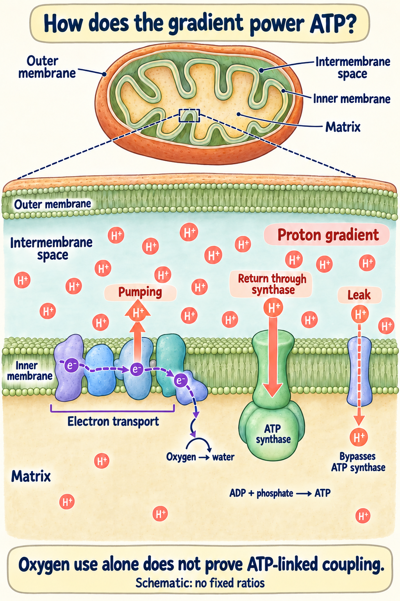
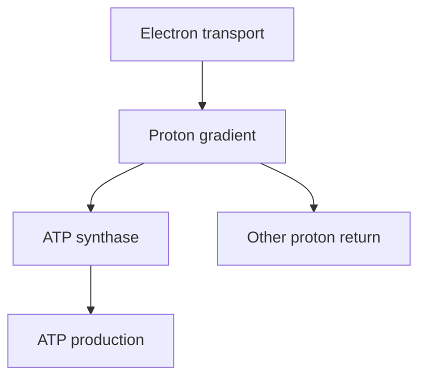

# Oxidative phosphorylation: using a proton gradient to make ATP

## In one sentence

Oxidative phosphorylation links electron transport to a proton gradient that powers ATP production in mitochondria.

## The intuition

Think of a water reservoir feeding a turbine. Electron transport builds a gradient across the inner mitochondrial membrane. ATP synthase uses that gradient to make chemical energy. The analogy captures coupling; it does not describe the many fuels, branches, and controls in a living cell.

## How it works

*Electron transport pumps protons from the matrix to the intermembrane space; their return through ATP synthase can power ATP production, while leak bypasses synthase. Oxygen use alone does not prove ATP-linked coupling; arrows and proton symbols show directions, not fixed ratios.*

**Mitochondria** are cellular compartments with inner and outer membranes. Metabolism supplies electron carriers, including reduced nicotinamide adenine dinucleotide (**NADH**). The **electron transport chain** passes electrons through a series of reactions, with oxygen serving as the final electron acceptor in mitochondrial respiration.

Some of these reactions move protons across the inner membrane. A proton is a positively charged hydrogen ion. The resulting electrical and chemical gradient can drive **ATP synthase**. This enzyme combines adenosine diphosphate and phosphate to make **adenosine triphosphate (ATP)**, a molecule cells use to power many processes. Reconstitution experiments helped establish that a proton gradient can support ATP formation. [Racker and Stoeckenius 1974](https://pubmed.ncbi.nlm.nih.gov/4272126/).

Respiration and ATP production are related but not identical. Some oxygen consumption supports processes other than ATP production. Protons can return across the membrane without passing through ATP synthase. Damaged or uncoupled mitochondria can therefore consume oxygen without the expected energy output.

**Glycolysis** is another set of reactions that breaks down glucose and can produce ATP. A cell may use both routes. It can also change its fuel use when nutrients, oxygen, or signaling change.

*Coupling determines how much electron transport supports ATP production.*

## Why it matters in cancer

A cancer model may rely on mitochondrial ATP production, biosynthesis, or other mitochondrial functions. Another may compensate after one route is disrupted. High expression of respiratory genes does not establish high flux or a selective dependence.

Bulk tissue also contains several cell populations. A respiratory RNA signal may partly reflect cell composition. Assigning the signal to malignant cells requires further evidence.

## A worked example

Two fictional cultures consume oxygen at the same baseline rate. After a controlled ATP-synthase inhibition, oxygen consumption falls sharply in A and only slightly in B.

The result suggests different proportions of ATP-linked respiration under these assay conditions. It does not alone show which culture will die. Researchers must measure ATP, cell health, compensatory metabolism, and effects on matched control cells.

## Common confusions

- **RNA abundance versus respiration:** messages are not a rate measurement.
- **Oxygen consumption versus ATP output:** coupling and nonmitochondrial consumption matter.
- **ATP decline versus death:** cells can compensate or tolerate a short change.
- **General reactive oxygen species (ROS) versus ferroptosis:** oxidation signals do not establish iron-dependent lipid death.

## How it is measured

Research assays measure oxygen-consumption rate, often abbreviated OCR, through a series of controlled perturbations. Results require normalization to an appropriate measure such as viable cell number. These assays require viable cells or isolated functional material, not routine fixed sections. They use material and may alter it through the perturbations. Oxygen-consumption outputs are rates, such as picomoles per minute normalized to cell number or protein. Fuel, timing, and assay conditions matter.

ATP-synthase inhibition helps estimate an ATP-linked respiratory component. Calculating ATP production needs further assumptions and corrections; it is not the same unit as oxygen use. Published calculation methods have corrections, so use the specified version. No universal high-OCR cutoff establishes selective cancer dependence. Extracellular acidification is often used to examine glycolysis, but respiration-derived carbon dioxide can also acidify the medium. [Mookerjee 2015](https://pubmed.ncbi.nlm.nih.gov/25449966/).

## Try it

A fictional assay reports 60 picomoles of oxygen per minute per 10,000 viable cells before ATP-synthase inhibition and 30 afterward. What is the raw inhibitor-sensitive difference?

**Answer:** 30 picomoles per minute per 10,000 cells. Under suitable controls this helps estimate ATP-linked respiration. It is not 30 picomoles of ATP, a cell-death percentage, or a complete corrected ATP-production calculation.

## Explain it back

“Respiratory RNA is ___; oxygen use is ___; a requirement for survival is ___.”

One answer: “amount of messages; a measured rate; a functional dependence requiring its own experiment.”

## Takeaway

**Separate messages, respiration, ATP production and survival before calling a tumor dependent on mitochondria.**

## Related concepts

[Reactive oxygen species](/wiki/education/concepts/cancer-biology/metabolism-and-stress/reactive-oxygen-species) distinguishes chemical signals and damage. [NRF2–KEAP1](/wiki/education/concepts/cancer-biology/signaling-pathways/nrf2-keap1) regulates stress defenses. [Ferroptosis](/wiki/education/concepts/cancer-biology/cell-death-and-survival/ferroptosis) concerns membrane-lipid damage. [The metabolism lesson](/wiki/education/molecular-profiling/evee-pathways/05-oxidative-metabolism-and-stress) connects the measurements without merging them.

## Sources

Source check: 2026-10-09. General mechanism education; the worked example is fictional. Expert and learner review pending.

- [Racker and Stoeckenius 1974: proton-driven ATP formation in a reconstituted system](https://pubmed.ncbi.nlm.nih.gov/4272126/).
- [Mookerjee 2015: respiratory and glycolytic contributions to extracellular acid production](https://pubmed.ncbi.nlm.nih.gov/25449966/).
- [Mookerjee 2015: measuring and analyzing extracellular acid production](https://pubmed.ncbi.nlm.nih.gov/26709455/).
- [Mookerjee 2017: estimating ATP-production rates from extracellular flux](https://pubmed.ncbi.nlm.nih.gov/28270511/).
- [Mookerjee 2018: correction to the ATP-rate calculation method](https://pubmed.ncbi.nlm.nih.gov/30097494/).

<!-- BEGIN GENERATED USED IN -->
## Used in

- [Oxidative metabolism and stress: energy, damage, and dependence](/wiki/education/molecular-profiling/evee-pathways/05-oxidative-metabolism-and-stress)
- [Pathway mechanisms: a supporting lesson library](/wiki/education/molecular-profiling/evee-proposed-pathways)
<!-- END GENERATED USED IN -->
