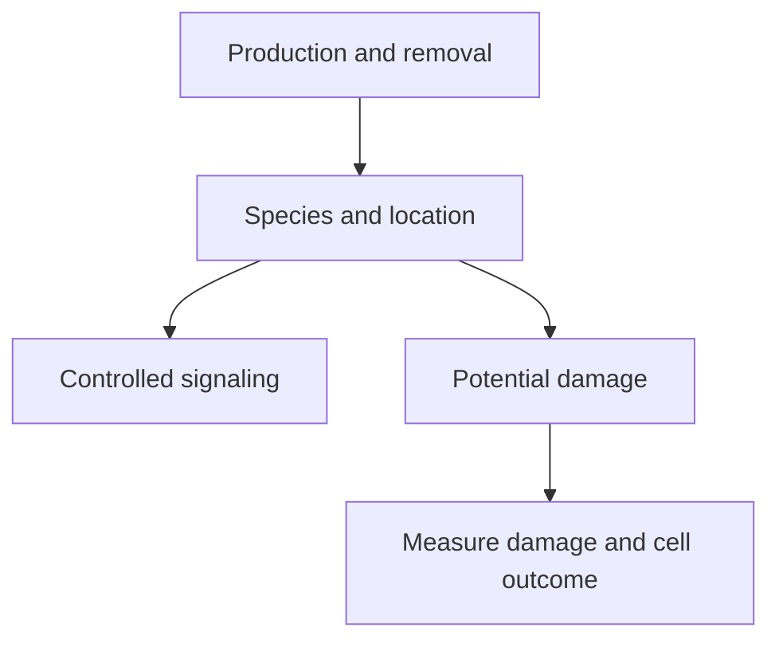

# Reactive oxygen species: signals and damage depend on context

## In one sentence

Reactive oxygen species are chemically distinct oxygen-containing molecules whose effects depend on their identity, location, amount and timing.

## The intuition

Think of sparks in a workshop. A small, controlled signal can tell someone to act; an uncontrolled burst can damage equipment. The analogy ends at the chemistry. Different reactive oxygen species behave differently, and not every member of the group is a free radical.

## How it works

**Reactive oxygen species (ROS)** includes superoxide and hydrogen peroxide, among other molecules. A **free radical** has an unpaired electron. Superoxide is a radical; hydrogen peroxide is not. The label ROS therefore does not identify one chemical or one effect.

ROS can arise during mitochondrial reactions and from other cellular enzymes. [Oxidative phosphorylation](/wiki/education/concepts/cancer-biology/metabolism-and-stress/oxidative-phosphorylation) concerns energy production. A change in respiration does not specify which reactive species formed, where it formed, or whether it caused damage.

Cells continually produce, transform and remove these molecules. Enzymes can convert superoxide to hydrogen peroxide, while other systems remove peroxide. Production and removal together influence a measured level. More antioxidant capacity does not necessarily mean that production fell.

Hydrogen peroxide can participate in controlled signaling. Its location and duration matter because its molecular partners differ across compartments. At damaging exposures, oxidation can alter proteins, DNA or lipids. **Oxidative stress** describes a damaging imbalance in redox control; one elevated fluorescent signal does not establish which material was harmed.

*Identify the chemistry and compartment before interpreting a general oxidation signal.*

## Why it matters in cancer

The [NRF2–KEAP1 system](/wiki/education/concepts/cancer-biology/signaling-pathways/nrf2-keap1) can increase stress defenses. Protection may help normal tissue, but can also help a cancer model survive. Oncogene-driven experiments showed enhanced NRF2 detoxification supporting tumor development in particular settings.

A separate mammary-epithelial model found that antioxidants could help detached cells restore energy production and survival. These experiments show why “less oxidation” cannot automatically mean “less cancer.” They are not advice to add or withhold antioxidant supplements.

Likewise, more ROS does not automatically identify a useful treatment vulnerability. The cells may adapt, the signal may come from another cell population, or normal tissue may share the sensitivity. [Ferroptosis](/wiki/education/concepts/cancer-biology/cell-death-and-survival/ferroptosis) is a particular iron-dependent lipid-damage-driven death process; it needs more specific evidence than a general ROS signal.

## How it is measured

| Research question | Readout | Key limitation |
|---|---|---|
| Did an oxidation-sensitive probe change? | Fluorescence or a fluorescence ratio | The probe's chemistry and loading determine what it reports |
| Did hydrogen peroxide change in a compartment? | A validated targeted sensor, such as a genetically encoded peroxide reporter | Sensitivity, pH behavior, calibration and removal kinetics matter |
| Did damage cause death? | Damage measurements, timing, independent perturbations and relevant rescue | Rescue can affect several processes; fluorescence alone does not diagnose death |

Live-cell measurements consume viable material or use engineered models. Fixed tissue can support selected damage markers, but cannot reconstruct a live ROS rate. Outputs are often relative fluorescence or calibrated sensor ratios; they are not a universal ROS concentration. There is no general ROS-positive threshold that selects treatment. Use unstimulated, positive, probe-only and cell-health controls, and specify the sensor's validation context.

## Common confusions

- **ROS versus free radicals:** the groups overlap but are not identical.
- **Production versus measured level:** removal also changes the result.
- **Antioxidant transcripts versus ROS:** messages do not measure the chemical species.
- **A ROS rise versus ferroptosis:** lipid damage, iron dependence and a death outcome remain separate questions.

## Try it

A fictional culture has more peroxide-sensitive fluorescence after treatment. The researcher calls this “mitochondrial ferroptosis.” What is missing?

**Answer:** Validate the probe and its cellular location first. Then measure the relevant damage and death over time. Mitochondrial origin and ferroptosis each require their own evidence; neither follows from one fluorescence increase.

## Explain it back

“A ROS result needs a named ___, a defined ___, and evidence for the proposed ___.”

One answer: “chemical/readout; compartment and timing; biological consequence.”

## Takeaway

**A reactive-oxygen signal becomes useful when its chemistry, location and consequence are specified.**

## Related concepts

- [NRF2–KEAP1](/wiki/education/concepts/cancer-biology/signaling-pathways/nrf2-keap1), regulating defenses.
- [Ferroptosis](/wiki/education/concepts/cancer-biology/cell-death-and-survival/ferroptosis), a specific lipid-damage-driven death mechanism.
- [Ex vivo drug screening](/wiki/education/concepts/measurement/functional-models/ex-vivo-drug-screen), for functional testing and its limits.

## Sources

Source check: October 9, 2026; expert and learner review pending. The exercise is fictional. Model findings and research sensors do not supply clinical treatment or supplement recommendations.

- [Belousov et al., 2006: a genetically encoded peroxide sensor](https://pubmed.ncbi.nlm.nih.gov/16554833/).
- [Pak et al., 2020: a sensitive, pH-stable peroxide reporter and local gradients](https://pubmed.ncbi.nlm.nih.gov/32130885/).
- [Schafer et al., 2009: antioxidant rescue in matrix-detached mammary epithelial models](https://pubmed.ncbi.nlm.nih.gov/19693011/).
- [DeNicola et al., 2011: NRF2-dependent detoxification in oncogene-driven models](https://pubmed.ncbi.nlm.nih.gov/21734707/).

<!-- BEGIN GENERATED USED IN -->
## Used in

- [Oxidative metabolism and stress: energy, damage, and dependence](/wiki/education/molecular-profiling/evee-pathways/05-oxidative-metabolism-and-stress)
<!-- END GENERATED USED IN -->
