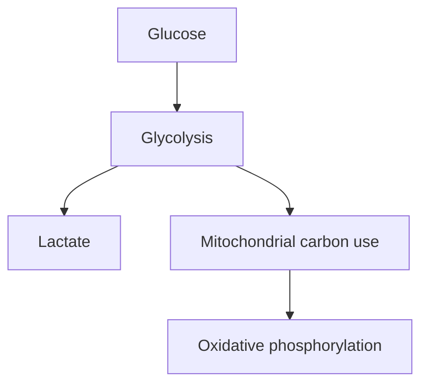

# Warburg effect: making lactate when oxygen is available

## In one sentence

The Warburg effect is a pattern in which cells convert substantial glucose to lactate even when oxygen is available.

## The intuition

Imagine a workshop using both a fast local generator and a larger power plant. A big delivery to the local generator does not tell you whether the power plant has shut down. The analogy helps separate fuel use from total energy production. Cells also use nutrients to build molecules, so their choices cannot be explained by electricity alone.

## How it works

**Glycolysis** breaks glucose down to pyruvate and produces some adenosine triphosphate (**ATP**), a molecule that transfers energy. Converting pyruvate to lactate helps regenerate a carrier needed to keep glycolysis running. Glycolysis itself does not require oxygen.

The distinctive word in **aerobic glycolysis** is “aerobic”: this lactate-producing pattern occurs with oxygen available. Oxygen shortage can also increase lactate production, but that is a different starting explanation. [Hypoxia](/wiki/education/concepts/cancer-biology/tumor-microenvironment/hypoxia) means inadequate oxygen for the local tissue's needs.

Cells can simultaneously send carbon into mitochondria and perform [oxidative phosphorylation](/wiki/education/concepts/cancer-biology/metabolism-and-stress/oxidative-phosphorylation). They may oxidize glucose-derived carbon, lactate or other nutrients. A human lung-tumor tracer study found enhanced glycolysis alongside glucose oxidation, with variation within and between tumors. Lactate production therefore does not establish broken mitochondria.

Metabolism also supplies building blocks for new cells. Growth signals, available nutrients and local conditions influence where carbon goes. Proliferating normal cells can use aerobic glycolysis too. The pattern is neither exclusive to cancer nor identical across every cancer cell.

*With oxygen available, lactate production and mitochondrial metabolism can coexist.*

## Why it matters in cancer

A metabolic pattern describes what cells are doing under specified conditions. **Dependence** asks whether disrupting a process prevents their growth or survival. Cells may compensate by changing fuels or production routes. Neither a glycolytic RNA signature nor glucose uptake alone answers that functional question.

The Warburg effect also does not supply a dietary prescription. A culture's response to removing one nutrient is not evidence that changing a person's diet selectively starves a tumor.

## How it is measured

| Field | What to document |
|---|---|
| Input and tissue cost | Viable cells, tissue slices or a defined tracer study; functional experiments consume material |
| Measures and outputs | Glucose uptake, lactate release and oxygen consumption over time; rates normalized to viable cells or another justified denominator |
| Distinguishing routes | Labeled-carbon tracing, with the tracer, sampled metabolites and timing specified |
| Thresholds and validation | No universal “Warburg-positive” cutoff predicts treatment benefit; methods and models need their own validation |
| Failure modes and limits | Changing oxygen, fuel or cell number; mixed cell populations; a tracer pattern is not automatically a complete flux estimate |

Acidification of culture medium is not pure glycolysis: respiratory carbon dioxide also contributes. Measure or correct those contributions before equating a pH change with lactate production.

## Common confusions

- **Lactate versus absent respiration:** both routes can operate together.
- **Oxygen availability versus actual use:** record the oxygen conditions and measure respiration separately.
- **High rate versus dependence:** a busy process may have substitutes.
- **Cancer versus normal proliferation:** the pattern is not cancer-specific.

## Try it

A fictional culture releases lactate under controlled oxygen conditions. It also consumes oxygen, and labeled glucose carbon reaches mitochondrial metabolites. Must one result be wrong?

**Answer:** No. The observations can coexist. Check normalization and tracer controls, then test which routes sustain growth under those conditions. These results do not identify a medicine.

## Explain it back

“Lactate with oxygen tells me ___, but it does not prove ___.”

One answer: “aerobic glycolysis is occurring; that respiration is absent or glycolysis is an irreplaceable survival route.”

## Takeaway

**Read the Warburg effect as a metabolic pattern, then test energy supply and dependence separately.**

## Related concepts

- [AMPK energy sensing](/wiki/education/concepts/cancer-biology/metabolism-and-stress/nutrient-sensing-ampk), for responses to energy stress.
- [Bulk RNA sequencing](/wiki/education/concepts/measurement/transcriptomics/bulk-rna-seq), for why messages are not metabolic rates.

## Sources

Source check: October 9, 2026; expert and learner review pending. The exercise is fictional. Human tracer results concern the studied lung tumors, not every cancer.

- [Vander Heiden et al., 2009: metabolism and cell proliferation](https://pubmed.ncbi.nlm.nih.gov/19460998/).
- [Hensley et al., 2016: metabolic heterogeneity in human lung tumors](https://pubmed.ncbi.nlm.nih.gov/26853473/).
- [Mookerjee et al., 2015: respiration also contributes to extracellular acidification](https://pubmed.ncbi.nlm.nih.gov/25449966/).

<!-- BEGIN GENERATED USED IN -->
## Used in

- [Oxidative metabolism and stress: energy, damage, and dependence](/wiki/education/molecular-profiling/evee-pathways/05-oxidative-metabolism-and-stress)
<!-- END GENERATED USED IN -->
