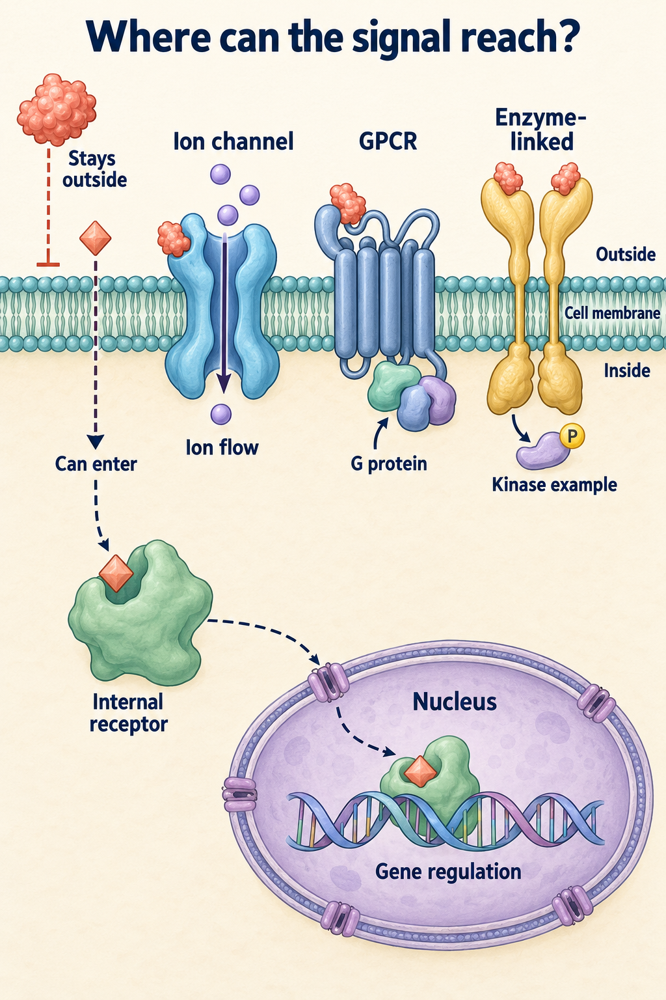
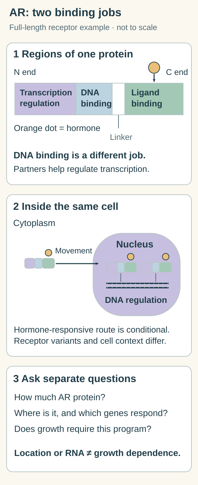

# Androgen receptor signaling: a hormone-responsive transcription program

## In one sentence

Androgen receptor signaling links androgen binding to changes in gene transcription, with effects determined by the receptor, its partners, and the cell context.

## The intuition

Think of a reader that can use a chemical signal to change which instructions a cell follows. Finding the reader on the shelf is different from showing that it is working or that the cell needs its instructions. The analogy has limits: the reader works with many partners, and the same signal can produce different outputs in different cells.

## How it works

The internal-receptor route in this existing family map shows reception inside the cell and a nuclear gene-regulation route. The AR inset below separates the receptor regions and the measurements needed to interpret that route.

Ligand binding and DNA binding occupy distinct regions of this full-length androgen receptor (AR) example. Hormone-responsive nuclear movement and gene regulation depend on receptor form, partners and accessible DNA; the region strip and small receptor symbols are schematic. AR amount, location, transcription and growth dependence need separate measurements. This is neither an estrogen-receptor label nor a transfer of a prostate-cancer indication. <a href="https://www.uniprot.org/uniprotkb/P10275/entry">Reviewed receptor annotation</a>; <a href="https://pubmed.ncbi.nlm.nih.gov/19359544/">Primary receptor-mechanism work in prostate models</a>.

The **androgen receptor (AR)** is a hormone-responsive transcription factor. A transcription factor helps regulate production of RNA, or ribonucleic acid, from DNA, or deoxyribonucleic acid. The [central dogma](/wiki/education/concepts/biology-basics/genetics/central-dogma) explains these information steps.

**Androgens** are hormones including testosterone and dihydrotestosterone. They can act as [ligands](/wiki/education/concepts/biology-basics/signaling/ligand-and-receptor), binding partners for AR. Ligand binding can change the receptor's shape and interactions, promote its movement into the nucleus, and alter its binding to regulatory DNA regions. Partner proteins and accessible DNA help determine which genes respond.

AR contains regions involved in ligand binding, DNA binding, and transcriptional regulation. A truncated receptor variant can behave differently from the full-length protein. An RNA signal for AR therefore does not fully characterize the receptor protein or its activity.

Receptor amount, nuclear location, downstream transcription, and growth dependence are successive questions. They can disagree without making the experiment impossible. A cell might use an AR program without needing it to survive under a particular condition.

## Why it matters in cancer

AR biology is extensively studied in prostate cancer. Some breast tumors also express AR, including a subset of [triple-negative breast cancers (TNBC)](/wiki/education/concepts/breast-cancer/receptors-and-subtypes/tnbc). The consequences remain disease- and cell-context specific.

**Luminal androgen receptor (LAR)** is a gene-expression subtype label, not a synonym for positive AR staining. The 2016 TNBCtype-4 refinement retained four tumor-specific classes after recognizing that immune and stromal cells contributed to two earlier classes. LAR describes a coordinated RNA pattern under that classifier. It does not mean a tumor has become estrogen receptor-positive or that an AR drug will help.

[AR antagonists](/wiki/education/concepts/therapeutics/targeted-small-molecules/ar-antagonists) test a particular intervention against this biology. Breast-cancer trials used defined staining assays and populations. Protein expression alone was insufficient to identify dependence in the TBCRC 032 correlative analyses. A classifier association also cannot replace a randomized treatment comparison.

## How it is measured

| Question | Measurement | Boundary |
|---|---|---|
| Is AR protein present? | Immunohistochemistry, often reporting nuclear staining as a percentage of tumor cells | Antibody, scoring, sample, and threshold matter |
| Is an AR-related program expressed? | RNA profiling and a named, versioned classifier | Cell mixture and normalization affect the result |
| Does the cell rely on it? | Controlled receptor perturbation with downstream and survival measurements | A model result remains distinct from clinical benefit |

**Immunohistochemistry (IHC)** uses antibodies to stain proteins in tissue. A percentage of stained nuclei is not a percentage of patients who respond. RNA abundance is not ligand occupancy or a direct measurement of transcription-factor function. Compare related measurements without collapsing them into one “AR-positive” category.

## Common confusions

- **AR staining versus LAR:** one measures protein; the other classifies an RNA pattern.
- **Nuclear location versus dependence:** location is a clue, not a survival test.
- **Breast versus prostate biology:** the receptor name does not transfer an indication.
- **Subtype versus treatment choice:** a research class does not replace clinical evidence.

## Try it

A fictional tumor has 20% AR-positive nuclei but receives a non-LAR classification from a specified RNA assay. Must one result be wrong?

**Answer:** No. The tests measure different quantities. Review assay conditions, tumor-cell content, classifier version, and sampling before interpreting their relationship. Neither result alone demonstrates that an AR antagonist will improve an outcome.

## Explain it back

“AR staining measures ___; LAR labels ___; dependence needs ___.”

One answer: “sampled protein expression; a classifier-defined RNA pattern; a functional test and appropriate clinical evidence.”

## Takeaway

**Keep the receptor, the transcription program, and the treatment evidence as separate observations.**

## Related concepts

- [AR antagonists](/wiki/education/concepts/therapeutics/targeted-small-molecules/ar-antagonists).
- [Intrinsic subtype and classification](/wiki/education/concepts/breast-cancer/receptors-and-subtypes/intrinsic-subtype).

## Sources

Source check: October 9, 2026. Mechanism and assay education; the example is fictional. Expert and learner review pending.

- [NCI: androgens, AR, and hormone therapy in prostate cancer](https://www.cancer.gov/types/prostate/prostate-hormone-therapy-fact-sheet).
- [Tran et al., 2009: receptor binding, localization, and transcriptional effects in antiandrogen development](https://pubmed.ncbi.nlm.nih.gov/19359544/).
- [Lehmann et al., 2016: the TNBCtype-4 refinement and tissue-mixture analysis](https://pubmed.ncbi.nlm.nih.gov/27310713/).
- [Lehmann et al., 2020: TBCRC 032 and AR-expression limitations](https://pubmed.ncbi.nlm.nih.gov/31822498/).

<!-- BEGIN GENERATED USED IN -->
## Used in

Browse the [concept index](/wiki/education/concepts/index) for related learning paths.
<!-- END GENERATED USED IN -->
