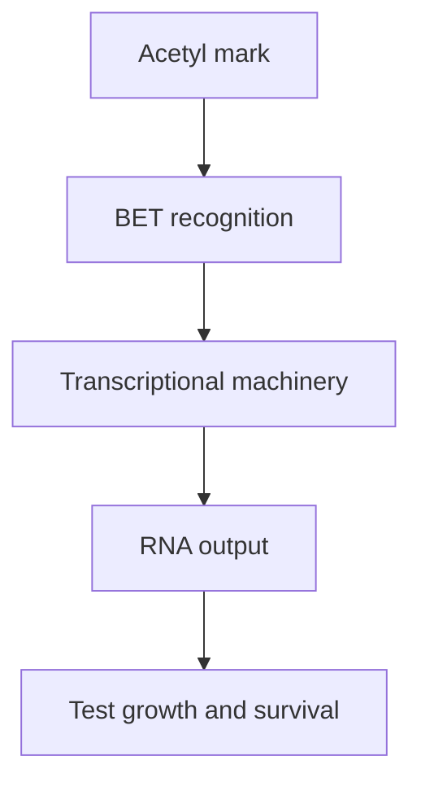

# BET bromodomain proteins: reading acetyl marks

## In one sentence

Bromodomain and extra-terminal (BET) proteins recognize acetylated protein marks and help regulate gene expression.

## The intuition

Imagine a book with tabs that help a reading team find particular passages. A reader notices the tabs and works with other people to use the text. BET proteins perform a related job with chemical marks on proteins. The analogy has limits: the marks are dynamic, and a reader can use several interactions to reach the same place.

## How it works

*Reading, occupying a pocket and depleting a protein are different operations.* The acetyl mark remains attached to the histone tail in all three comparisons. The generic BET reader shows two bromodomains (BD1 and BD2) and an extra-terminal (ET) region; one representative pocket interaction is enlarged. The middle scene illustrates competition at that pocket, not a claim that JQ1 acts only on BD1. Other protein regions remain; whether their interactions function needs testing. A dashed outline represents less protein after a separately verified depletion. BET is one bromodomain family, and its members are not interchangeable. [Filippakopoulos 2010](https://pubmed.ncbi.nlm.nih.gov/20871596/); [Shu 2016, full resistance and perturbation experiments](https://pmc.ncbi.nlm.nih.gov/articles/PMC4854653/). No BRD3-variant-to-BRD4-dependence or clinical response prediction follows.

**Chromatin** is DNA packaged with proteins, including **histones**. An **acetyl mark** is a chemical modification that can be attached to lysine, an amino acid in a protein. Adding, removing and reading a mark are different molecular jobs.

A **bromodomain** is a protein region that recognizes acetylated lysines. Many proteins contain bromodomains; they do not all belong to the BET family. The BET family includes **BRD2, BRD3, BRD4 and BRDT**. Its members contain two bromodomains and an extra-terminal region involved in protein interactions.

BET proteins help connect chromatin to transcription, the production of RNA messages described in the [central dogma](/wiki/education/concepts/biology-basics/genetics/central-dogma). BRD4, for example, can recruit machinery that helps RNA polymerase continue along a gene. Which genes respond depends on the cell and its regulatory state. [MYC](/wiki/education/concepts/cancer-biology/signaling-pathways/myc) is a transcriptional regulator studied in some BET experiments. Lower MYC RNA does not, by itself, prove that reduced MYC function caused a later growth effect.

A bromodomain inhibitor can compete for an acetyl-recognition pocket. The experimental compound **JQ1** established that this reading interaction could be perturbed. Occupying a pocket differs from removing the entire protein: other domains and interactions may still function. A compound acting on several BET family members also differs from a BRD3-specific perturbation.

*Blocking a reading interaction can change transcription; it does not identify an allele-specific vulnerability.*

## Why it matters in cancer

Some cancer models rely on transcriptional programs supported by BET proteins. A primary triple-negative breast cancer study found sensitivity in certain cultures and in-vivo models. It also identified resistant cultures that still depended on BRD4 through bromodomain-independent regulation. Dependence on a protein and sensitivity to one way of inhibiting it can therefore diverge.

A BRD3 sequence change does not establish BRD4 dependence, nor predict response to a broad BET inhibitor. Ask what the alteration actually changes, which family member matters, and whether the tested intervention reaches that function. A change in a growth-associated transcript is not proof of selective tumor killing.

## How it is measured

Researchers can measure protein abundance, chromatin binding and RNA changes, then test separate family members genetically. Competition or displacement assays address the particular reading interaction. Compare early target effects with later growth and death, so general cell damage is not mistaken for the primary mechanism.

Fixed tissue may support protein staining; chromatin assays and RNA profiling consume appropriately preserved material. Functional perturbations need viable cells or models. Outputs include relative binding enrichment, RNA counts and normalized growth/death measures. No universal “BET-high” score establishes drug benefit. Controls must address cell number, global transcription, perturbation specificity and rescue by a suitable reference protein. These are research approaches, with assay-specific validation.

## Common confusions

- **Reader versus writer:** a BET protein recognizes a mark; it is not the enzyme that adds the acetyl group.
- **BET versus every bromodomain:** BET is one family within a broader group.
- **BRD3 versus BRD4:** related proteins do not make their alterations interchangeable.
- **Pocket inhibition versus protein depletion:** the remaining protein can retain other functions.
- **JQ1 versus a treatment plan:** a chemical probe establishes experimental biology, not a patient-ready regimen.

## Try it

In the fictional middle scene, a probe occupies a BET acetyl-recognition pocket, while the acetyl mark and the rest of the protein remain. A BRD3-altered culture resists that probe, but an independently controlled BRD4 depletion reduces growth. Are the observations contradictory?

**Answer:** no. Pocket engagement and less BRD4 protein test different operations. Verify inhibitor engagement and depletion, then test which function supports growth. Remaining regions do not guarantee intact function. The result does not make the BRD3 alteration a response biomarker or predict a clinical benefit.

## Explain it back

“BET proteins read ___; inhibiting a pocket differs from ___; a BRD3 variant does not prove ___.”

One answer: “acetyl marks; removing every protein function; dependence on the family or a clinical drug response.”

## Takeaway

**Match the altered protein function to the intervention, rather than matching the family name to a drug label.**

## Related concepts

- [Mass-spectrometry proteomics](/wiki/education/concepts/measurement/proteins-and-spatial/mass-spectrometry-proteomics), for sampled protein amounts.
- [Bulk RNA sequencing](/wiki/education/concepts/measurement/transcriptomics/bulk-rna-seq), for messages and cell-mixture limits.
- [Preclinical evidence](/wiki/education/concepts/evidence-and-statistics/study-design/preclinical-evidence), for the gap between models and patients.

## Sources

Source check: October 9, 2026; expert and learner review pending. The exercise is fictional. No clinical response prediction follows from a BET-family variant.

- [Yang et al., 2005: BRD4 recruitment of transcription-elongation machinery](https://pubmed.ncbi.nlm.nih.gov/16109377/).
- [Filippakopoulos et al., 2010: experimental BET bromodomain inhibition](https://pubmed.ncbi.nlm.nih.gov/20871596/).
- [Shu et al., 2016: response and resistance in TNBC models](https://pubmed.ncbi.nlm.nih.gov/26735014/).

<!-- BEGIN GENERATED USED IN -->
## Used in

- [Stress defenses and chromatin readers: test the direction](/wiki/education/molecular-profiling/evee-pathways/04-cul3-nrf2-ferroptosis-and-bet)
<!-- END GENERATED USED IN -->
